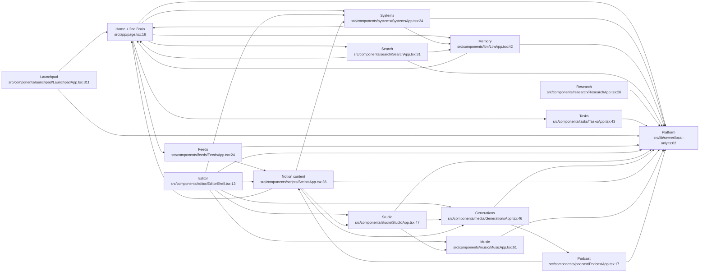

# 00 — Feature inventory (VOLTA OS, 2026-10-28)

Source: Phase 0 discovery agent (import graph + grep-verified entry points), reviewed by orchestrator. Paths relative to `src/`. API entry points as `route:METHOD@line` against `app/api/<route>/route.ts`.

| # | Feature | Purpose | Main entry | Core server code |
|---|---|---|---|---|
| 1 | home | Desktop bento/orbital + mobile home, Second Brain graph, memory-source routes | `app/page.tsx:16`, `components/mobile/MobileHome.tsx:15`, `components/second-brain/SecondBrainApp.tsx:152` | `lib/server/sources/{index,notes,pieces,mcp,skills,routines,notion,claude-mem,transcripts}.ts`, `vaults.ts`, `workspace.ts` |
| 2 | memory | LTM screen captures, Honcho, Claude Code sessions | `components/ltm/LtmApp.tsx:42`, `components/honcho/HonchoApp.tsx:61`, `components/sessions/SessionsApp.tsx:33` | `lib/server/{ltm,honcho}.ts`, `sources/sessions.ts`, `app/api/{ltm,honcho,claude-sessions}/_shared.ts` |
| 3 | search | ⌘K palette + search app over all sources | `components/search/SearchPalette.tsx:26`, `search:GET@11` | `lib/server/search/**` |
| 4 | research | Research corpus inventory, threads, graphs, syntheses | `components/research/ResearchApp.tsx:26` | `lib/server/research/**` |
| 5 | tasks | OpenClaw `actions.md` board + actions | `components/tasks/TasksApp.tsx:43`, `actions:GET@17/POST@28` | `sources/{actions,actions-write}.ts` |
| 6 | systems | Service/model/storage health + Fix with agent | `components/systems/SystemsApp.tsx:24`, `systems/fix:POST@17` | `lib/server/systems/**` |
| 7 | launchpad | Repos, Netlify, Tailscale serve, Notion pins | `components/launchpad/LaunchpadApp.tsx:311`, `launchpad:GET@15` | `lib/server/launchpad/**` |
| 8 | feeds | Cron outputs with JEV triage | `components/feeds/FeedsApp.tsx:24` | `lib/server/feeds/**` |
| 9 | editor | RUBRIC editor + NLE edit mode | `components/editor/EditorShell.tsx:13` | `lib/server/editor/**`, `lib/nle/model.ts`, `lib/editor-inbox.ts` |
| 10 | studio | HyperFrames/Remotion/ffmpeg render queue | `components/studio/StudioApp.tsx:47` | `lib/server/studio/**` |
| 11 | generations | Paid media generation with quotes + daily budget | `components/media/GenerationsApp.tsx:46` | `lib/server/media/**` |
| 12 | notion-content | Scripts, Carousels, Recos (Notion-backed) | `components/scripts/ScriptsApp.tsx:36`, `components/media/CarouselsApp.tsx:125`, `components/recos/RecosApp.tsx:51` | `lib/server/{notion,carousels,recos}/**` |
| 13 | music | VANTA VECTOR library + Suno | `components/music/MusicApp.tsx:61` | `lib/server/music/**` |
| 14 | podcast | Daily briefing pipeline + RSS | `components/podcast/PodcastApp.tsx:17` | `lib/server/podcast/**` |
| 15 | platform | Shared infra (guards, redact, iCloud, terminal, LLM, quota, JEV, cache, UI kits) | `lib/server/local-only.ts:62` | `lib/server/{local-only,route-helpers,redact,icloud,claude-terminal,workspace,vaults}.ts`, `{llm,quota,jev}/**`, `sources/cache.ts`; client `robo-ui`, `elements/kit`, `useSharedJson` |

## Boundary decisions (orchestrator)
- **Accepted** the 15 features. LTM/Honcho/Sessions stay together as `memory`; Second Brain lives in `home` (same routes); Elements showcase lives in `platform`.
- **`lib/server/sources/` is not a feature.** Its files are assigned: `cache.ts`→platform, `actions*`→tasks, `sessions.ts`→memory, the rest→home.
- **Mock-era routes** (`workspace`, `files`, `skills/run`, `cache-status`, `app/api/jev-router/jev.ts`) belong to home but are flagged for the duplication hunt.

## Known structural smells to carry into Phase 2
- Server code importing from `components/`: `research/*` (types), `music/*`, `studio/index-projects.ts:10`, `carousels/*`, `sources/actions*.ts`, `editor/review-note.ts:5`.
- Library importing from an API route: `sources/{index,sessions}.ts` ← `app/api/honcho/_shared` (`redactSecrets`).
- API-local helpers next to `route-helpers`: `app/api/{ltm,honcho,claude-sessions}/_shared.ts`, `app/api/workspace/frontmatter.ts`, `app/api/skills/run/reports.ts`.
- Two JEVs: `app/api/jev-router/jev.ts` (heuristic) vs `lib/server/jev`.
- Cycles: home ↔ systems; editor ↔ studio ↔ music ↔ generations.

## Dependency graph

