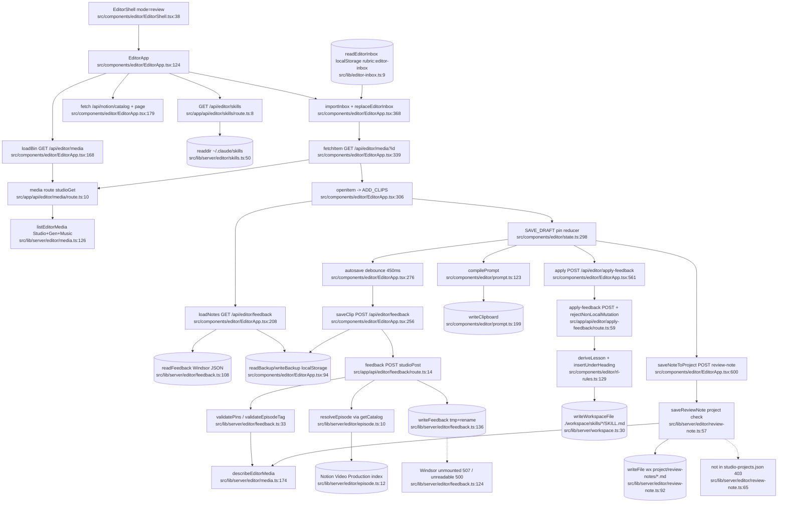

# Feature 9 — editor (RUBRIC review + NLE edit mode)

**Purpose.** One app (`EditorShell`) with two modes: **Review** pins timestamped/positioned notes on real Studio / Generations / Music files, persists them to the Windsor drive, compiles an agent prompt, and "teaches" a workspace copy of `/cut` and `/animate` skills; **Edit** is a browser NLE that saves sequences as JSON, uploads media, serves Range-capable previews, builds filmstrips/waveforms with ffmpeg, and exports MP4 through a single-slot ffmpeg queue (plus a HyperFrames HTML export).

## Sources consulted
All paths under `src/`. Line ranges are what was read (full file unless a range is given).

| File | Lines |
|---|---|
| `PATHFINDER-2026-10-28/00-features.md` (repo root) | 1–67 |
| `components/editor/EditorShell.tsx` | 1–63 |
| `components/editor/EditorApp.tsx` | 85–440, 480–630 |
| `components/editor/state.ts` | grep of exports / reducer cases (8–384) |
| `components/editor/prompt.ts` | grep of exports (14–202) |
| `components/editor/rl-rules.ts` | grep of exports (5–181) |
| `components/editor/nle/NleWorkspace.tsx` | 20–262 (+ grep 470–490) |
| `components/editor/nle/NleExportDialog.tsx` | 95–195 |
| `components/editor/nle/NleAssets.tsx` | grep (12–150) |
| `components/editor/nle/NlePreview.tsx` | grep (4–239) |
| `components/editor/nle/preview/useMediaPool.ts` | 1–60 |
| `components/editor/nle/preview/Layer.tsx` | 150–173 |
| `components/editor/nle/timeline/media.ts` | 36–80 |
| `components/editor/nle/panels/thumbs.ts` | grep (2–44) |
| `lib/nle/model.ts` | grep of exports (5–206), 320–340 |
| `lib/editor-inbox.ts` | 1–46 |
| `lib/server/editor/{episode,skills,review-note,feedback,media}.ts` | full |
| `lib/server/editor/nle/{paths,http,projects,assets,upload,thumbs,peaks,export}.ts` | full |
| `lib/server/editor/nle/text.ts` | 1–28 (grep), 120–254 |
| `lib/server/editor/nle/filtergraph.ts` | grep (1–547) |
| `lib/server/editor/nle/hyperframes.ts` | grep (1–28) |
| `app/api/editor/**/route.ts` (12 routes) | full |
| Cross-feature (for deps / repeats): `lib/server/workspace.ts` 1–40; `lib/server/studio/http.ts` 8–45; `lib/server/systems/run.ts` 9–122 (grep), 60–69; `lib/server/local-only.ts`, `lib/server/icloud.ts`, `lib/server/studio/storage.ts`, `lib/server/studio/index-projects.ts`, `lib/server/studio/runner.ts`, `lib/server/music/library.ts` 405–425, `lib/server/redact.ts`, `app/api/{studio,media,music,podcast}/file/route.ts` (grep) |

---

## (a) Review mode — load, pin, autosave, prompt, apply-feedback, review note

Node count: **35**.

---

## (b) Edit mode (NLE) — project load/save → media/upload → preview → export

```mermaid
flowchart TD
  SHELL2["EditorShell mode=edit<br/>src/components/editor/EditorShell.tsx:38"]
  WS["NleWorkspace<br/>src/components/editor/nle/NleWorkspace.tsx:94"]
  LSB[("localStorage volta:nle-backup / last / uploads<br/>src/components/editor/nle/NleWorkspace.tsx:168")]
  PLIST["GET /api/editor/nle/projects<br/>src/app/api/editor/nle/projects/route.ts:12"]
  LOADP[("loadProject PROJECTS_DIR json<br/>src/lib/server/editor/nle/projects.ts:65")]
  EVICT["EDEADLK iCloud 409 / 404<br/>src/lib/server/editor/nle/projects.ts:71"]
  AUTOS2["autosave 1.2s saveNow<br/>src/components/editor/nle/NleWorkspace.tsx:204"]
  SAVEP["nleMutation POST projects<br/>src/lib/server/editor/nle/http.ts:14"]
  SAVEPR["saveProject validateSequence<br/>src/lib/server/editor/nle/projects.ts:76"]
  SPACE["requireSpace 3 GiB floor<br/>src/lib/server/editor/nle/paths.ts:56"]
  ATOM[("writeAtomic ~/Library/Application Support/VOLTA/editor<br/>src/lib/server/editor/nle/paths.ts:76")]
  BIN2["loadBin GET /api/editor/media<br/>src/components/editor/nle/NleWorkspace.tsx:123"]
  UPX["uploadFile XHR POST nle/upload<br/>src/components/editor/nle/NleWorkspace.tsx:60"]
  UPR["upload route rejectNonLocal+CrossSite<br/>src/app/api/editor/nle/upload/route.ts:15"]
  RECV[("receiveUpload stream .part to uploads/<br/>src/lib/server/editor/nle/upload.ts:70")]
  PROBE["probeFile ffprobe execFile<br/>src/lib/server/studio/index-projects.ts:80"]
  BADUP["unplayable 415 / space 507<br/>src/lib/server/editor/nle/upload.ts:99"]
  CFA["clipFromAsset src=url<br/>src/lib/nle/model.ts:328"]
  PREV["NlePreview layersAt<br/>src/components/editor/nle/NlePreview.tsx:184"]
  VID["video src + useMediaPool<br/>src/components/editor/nle/preview/Layer.tsx:159"]
  FILER["GET nle/file u_ or x_ id<br/>src/app/api/editor/nle/file/route.ts:14"]
  STREAM["streamFile Range/ETag<br/>src/lib/server/editor/nle/http.ts:55"]
  RES["resolveAsset id to path, offline 409<br/>src/lib/server/editor/nle/assets.ts:96"]
  THUMB["getThumbs filmstrip<br/>src/lib/server/editor/nle/thumbs.ts:25"]
  THFF[("execFile ffmpeg hstack sprite to cache/<br/>src/lib/server/editor/nle/thumbs.ts:68")]
  PEAK["getPeaks<br/>src/lib/server/editor/nle/peaks.ts:18"]
  PEFF[("spawn ffmpeg s16le pipe, writeAtomic json<br/>src/lib/server/editor/nle/peaks.ts:44")]
  EXDLG["Export dialog POST nle/export<br/>src/components/editor/nle/NleExportDialog.tsx:140"]
  START["startExport resolve assets, space, enqueue<br/>src/lib/server/editor/nle/export.ts:130"]
  PUMP["pump single-slot queue<br/>src/lib/server/editor/nle/export.ts:186"]
  GRAPH["buildExportGraph<br/>src/lib/server/editor/nle/filtergraph.ts:254"]
  TEXT[("renderText: swiftc compile + spawn helper PNG<br/>src/lib/server/editor/nle/text.ts:134")]
  FFX[("spawn ffmpeg libx264 to .part, redact log<br/>src/lib/server/editor/nle/export.ts:266")]
  DONE[("rename .part to Windsor/local exports + persist jobs json<br/>src/lib/server/editor/nle/export.ts:301")]
  FAIL["exit != 0 error / cancel SIGTERM<br/>src/lib/server/editor/nle/export.ts:297"]

  SHELL2 --> WS
  WS --> LSB
  WS --> PLIST --> LOADP
  LOADP -.-> EVICT
  WS --> AUTOS2 --> SAVEP --> SAVEPR --> SPACE --> ATOM
  WS --> BIN2
  WS --> UPX --> UPR --> RECV --> PROBE
  RECV -.-> BADUP
  RECV --> ATOM
  BIN2 --> CFA
  UPX --> CFA --> PREV --> VID --> FILER --> STREAM
  PREV --> THUMB --> RES
  THUMB --> THFF
  PREV --> PEAK --> RES
  PEAK --> PEFF
  WS --> EXDLG --> START --> RES
  START --> SPACE
  START --> PUMP --> GRAPH --> TEXT
  PUMP --> FFX --> DONE
  FFX -.-> FAIL
  DONE --> FILER
```

Node count: **35**.

Notes: project delete is `DELETE /api/editor/nle/projects` (`app/api/editor/nle/projects/route.ts:20`) → `deleteProject` renames into `.trash` (`lib/server/editor/nle/projects.ts:91`). Bin items (`o_`/`g_`/`m_`) preview through `/api/studio/file`, `/api/media/file`, `/api/music/file` (URLs built at `src/lib/server/editor/media.ts:26-28`); only uploads (`u_`) and exports (`x_`) go through `/api/editor/nle/file`. HyperFrames export: `NleExportDialog.tsx:182` → `app/api/editor/nle/hyperframes/route.ts:9` → `sequenceToHyperframes` `lib/server/editor/nle/hyperframes.ts:21` (pure, returns HTML; browser downloads it).

---

## Side effects
- **Windsor JSON write (atomic)**: pins per file → `/Volumes/Windsor/VOLTA/editor/feedback/<fileKey>.json` — `src/lib/server/editor/feedback.ts:11`, `:134` (mkdir), `:138-139` (tmp + rename).
- **Workspace skill files**: `./workspace/skills/{cut,animate}/SKILL.md` read-modify-write (non-atomic) — `src/app/api/editor/apply-feedback/route.ts:83-87` → `src/lib/server/workspace.ts:30-33`.
- **Project review notes**: `<project>/review-notes/` mkdir + `writeFile(..., {flag:'wx'})` — `src/lib/server/editor/review-note.ts:75`, `:92`.
- **Filesystem read of live skills dir**: `~/.claude/skills` readdir/access — `src/lib/server/editor/skills.ts:50`, `:58`.
- **Notion read** (Video Production catalog) — `src/lib/server/editor/episode.ts:12`; client `/api/notion/catalog` + `/api/notion/page` — `src/components/editor/EditorApp.tsx:179`, `:190`.
- **Clipboard writes** — `src/components/editor/prompt.ts:202`; `src/components/editor/nle/NleExportDialog.tsx:171`.
- **localStorage**: `rubric:editor-inbox` (`src/lib/editor-inbox.ts:6`, `:21`, `:32`), `rubric:editor-state` (`src/components/editor/state.ts:8`; write `EditorApp.tsx:426`), per-file backups (`EditorApp.tsx:105`), `volta:editor-mode` (`EditorShell.tsx:10`, `:28`), `volta:nle-*` (`NleWorkspace.tsx:22-25`, `:206`, `:245`).
- **NLE state dir** `~/Library/Application Support/VOLTA/editor/{uploads,cache,projects,exports}` — `src/lib/server/editor/nle/paths.ts:13-18`; atomic writer `:76-86`; cache pruning (deletes oldest) `:89-104`.
- **Project save / trash** — `src/lib/server/editor/nle/projects.ts:83` (writeAtomic), `:91` (rename into `.trash`).
- **Upload stream** to `uploads/u_*.part` → rename → sidecar meta — `src/lib/server/editor/nle/upload.ts:70`, `:95`, `:104`; deletes unplayable file `:100`.
- **Spawns**: ffprobe (`src/lib/server/studio/index-projects.ts:85`, via `probeFile` at `upload.ts:97`, `assets.ts:100`, `media.ts:97`, `media.ts:179`); ffmpeg sprite `thumbs.ts:68`; ffmpeg peaks `peaks.ts:44` (SIGKILL timer `:51`); `swiftc` compile `text.ts:134`; text helper binary `text.ts:234`; export ffmpeg `export.ts:266` (SIGTERM/SIGKILL `:161-164`).
- **Export outputs**: `/Volumes/Windsor/VOLTA/editor/exports` or local fallback (`paths.ts:19`, `:36-38`); work dir + side files `export.ts:218-221`; rename `.part` → final `:301`; job history `cache/export-jobs.json` `:18`, `:53`; cleanup `:316-317`.
- **Cache writes**: thumbs `thumbs.ts:78`; peaks `peaks.ts:32`; text PNG + meta `text.ts:252`, utimes touch `:225-226`.
- **In-memory registries on globalThis**: export queue `export.ts:35-36`; text binary promise `text.ts:124`; thumbs/peaks inflight maps `thumbs.ts:13`, `peaks.ts:16`.

## External dependencies
- **studio**: `studioGet`/`studioPost`/`fail` — `src/app/api/editor/{media,feedback,review-note,skills}/route.ts` (e.g. `feedback/route.ts:4`), `src/lib/server/editor/nle/http.ts:6`; `StudioError`, `windsorMounted`, `isInside` — `src/lib/server/editor/feedback.ts:6`, `media.ts:13`, `review-note.ts:7`, `nle/paths.ts:6`; `getProject`/`loadConfig`/`projectExists` — `media.ts:10`, `review-note.ts:6`; `probeFile`/`projectOutputs`/`resolveOutputFile` — `media.ts:11`, `nle/assets.ts:5`, `nle/upload.ts:7`; client URL `/api/studio/file` — `media.ts:26`.
- **generations**: `readManifest`/`resolveFile` — `src/lib/server/editor/media.ts:9` (called `:146`, `:201`); `MediaError` — `media.ts:7`; URL `/api/media/file` — `media.ts:27`.
- **music**: `getLibrary`/`resolveTrack`/`loadConfig`/`MusicError` — `src/lib/server/editor/media.ts:8` (called `:156`, `:212`); URL `/api/music/file` — `media.ts:28`.
- **notion-content**: `getCatalog` — `src/lib/server/editor/episode.ts:3` (call `:12`); client `/api/notion/catalog`, `/api/notion/page` — `src/components/editor/EditorApp.tsx:179`, `:190`.
- **systems**: `redact` from `systems/run` — `src/lib/server/editor/nle/export.ts:8` (used `:201`).
- **platform**: `rejectNonLocalMutation` — `src/app/api/editor/apply-feedback/route.ts:8`, `nle/http.ts:5`; `rejectNonLocalRead` — `app/api/editor/nle/file/route.ts:4`, `nle/thumbs/route.ts:6`; `rejectNonLocal`+`rejectCrossSite` — `nle/upload/route.ts:6`; `readWorkspaceFile`/`writeWorkspaceFile` — `apply-feedback/route.ts:7`; `isEvicted`/`onDisk`/`isEvictedError` — `media.ts:14`, `nle/assets.ts:7`, re-export `nle/paths.ts:69`.
- **Inbound (producers of editor-inbox)**: `MusicApp.tsx:197`, `StudioApp.tsx:199`, `ScriptsApp.tsx:86`, `CarouselsApp.tsx:354`, `GenerationsApp.tsx:225` (all `src/components/...`).
- **Structural smell**: server imports client modules — `src/lib/server/editor/review-note.ts:5` (`components/editor/spatial`), `src/app/api/editor/apply-feedback/route.ts:9` (`components/editor/rl-rules`).

## Repeated concerns noticed
- **Range file serving (5 copies of `parseRange`)**: `src/lib/server/editor/nle/http.ts:37` + `streamFile :55` vs `src/app/api/studio/file/route.ts:13`, `src/app/api/media/file/route.ts:12`, `src/app/api/music/file/route.ts:13`, `src/app/api/podcast/file/route.ts:13`. Editor's comment admits "same handling as /api/studio/file" (`http.ts:54`). Thumbs route hand-rolls ETag/304 again (`app/api/editor/nle/thumbs/route.ts:21-22`).
- **ffmpeg/ffprobe binary paths hardcoded 4×**: `src/lib/server/editor/nle/paths.ts:21-22`, `src/lib/server/studio/index-projects.ts:40`, `src/lib/server/music/library.ts:20-21`, `src/lib/server/podcast/config.ts:14-15` (only podcast honors env override); `systems/run.ts:19` has a `BIN` resolver that does not include ffmpeg.
- **ffmpeg/ffprobe spawn + stderr-tail error shaping**: `nle/thumbs.ts:68-73`, `nle/peaks.ts:44-83`, `nle/export.ts:266-293`, `nle/text.ts:234-248`, `studio/index-projects.ts:85`, `music/library.ts:113`, `music/library.ts:419`, `podcast/tts.ts:257`, `studio/runner.ts:441`. Each has its own timeout/kill and "last stderr line" logic.
- **Frame/thumbnail extraction**: editor sprite `nle/thumbs.ts:47` vs music cover extraction `music/library.ts:418-424`. Client fetches thumbs from two separate caches: `components/editor/nle/panels/thumbs.ts:44` and `components/editor/nle/timeline/media.ts:61`.
- **Job queues (one-at-a-time, SIGTERM→SIGKILL, globalThis registry, persisted history)**: `nle/export.ts:35-36, 151-166, 186-321` vs `studio/runner.ts:76-77, 229-230, 314-317, 565-570` (runner appends JSONL `:90`; export rewrites JSON `:53`).
- **Concurrency limiter + inflight dedupe**: `nle/paths.ts:107` `limiter`, `nle/thumbs.ts:13`, `nle/peaks.ts:16` — editor-only; Studio/music use their own globalThis maps (`studio/index-projects.ts:66`, `music/library.ts:60`).
- **Atomic tmp+rename writes**: editor has 2 implementations itself (`nle/paths.ts:76` `writeAtomic` and inline `editor/feedback.ts:136-139`), plus `research/inventory.ts:227`, `music/suno.ts:323`, `music/meta.ts:151`, `carousels/state.ts:106`, `feeds/store.ts:82`, `sources/actions-write.ts:82`, `podcast/storage.ts:63`. Meanwhile `workspace.ts:33` (used by apply-feedback) is **not** atomic.
- **Free-space floor checks**: `nle/paths.ts:24-67` (`MIN_REMAIN_BYTES` 3 GiB, `freeBytes`, `requireSpace`) vs `studio/storage.ts:13, 42-45` (`MIN_FREE_BYTES` 3 GiB) vs `podcast/storage.ts:31-34` + `podcast/config.ts:13` (2 GiB). `GiB` constant redefined at `nle/paths.ts:24` and `systems/run.ts:122`.
- **Windsor root hardcoded**: `editor/feedback.ts:11` and `nle/paths.ts:19` spell `/Volumes/Windsor/VOLTA/editor/...` instead of deriving from `studio/storage.ts:7` `STUDIO_MOUNT`.
- **iCloud eviction checks + brctl hints**: `editor/media.ts:22` `brctlCommand`, `:96`; `nle/assets.ts:119, 123`; `nle/projects.ts:71` (EDEADLK); vs `studio/config.ts:260`, `studio/runner.ts:286, 510`, `studio/index-projects.ts:162, 326`, `music/library.ts:6`, `vaults.ts:47`. Shared primitive exists (`lib/server/icloud.ts:9, 33`) but the user-facing "download it first / brctl" message is re-written in each feature.
- **Media path resolution / roots (id → file)**: `editor/media.ts:174-219` (`describeEditorMedia` regex-dispatches o_/g_/m_) and `nle/assets.ts:96` (`resolveAsset` adds u_), with id regexes duplicated at `editor/feedback.ts:15`, `nle/assets.ts:28-29`, `editor/media.ts:175/198/210`. MIME/ext maps `nle/assets.ts:31-70` + `nle/upload.ts:16-37` duplicate `studio/index-projects.ts:29`.
- **JSON-body route wrapper duplicated**: `nle/http.ts:14` `nleMutation` is a near copy of `studio/http.ts:28` `studioPost` (only `Buffer.byteLength` vs `text.length` differs). `apply-feedback/route.ts:59-70` hand-rolls guard + parse instead of using either.
- **Pin validation duplicated**: `apply-feedback/route.ts:14-15, 27-53` (SKILLS set, MAX_PINS=500) vs `editor/feedback.ts:12-13, 33-72` (same SKILLS, MAX_PINS=300).
- **Redaction (3 implementations)**: export uses `systems/run.ts:63` `redact`; Studio runner uses `lib/server/redact.ts:6` → `search/redact.ts:258`; Honcho re-exports at `app/api/honcho/_shared.ts:22`. Same job (log lines from child processes) uses different redactors in editor vs studio.
- **Local-only guards applied ad hoc**: `studioGet`/`studioPost` (`studio/http.ts:15, 28`), `nleMutation` (`nle/http.ts:16`), direct `rejectNonLocalRead` (`nle/file/route.ts:15`, `nle/thumbs/route.ts:15`, plus `studio|media|music/file` routes `:31`), direct `rejectNonLocal ?? rejectCrossSite` (`nle/upload/route.ts:15`).
- **Editor-inbox handoff via localStorage**: single module `lib/editor-inbox.ts:6-46`, but 5 producers each build item shapes (`MusicApp.tsx:197`, `StudioApp.tsx:199`, `ScriptsApp.tsx:86`, `CarouselsApp.tsx:354`, `GenerationsApp.tsx:225`) and the consumer re-derives file keys (`components/editor/state.ts:72` `inboxFileKey`) and also listens to raw `'rubric:editor-inbox'` string (`EditorApp.tsx:406`) instead of the exported constant. Edit mode (NLE) does not consume the inbox at all.
- **Client duplication inside editor**: two `jsonFetch` helpers (`EditorApp.tsx:117`, `NleWorkspace.tsx:45`), two bin loaders (`EditorApp.tsx:165`, `NleWorkspace.tsx:120`), two localStorage backup/restore schemes (`EditorApp.tsx:94-109`, `NleWorkspace.tsx:28-43, 166-185`). `tildePath` (`nle/paths.ts:71`) duplicates `tilde` (`systems/run.ts:12`).

## Confidence + known gaps
- **Confidence: high** for server-side flow and line numbers (every server file in scope read in full; node lines verified by `grep -n`/`awk NR`). **Medium** for client UI internals.
- Not read in full: `filtergraph.ts` (547 lines; only outline + `renderText` call sites `:329`, `:344`, side-file push `:470`), `hyperframes.ts` body, `NleTimeline.tsx`, `NleInspector.tsx`, `NleAssets.tsx`, `NlePreview.tsx` (beyond grep), `MediaBin.tsx`, `SpatialVideoCanvas.tsx`, `PinPopover.tsx`, `useDictation.ts` (may use Web Speech API — unverified), `components/editor/state.ts` reducer bodies.
- `local-only.ts` guard internals and `studio/storage.ts` `windsorMounted` semantics were taken from signatures, not traced.
- Did not verify whether `/api/notion/page` performs live Notion calls vs cache; attributed to notion-content.
