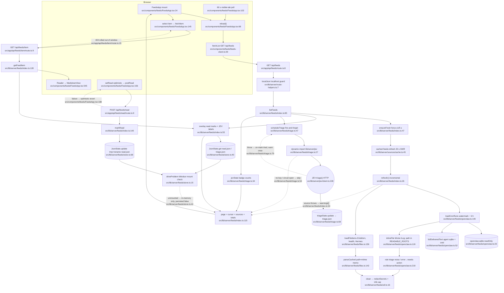

# 01 — Feeds (flowchart)

## 1. Purpose
One newest-first inbox of every automation's output (OpenClaw cron runs, ErisMorn memory logs, Cron Health reports, Hermes cron outputs), secret-masked server-side, with persistent read marks and optional JEV triage (needs-action / fyi / noise).

**Sources consulted** (all read in full unless a range is given)
- `src/app/api/feeds/route.ts:1-20`, `src/app/api/feeds/item/route.ts:1-21`, `src/app/api/feeds/read/route.ts:1-23`
- `src/lib/server/feeds/index.ts:1-156`, `config.ts:1-29`, `openclaw.ts:1-232`, `files.ts:1-204`, `store.ts:1-126`, `triage.ts:1-88`, `util.ts:1-59`
- `src/components/feeds/feeds-client.ts:1-65`, `src/components/feeds/FeedsApp.tsx:14-160, 182, 205-213, 257-272, 488-545` (grep + ranges), `src/components/feeds/parts.tsx` (grep)
- Platform: `src/lib/server/sources/cache.ts:1-66`, `src/lib/server/route-helpers.ts:7`, `src/lib/server/local-only.ts:62,71`, `src/lib/server/redact.ts:6`, `src/lib/server/jev/index.ts:1-8`, `src/lib/server/jev/client.ts:36-52,202-252` (grep), `src/lib/server/jev/cache.ts:1-20`
- Cross-checks: `src/app/api/jev-router/jev.ts:1-40` (grep), `src/lib/server/podcast/gather.ts:217-250` (Feeds consumer)

## 2. Primary happy path

Node count: 35.

## 3. Side effects
- Read-only SQLite open of `~/.openclaw/state/openclaw.sqlite`, handle cached on globalThis — `src/lib/server/feeds/openclaw.ts:23`; per-agent DBs opened read-only — `openclaw.ts:43`; zstd decompress of transcript events — `openclaw.ts:65`.
- Filesystem reads: inlined report files (≤60 KB, under `READABLE_ROOTS`) — `openclaw.ts:128`; memory/health/Hermes files — `files.ts:42`, `files.ts:68`; directory listing — `files.ts:124`.
- In-process caches on globalThis: `__feedsStore` — `index.ts:22-23`; `cached('feeds:refresh')` — `index.ts:51`; file-parse memo — `files.ts:32`; full-text memo (cleared at 300) — `openclaw.ts:53,80`; agent DB handles — `openclaw.ts:37`.
- Disk writes (Windsor only): `read.json` via tmp+rename — `store.ts:79-82` (called from `index.ts:148`); `triage.json` — `triage.ts:69`. Paths: `config.ts:16-18`.
- Network: JEV `triage()` (batches of 32, ≤8 batches per trigger, minConfidence 0.34) — `triage.ts:63`, implemented at `src/lib/server/jev/client.ts:228`. Triggered as a side effect of every list GET — `index.ts:88`.
- Logging: `console.warn` once when JEV fails — `triage.ts:82`; parse errors — `files.ts:150`; route errors — `read/route.ts:20`, `item/route.ts:18`.
- Client: 60 s polling — `FeedsApp.tsx:102`; IntersectionObserver pagination — `FeedsApp.tsx:131`; toast when read marks not persisted — `FeedsApp.tsx:79`.

## 4. External dependencies
- platform `cached` SWR — `src/lib/server/feeds/index.ts:2,51` → `src/lib/server/sources/cache.ts:45`.
- platform `localJson` — `src/app/api/feeds/route.ts:1,8` → `src/lib/server/route-helpers.ts:7`; `rejectNonLocalRead` — `item/route.ts:2,10` and `rejectNonLocalMutation` — `read/route.ts:2,10` → `src/lib/server/local-only.ts:62,71`.
- platform redaction — `src/lib/server/feeds/util.ts:3,17` → `src/lib/server/redact.ts:6` (re-export of `search/redact`).
- platform JEV (`lib/server/jev`) — `src/lib/server/feeds/triage.ts:24-31,36,40,54,63,76`.
- notion-content UI kit: `MarkdownView` — `src/components/feeds/FeedsApp.tsx:11,545` → `src/components/notion/MarkdownView.tsx:200`.
- platform UI kit: `AppTopBar`, `toast`, `clipboard` — `FeedsApp.tsx:8-10`.
- Consumers: podcast fetches `/api/feeds?limit=100` over loopback HTTP — `src/lib/server/podcast/gather.ts:222`.

## 5. Repeated concerns noticed
- **Two JEVs.** Feeds uses the real client `lib/server/jev` `triage()` (`src/lib/server/feeds/triage.ts:27,63` → `src/lib/server/jev/client.ts:228`) via a *dynamic* import, while podcast imports the same module *statically* (`src/lib/server/podcast/rank.ts:2`) and the mock-era heuristic `classify()` lives at `src/app/api/jev-router/jev.ts:74`. Three integration styles for one service.
- **Double JEV caching / batching.** Feeds keeps a forever label cache in `triage.json` (`store.ts:104-111`, `triage.ts:69`) and batches 32 × 8 (`triage.ts:15-16`), on top of the JEV client's own 6 h LRU (`src/lib/server/jev/cache.ts:4-6`) and its own chunk+pmap batching (`src/lib/server/jev/client.ts:233`).
- **JSON state store, reimplemented.** `JsonState` (mtime reload, serialised promise chain, tmp+rename) at `src/lib/server/feeds/store.ts:26-97` vs carousels `writeDeckState` chain+tmp+rename `src/lib/server/carousels/state.ts:90-116` vs podcast `writeFileAtomic` `src/lib/server/podcast/storage.ts:60` vs sync `renameSync` in `src/lib/server/podcast/config.ts:68` and `src/lib/server/jev/telemetry.ts:101` (also `music/meta.ts:151`, `research/inventory.ts:227`, `sources/actions-write.ts:82`).
- **Windsor mount check ×4.** `driveProblem` `src/lib/server/feeds/store.ts:15` (dev-compare), `checkStorage` `src/lib/server/podcast/storage.ts:24`, `windsorMounted` `src/lib/server/studio/storage.ts:28`, `src/lib/server/media/storage.ts:17`; mount constant redeclared in `feeds/config.ts:15`, `podcast/config.ts:11`, `media/config.ts:5`, `studio/storage.ts:7`.
- **Read-state stores.** Server `read.json` for feeds (`store.ts:110`) vs browser `localStorage` week state for recos (`src/components/recos/RecosApp.tsx:92,106`) vs carousels Windsor state + localStorage backup (`src/components/media/CarouselsApp.tsx:113,219`).
- **Force-refresh rate limiting ×2.** Feeds 5 s gate `src/lib/server/feeds/index.ts:49` vs Notion `allowForce` 30 s `src/lib/server/notion/route.ts:11`.
- **Markdown → plain text helpers.** `titleFrom`/`excerptOf` `src/lib/server/feeds/util.ts:23,36` vs `stripMd` `src/lib/notion-md.ts:7` vs inline strip in `src/lib/server/podcast/gather.ts:52` vs `stripHtml` `src/lib/server/podcast/util.ts:125`.
- **Client fetch wrapper ×N.** `api<T>()` in `src/components/feeds/feeds-client.ts:7` ≈ `api<T>()` in `src/components/podcast/podcast-client.ts:4` ≈ `useRemote` `src/components/notion/useRemote.ts:21` ≈ raw fetch in `CarouselsApp.tsx:129` / `RecosApp.tsx:74`. Formatters too: `fmtDuration` `feeds-client.ts:57` vs `fmtSecs` `podcast-client.ts:49`.
- **Feeds consumed over HTTP loopback** instead of `listFeeds()`: `src/lib/server/podcast/gather.ts:222` → re-enters `localJson` and fires `scheduleTriage` (`index.ts:88`) as a hidden side effect of podcast generation.

## 6. Confidence + known gaps
- **High** for the server path (every file read in full, lines grep-verified).
- **Medium** for the client: `FeedsApp.tsx` read in ranges only (keyboard shortcuts, source rail, copy action not traced).
- Not traced: internals of `jev/client.ts` `ask()` HTTP transport, breaker timing; `MarkdownView` rendering rules.
- No tests located for feeds.
