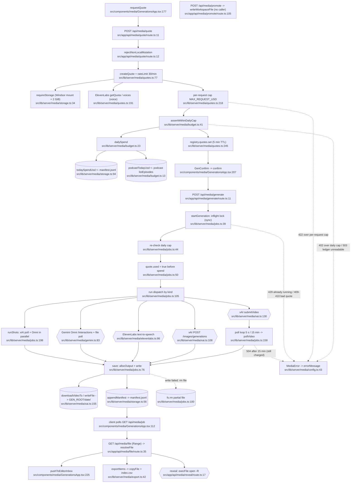

# generations — flowchart (Phase 1)

## 1. Purpose
Paid image / video / voice / shot-list generation (xAI, Gemini Omni, ElevenLabs) behind a two-step quote → confirm flow, a per-request and daily USD cap, and an append-only manifest on Windsor; outputs are served, exported, revealed, or handed to the Editor.

**Sources consulted** (all paths under `src/`)
- `lib/server/media/jobs.ts:1-270` (full), `budget.ts:1-57` (full), `storage.ts:1-147` (full), `config.ts:1-52` (full), `catalog.ts:1-42` (full)
- `lib/server/media/quotes.ts:1-90, 186-247` (+ grep outline), `xai.ts:1-30, 95-161`, `gemini.ts:12-17, 34-49, 80-129`, `elevenlabs.ts:5-12, 84-107`, `export.ts:11-113`, `pricing.ts` (grep)
- `app/api/media/{quote,generate,job,status,items,file,promote,export,reveal}/route.ts` (all full)
- `components/media/GenerationsApp.tsx:46, 81-146, 170-245`, `gen-client.ts:1-42`, `GenConfirm.tsx:8-36`, `ExportDialog.tsx:51-61` (grep)
- `lib/editor-inbox.ts:1-40` (grep), `lib/server/podcast/storage.ts:20-60`, `lib/server/workspace.ts:21,30`

## 2. Happy path

Node count: 35 (ERR and RMF included; `PROM` drawn disconnected because nothing in the app calls it).

## 3. Side effects
- Provider HTTP (spends money): xAI images `xai.ts:108` (via `xaiJson` → `fetch` `xai.ts:15`), xAI video submit `xai.ts:131-134`, xAI poll `xai.ts:143` (`/videos/{id}`), Gemini Omni `gemini.ts:84-95` (`/interactions` `:85`) + Files poll `gemini.ts:118-124` + download `gemini.ts:126-128`, ElevenLabs TTS `elevenlabs.ts:93-101`.
- Read-only provider HTTP: catalog/quota `catalog.ts:13-21`, `quotes.ts:191`.
- Third-party CDN downloads without auth header: `xai.ts:123` (image URL), `xai.ts:158-160` (video stream to file).
- File writes on Windsor: `allocOutput` mkdir `storage.ts:49`; image/voice `writeFile` `jobs.ts:120,136`; Omni base64 `gemini.ts:102`; streams `xai.ts:160`, `gemini.ts:128`.
- Ledger append: `appendManifest` `storage.ts:56-59` (the only spend record; also feeds the daily cap).
- Delete on failure: `jobs.ts:100`; export folder rollback `export.ts:101`.
- Export copies + CSV: `export.ts:74-99` (`EXPORT_ROOT` `config.ts:9`).
- Finder: `execFile('/usr/bin/open')` `app/api/media/reveal/route.ts:17`, `app/api/media/export/route.ts:21`.
- Workspace write (promote, orphan route): `app/api/media/promote/route.ts:105` → `lib/server/workspace.ts:30`.
- In-memory state: job map `jobs.ts:15`, quote registry + inflight `quotes.ts:48`; client persists job id in localStorage (`storeJob`, `GenerationsApp.tsx:209`).
- Client → Editor inbox (localStorage): `GenerationsApp.tsx:225`.

## 4. External dependencies
- podcast: `listEpisodes` for the daily cap `budget.ts:3,16` (generations → podcast edge).
- platform: `rejectNonLocalRead/Mutation` (`local-only.ts:62,71`) in every route; `localJson` `route-helpers.ts:7` (`status`, `items`); `redactSecrets` via `maskSecrets` `config.ts:2,37-41`; `readWorkspaceFile/writeWorkspaceFile` `workspace.ts:21,30` (promote).
- notion-content (client-side code in this folder): promote route imports `components/media/data` + `components/media/style` (`promote/route.ts:6-7`) — server route depending on client modules.
- Consumers: studio (`studio/index-projects.ts:7-8, 332, 384`), editor (`lib/server/editor/media.ts:7,9`).
- Env: `XAI_API_KEY`, `ELEVENLABS_API_KEY`, `GEMINI_API_KEY`, `VOLTA_GEN_MAX_USD`, `VOLTA_GEN_DAILY_USD` (`config.ts:13-23`).

## 5. Repeated concerns noticed
- **Job state + single-flight lock** — memory-only job map `jobs.ts:15` + `registry.inflight` `jobs.ts:32,39,71`; restart loses the job (`app/api/media/job/route.ts:14` "server may have restarted"). Studio persists to JSONL (`studio/runner.ts:86`), podcast to `.job.json` (`podcast/pipeline.ts:23-30`), NLE export to `export-jobs.json` (`editor/nle/export.ts:18`), Suno uses a bare boolean (`music/suno.ts:218,236`).
- **Range file route** — `app/api/media/file/route.ts:12-28` duplicate of studio/music/podcast `parseRange` (`studio/file/route.ts:13`, `music/file/route.ts:13`, `podcast/file/route.ts:13`) and `editor/nle/http.ts:37`/`streamFile :55`. Drift: media caches `immutable` (`:39`) and never destroys the stream on client abort (no `req.signal` listener; studio `:51`, music `:50`, podcast `:60` do).
- **Storage-root resolution / Windsor check** — `checkStorage` `storage.ts:13-31` is a near-verbatim copy of `podcast/storage.ts:23-40` (same messages, same 2 GiB), and of `studio/storage.ts:28-51` (3 GiB). `/Volumes/Windsor` hard-coded at `config.ts:5-9` plus ≥8 other modules.
- **Manifest JSONL store** — `appendManifest`/`readManifest` `storage.ts:56-86` (mtime-keyed cache, torn-line skip) vs studio `jobs.jsonl` `studio/runner.ts:86-134` (tail-2MB read, torn-line skip), `llm/usage-log.ts:53`, `sources/actions-write.ts:83`. Podcast uses a JSON (not JSONL) manifest `podcast/storage.ts:57`.
- **Path containment** — inline `realpath`+`startsWith(root+sep)` at `storage.ts:110-114`, `export.ts:52-58`, `export.ts:110-111`, vs `isInside` helper in `studio/storage.ts:69` and `music/library.ts:72`.
- **Async provider poll loops** — `jobs.ts:158-172` (xAI, 5 s/15 min), `jobs.ts:226-253` (shots), `gemini.ts:118-124` (3 s/5 min), each with its own `sleep` (`jobs.ts:19`, `gemini.ts:17`); client poll `GenerationsApp.tsx:135` (1.2/4 s) ≈ Suno client loop `music/SunoPanel.tsx:106` (5 s/8 min).
- **Provider fetch wrappers** — `xai()` `xai.ts:12`, `eleven()` `elevenlabs.ts:7`, `gemini()` `gemini.ts:40`, `svc()` `music/suno.ts:69`: same key check + `AbortSignal.timeout` + JSON-error shaping. `geminiKey` defined twice: `media/config.ts:23`, `podcast/config.ts:73`.
- **Spend tracking** — daily cap enforced only at `quotes.ts:221` and `jobs.ts:44`; podcast TTS spend is *counted* (`budget.ts:13-20`) but podcast never calls `assertWithinDailyCap` (no hit in `lib/server/podcast/**`), and Suno credits (`music/suno.ts:241`) sit outside the ledger entirely.
- **Local-only guard + JSON parse hand-rolled** — every media route repeats `rejectNonLocalMutation` + `req.json()` try/catch (`quote/route.ts:12-19`, `generate/route.ts:12-19`, `export/route.ts:14-17`, `reveal/route.ts:12-15`, `promote/route.ts:74-81`) instead of `studioPost`-style wrapper (`studio/http.ts:28`).
- **Editor-inbox handoff** — `GenerationsApp.tsx:225-234` hand-builds the item and `fileUrl` (`gen-client.ts:18`); same pattern in `StudioApp.tsx:199`, `MusicApp.tsx:197`, `CarouselsApp.tsx:354`, `ScriptsApp.tsx:86`.
- **Date stamping** — `localDate` `storage.ts:41` duplicated `podcast/util.ts:11`; time stamp `storage.ts:52` vs `studio/args.ts:27`.
- **Open in Finder** — `execFile('/usr/bin/open', …)` wrapped inline twice (`reveal/route.ts:17`, `export/route.ts:21`).

## 6. Confidence + known gaps
- Confidence: high for quote → generate → save → manifest (jobs/budget/storage read in full); provider internals partially read.
- Gaps: `quotes.ts:90-186` per-kind validation/pricing not read line-by-line; `pricing.ts` only grepped; `GenComposer`, `ShotListPanel`, `GenGallery` UI not read; `promote` route appears orphaned (no `fetch('/api/media/promote')` in `src/`) — likely mock-era, flag for Phase 2.
