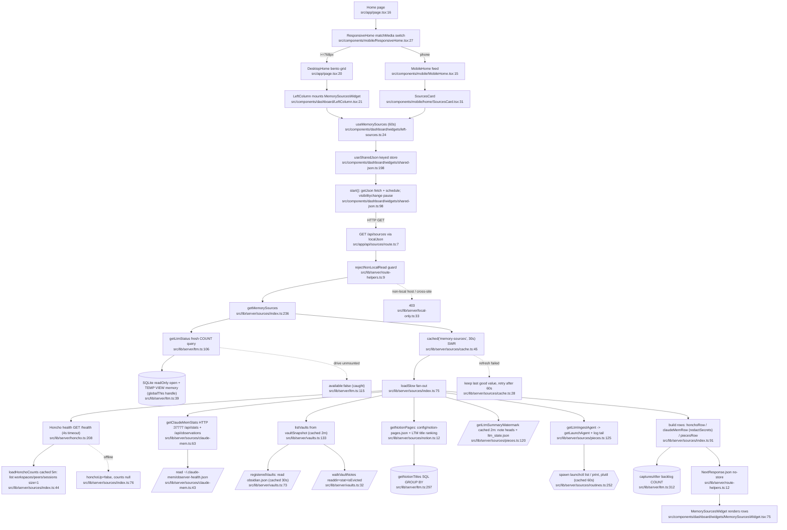
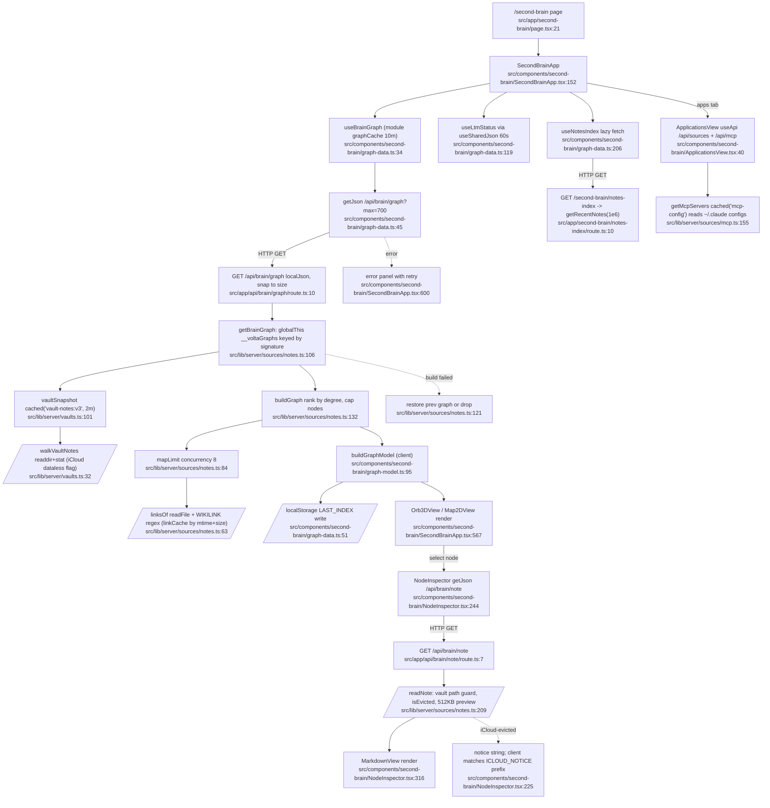

# 01 — Flowchart: home (Home dashboard + Second Brain)

## 1. Purpose
Home OS shell (desktop bento / phone feed) whose data-bearing panel is the **Memory Sources** status fan-out (`/api/sources`), plus the **Second Brain** app: an Obsidian wikilink graph, note drawer and analytics tabs over the same vault snapshot.

### Sources consulted (all paths under `src/`)
- `app/page.tsx:1-41`, `components/mobile/MobileHome.tsx:1-34`, `components/mobile/ResponsiveHome.tsx:1-30` (grep)
- `components/dashboard/LeftColumn.tsx:1-26`, `RightColumn.tsx:1-23`, `CenterOrbitalCore.tsx:20-70, 253-258`
- `components/dashboard/widgets/left-sources.ts:1-34`, `shared-json.ts:39-200` (grep + 88-116), `right-hooks.ts:20-40`, `MemorySourcesWidget.tsx` (grep)
- `components/mobile/home/{SourcesCard,LtmCard,SecondBrainCard,data}.ts(x)` (grep)
- `app/api/{sources,brain/graph,brain/note,vaults,notes/recent,ltm/activity}/route.ts` (full), `app/second-brain/notes-index/route.ts:1-24`, `app/second-brain/page.tsx` (grep)
- `lib/server/sources/index.ts:1-304`, `cache.ts:1-66`, `notes.ts:1-242`, `claude-mem.ts:1-92`, `notion.ts:1-23`, `pieces.ts:1-149`
- `lib/server/sources/{routines,mcp,skills,transcripts,plugins}.ts` (grep: imports, exports, spawn/readFile sites)
- `lib/server/vaults.ts:1-213`, `workspace.ts:1-61`, `route-helpers.ts:1-21`, `local-only.ts:25-80`, `ltm.ts:1-321`, `icloud.ts` (grep)
- `components/second-brain/SecondBrainApp.tsx` (grep 1-30, 152-200, 550-641), `graph-data.ts:1-130, 182-229` (grep), `graph-model.ts` (grep), `NodeInspector.tsx:225-256, 316`, `ApplicationsView.tsx:1-41`, `analytics-shared.tsx:11-160`

## 2. Primary happy paths

### Chart A — Home → Memory Sources (`/api/sources`)

Node count: 31 (27 happy path + 4 error/fallback).

### Chart B — Second Brain graph, note drawer, Applications tab

Node count: 26 (23 happy path + 3 error/fallback).

## 3. Side effects
- SQLite read-only open of `/Volumes/Windsor/LTM/ltm.sqlite` + `CREATE TEMP VIEW memory` on first use, handle cached on `globalThis.__ltmDbFiltered` — `src/lib/server/ltm.ts:39`, `:43`, `:44`
- SQL queries: status `src/lib/server/ltm.ts:111`, notion titles `:302`, backlog `:314`, activity/today (home widgets) `:245`, `:268`
- HTTP: Honcho `/health` + list calls `src/lib/server/honcho.ts:101` (via `index.ts:76`, `:45`); claude-mem `/api/stats`, `/api/observations?limit=1` `src/lib/server/sources/claude-mem.ts:57`, `:65`, `:69`
- File reads: `~/Library/Application Support/obsidian/obsidian.json` `src/lib/server/vaults.ts:73`; vault walk readdir/stat `vaults.ts:35`, `:46`; note bodies for wikilinks `notes.ts:70`; single note `notes.ts:238` (and partial read `:225`); `config/notion-pages.json` `notion.ts:15`; observer-health `claude-mem.ts:43`; Pieces-Vault `ltm/` note heads `pieces.ts:97`, `ltm_state.json` `pieces.ts:105`, ltm-ingest log tail `pieces.ts:133`
- Process spawns: `launchctl list` `src/lib/server/sources/routines.ts:252`, `launchctl print` `:269`, `plutil -convert json` `:290`; (orbital core also triggers `nice openclaw cron list --json` `:107` via `/api/routines`)
- In-process caches: `cached()` LRU on `globalThis.__voltaCache` `src/lib/server/sources/cache.ts:4` (keys `memory-sources` `index.ts:238`, `sources:honcho-counts` `index.ts:81`, `obsidian-vaults` `vaults.ts:70`, `vault-notes:v3` `vaults.ts:105`, `pieces:ltm-watermark` `pieces.ts:121`); `globalThis.__voltaGraphs` `notes.ts:99`; `globalThis.__voltaNoteLinks` `notes.ts:59`; `globalThis.__claudeMemGood` `claude-mem.ts:37`
- Client: `localStorage` LAST_INDEX `src/components/second-brain/graph-data.ts:51`; module-level `graphCache` `graph-data.ts:25`; shared-json timers + `visibilitychange` listener `src/components/dashboard/widgets/shared-json.ts:151`
- Writes (mock-era, not on the happy path): `writeWorkspaceFile` / `appendWorkspaceFile` `src/lib/server/workspace.ts:30`, `:37`

## 4. External dependencies
- **memory** (LTM): `import { capturesAfter, getStatus } from '../ltm'` `src/lib/server/sources/index.ts:6`; `getNotionTitles` `src/lib/server/sources/notion.ts:5`; `/api/ltm/status` polled by home `src/components/dashboard/CenterOrbitalCore.tsx:36` and Second Brain `src/components/second-brain/graph-data.ts:111`; `/api/ltm/today|activity` `src/components/mobile/home/LtmCard.tsx:34-35`
- **memory** (Honcho): `health, listPeers, listSessions, listWorkspaces, HONCHO_START_COMMAND` `src/lib/server/sources/index.ts:5`
- **memory** (API layer): `redactSecrets` imported from an API route `src/lib/server/sources/index.ts:2` (`@/app/api/honcho/_shared`)
- **memory** (client): `getJson`/`ApiError` from `@/components/ltm/ltm-client` in `graph-data.ts:7`, `right-hooks.ts:5`, `shared-json.ts` (start `:98`)
- **systems** (routines/launchd): `getLaunchAgent` `src/lib/server/sources/pieces.ts:7`
- **tasks**: `/api/actions` `src/components/dashboard/widgets/needs-you.ts:17`, `src/components/mobile/home/AwaitingCard.tsx:19`
- **feeds**: `/api/feeds?needsAction=1…` `src/components/dashboard/widgets/needs-you.ts:20`
- **platform**: `localJson` `src/lib/server/route-helpers.ts:7`; `rejectNonLocalRead` `src/lib/server/local-only.ts:62`; `cached` `src/lib/server/sources/cache.ts:45`; `isEvicted` `src/lib/server/icloud.ts:9` (used `vaults.ts:7`, `notes.ts:6`); `HudPanel` from `@/components/robo-ui` `MemorySourcesWidget.tsx:6`

## 5. Repeated concerns noticed
- **Polling hooks x4 (+1)**: `useSharedJson` `src/components/dashboard/widgets/shared-json.ts:198`; `usePolledJson` `src/components/dashboard/widgets/right-hooks.ts:26` (only referenced in its own file); `useApi` `src/components/second-brain/analytics-shared.tsx:40`; `useVisiblePoll` `src/components/ltm/useVisiblePoll.ts:14`; ad-hoc `visibilitychange` in `components/tasks/TasksApp.tsx:92`, `components/feeds/FeedsApp.tsx:106`, `components/editor/EditorApp.tsx:298`. Same URL `/api/sources` is fetched through two different stores: `left-sources.ts:25` (useSharedJson) vs `ApplicationsView.tsx:40` (useApi).
- **URL constants re-declared per widget**: `'/api/routines'` in `CenterOrbitalCore.tsx:38`, `RoutinesWidget.tsx:97`, `SecondBrainCard.tsx:57`, `mobile/home/data.ts:25`, `RoutinesAnalyticsView.tsx:86`; `'/api/skills-real'` x5 (`CenterOrbitalCore.tsx:37`, `SkillsDeckWidget.tsx:127`, `SecondBrainCard.tsx:56`, `data.ts:52`, `SkillsAnalyticsView.tsx:86`); `'/api/vaults'` x5.
- **Bespoke caches beside `cached()`**: graph cache `src/lib/server/sources/notes.ts:99` (signature-keyed, own inflight/rollback), link cache `notes.ts:59`, claude-mem last-good `claude-mem.ts:37`, Honcho stats `src/lib/server/honcho.ts:406`, client `graphCache` `src/components/second-brain/graph-data.ts:25`.
- **mtime+size memo**: `notes.ts:65` (linkCache), `src/lib/server/sources/transcripts.ts:167`, `src/lib/server/sources/sessions.ts:663` (`unchanged`), `sessions.ts:1403` (transcript LRU).
- **Bounded-concurrency helper**: `mapLimit` `src/lib/server/sources/notes.ts:84` vs `pool` `src/lib/server/honcho.ts:408`.
- **Relative-time "ago" formatters**: `src/lib/server/sources/index.ts:24`, `components/second-brain/analytics-shared.tsx:131` (relTime), `components/second-brain/graph-model.ts:254`, `components/dashboard/orbital/artifact-meta.ts:82`, `components/launchpad/parts.tsx:10`, `components/sessions/sessions-client.ts:22`, `components/feeds/feeds-client.ts:43`, `components/studio/studio-client.ts:35`, `components/ltm/ltm-client.ts:94`.
- **`useNow` clocks x2**: `components/second-brain/analytics-shared.tsx:113`, `components/dashboard/widgets/hooks.ts:10`.
- **Frontmatter parsers x3**: `src/lib/server/vaults.ts:158`, `src/lib/server/sources/skills.ts:12`, `src/app/api/workspace/frontmatter.ts:2`.
- **`readJson` (try JSON.parse readFile, null on error) copy-paste**: `src/lib/server/sources/mcp.ts:65`, `src/lib/server/sources/plugins.ts:22`; same inline pattern `vaults.ts:73`, `claude-mem.ts:43`, `notion.ts:15`, `pieces.ts:105`.
- **Head/tail partial file reads**: `readHead`/`readTail` `src/lib/server/sources/pieces.ts:41`, `:52` vs inline preview read `src/lib/server/sources/notes.ts:225`.
- **HTTP JSON-with-timeout helpers**: `getJson` `src/lib/server/sources/claude-mem.ts:56` vs `memFetch` `src/lib/server/sources/sessions.ts:1468` (same worker, same shape) vs Honcho `request` `src/lib/server/honcho.ts:95`.
- **Obsidian URL builders x2**: `obsidianUrl` `src/lib/server/vaults.ts:127` vs `obsidianUrlFor` `src/components/second-brain/graph-model.ts:87`.
- **Redaction imported from an API route** (layering): `src/lib/server/sources/index.ts:2`, `src/lib/server/sources/sessions.ts:6` import `redactSecrets` from `@/app/api/honcho/_shared` while `src/lib/server/ltm.ts:5` imports the canonical `./redact`.
- **Honcho "count via size=1 pages" twice**: `loadHonchoCounts` `src/lib/server/sources/index.ts:44` vs `computeStats` `src/lib/server/honcho.ts:428`.
- **Two transcript scanners over `~/.claude/projects`**: `src/lib/server/sources/transcripts.ts:13`/`:152` (usage + skills, used by `skills.ts:8`) vs `src/lib/server/sources/sessions.ts:36`/`:665` (memory feature); separate `scanFile`, automated-project detection (`transcripts.ts:71` vs `sessions.ts:173-176`).
- **Markdown renderers x4**: `components/second-brain/MarkdownView.tsx`, `components/notion/MarkdownView.tsx`, `components/dashboard/widgets/MiniMarkdown.tsx`, `components/honcho/RichText.tsx`.
- **iCloud signalling via string contract**: server writes notice text `src/lib/server/sources/notes.ts:222`, client detects by prefix `src/components/second-brain/NodeInspector.tsx:225` (no structured flag).
- **Platform depends on memory**: `src/lib/server/route-helpers.ts:4` imports `LtmUnavailableError` from `./ltm` for its 503 mapping.

## 6. Confidence + known gaps
- Confidence: **high** for Chart A server path and Chart B graph/note path (files read in full); **medium** for client polling internals (shared-json read at key lines only) and for `routines.ts` launchctl details (grep only).
- Not charted: desktop right column (NeedsYou/Today/Routines/SkillsDeck) and orbital core rings beyond URL wiring; Routines/Skills/Timeline analytics tabs; mock-era routes (`workspace`, `files`, `skills/run`, `cache-status`, `app/api/jev-router/jev.ts`) — flagged for Phase 2 but not traced; `transcripts.ts` scan internals.
- `usePolledJson` appears to have no external callers (grep found only its definition) — likely dead code; verify before deleting.
