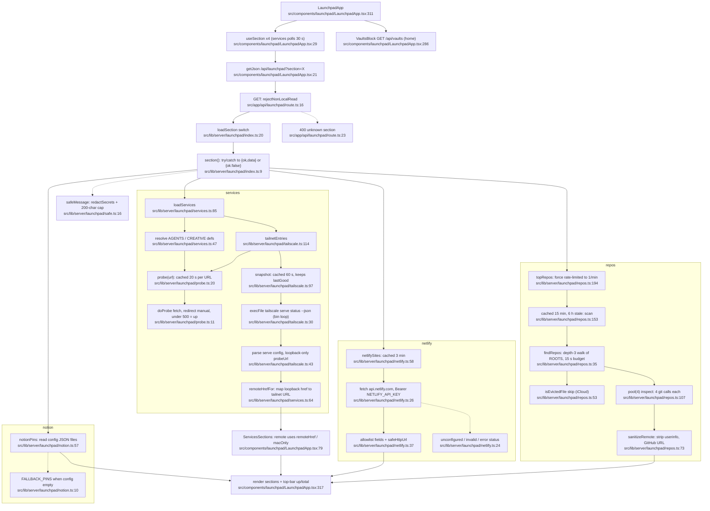

# 01 — Flowchart: launchpad

## Purpose
A page of live links. It shows local agent services and creative tools with a liveness probe on each, `tailscale serve` entries, Netlify sites, the most active git repos, Notion pins and Obsidian vaults. Each section loads independently, so a slow source (the git scan) never blocks the fast ones.

## Sources consulted
- `src/app/api/launchpad/route.ts:1-26` (all)
- `src/lib/server/launchpad/index.ts:1-36`, `probe.ts:1-22`, `safe.ts:1-19`, `services.ts:1-89`, `netlify.ts:1-60`, `notion.ts:1-64`, `repos.ts:1-198`, `tailscale.ts:1-123` (all)
- `src/lib/server/launchpad/types.ts` (not read; types only)
- `src/components/launchpad/LaunchpadApp.tsx` (15-70, 280-340 read; section components grepped at 67, 122, 143, 218, 252, 358-388)
- `src/components/launchpad/parts.tsx:28-55`
- `src/lib/remote-client.ts:1-29`, `src/lib/server/local-only.ts:29-79`, `src/lib/server/icloud.ts:9-33`, `src/lib/server/sources/cache.ts:40-66`

## Flowchart

Node count: 32.

## Side effects
- **HTTP probes (outbound, no credentials)**:
  - `fetch(url, redirect manual, 2 s)` to the loopback services in `services.ts:26-37`, the tailnet proxy targets and `labs.google` (5 min TTL): `src/lib/server/launchpad/probe.ts:11`
  - The response body is cancelled after the status is read: `probe.ts:12`
- **HTTP to a third party**: `https://api.netlify.com/api/v1/sites?per_page=100` with `Authorization: Bearer $NETLIFY_API_KEY` and a 10 s timeout. `src/lib/server/launchpad/netlify.ts:23-30`.
- **Process spawns**:
  - `tailscale serve status --json`, trying up to 4 binary paths with a 4 s timeout each: `src/lib/server/launchpad/tailscale.ts:10,30`
  - `git -C <repo> log | rev-list | symbolic-ref | config`, 4 concurrent repos with a 5 s timeout and `GIT_OPTIONAL_LOCKS=0`: `src/lib/server/launchpad/repos.ts:24,68,107-112`
  - `rev-parse` fallback: `repos.ts:120`
- **Filesystem walk**: `readdir` under `~/Documents/PROJECTS`, `~/ErisMorn` and `~/Volta-OS`, depth 3, 15 s or 30k-dir budget. `src/lib/server/launchpad/repos.ts:15,47`. Also `realpath` dedup (`repos.ts:161`) and an iCloud eviction stat (`repos.ts:53`, via `src/lib/server/icloud.ts:12`).
- **File reads**: `config/notion-links.json` and `config/notion-pages.json` (relative to cwd). `src/lib/server/launchpad/notion.ts:16,27`.
- **Caches (`cached()` SWR)**:
  - `launchpad:probe:<url>` 20 s: `probe.ts:21`
  - `launchpad:tailscale` 60 s, plus a module-level `lastGood` fallback: `tailscale.ts:94,98-110`
  - `launchpad:netlify` 3 min: `netlify.ts:59`
  - `launchpad:repos` 15 min with 6 h stale, plus the module-level `lastForcedAt` rate limit: `repos.ts:190-197`
- **No writes**: launchpad is fully read-only.

## External dependencies
- **platform**:
  - `rejectNonLocalRead` (`src/lib/server/local-only.ts:62`, used at `src/app/api/launchpad/route.ts:16`). This route does not use `localJson`.
  - `cached` (`src/lib/server/sources/cache.ts:45`)
  - `redactSecrets` (`src/lib/server/redact.ts:6`, used at `safe.ts:18` and `repos.ts:95`)
  - `isEvictedFile` (`src/lib/server/icloud.ts:12`, used at `repos.ts:10,32`)
  - `isLoopbackUrl` and `useRemoteClient` (`src/lib/remote-client.ts:17,22`, used at `LaunchpadApp.tsx:10,68,85`)
  - UI kit `AppTopBar`
- **home**: `/api/vaults` for Obsidian vaults (`src/components/launchpad/LaunchpadApp.tsx:286`). This is the launchpad→home edge.
- **External services**: the Netlify API; the Tailscale CLI and daemon.

## Repeated concerns noticed
1. **Service liveness probing is duplicated with systems.**
   - Launchpad's `probe()`/`doProbe()` (`src/lib/server/launchpad/probe.ts:7-21`) and systems' `httpGet()` (`src/lib/server/systems/run.ts:86-114`) both do fetch with redirect `manual`, a 2 s `AbortSignal.timeout` and a latency measurement.
   - They hit the same 5 services (`launchpad/services.ts:26-37` vs `systems/index.ts:36-39,54`) with different paths and different meanings of "up" (under 500 vs 2xx). The two pages can disagree about whether OpenClaw, Honcho and the others are up.
   - Neither shares the other's cache key (`launchpad:probe:*` vs `systems:core`).
2. **Hard-coded port and URL registry.** See systems concern 2. Hermes: env or 9900 (`launchpad/services.ts:9`) vs listener detection (`systems/index.ts:51-52`). Honcho: `127.0.0.1:8000` hard-coded (`launchpad/services.ts:37`) vs `HONCHO_URL` env (`src/lib/server/honcho.ts:23`). claude-mem: `localhost:37777` (`launchpad/services.ts:36`) vs `CLAUDE_MEM_URL` env (`src/lib/server/sources/claude-mem.ts:8`). The VOLTA port 50000 appears in `tailscale.ts:13`, `systems/index.ts:21` and the `local-only.ts:6` comment.
3. **The LOOPBACK set is defined four times, and the copies differ.** `src/lib/remote-client.ts:7`, `src/lib/server/local-only.ts:4` (`LOCAL_HOSTS`), `src/lib/server/launchpad/tailscale.ts:11` and `src/lib/server/music/suno.ts:34` include `'::1'`. `src/lib/server/launchpad/services.ts:61` does not, so `remoteHrefFor` would miss a bare `::1` that `tailscale.ts` accepts.
4. **Error and URL sanitizing helpers.** `safeMessage`/`safeHttpUrl` (`src/lib/server/launchpad/safe.ts:5-19`) are launchpad-local. Systems has its own `redact()` cap (`src/lib/server/systems/run.ts:63`). Tasks redacts inline (`src/lib/server/sources/actions.ts:143`). `sanitizeRemote` (`repos.ts:73`) and the `tailscale.ts:59-62` proxy-target stripping both strip credentials from URLs separately.
5. **Child processes and binary lookup.** `promisify(execFile)` is re-created at `repos.ts:12` and `tailscale.ts:9`. The tailscale candidate-path loop (`tailscale.ts:10,28-35`) duplicates systems' `bin()`/`BIN` resolver (`src/lib/server/systems/run.ts:15-31`). Each has its own timeout and error formatting.
6. **Rate limits and fallbacks kept in module state, alongside `cached()`.** These live outside the shared cache's own `force` semantics: `lastForcedAt` (`repos.ts:190-196`), `lastGood` (`tailscale.ts:94,104-107`), and `memo` in tasks (`src/lib/server/sources/actions.ts:173`).
7. **Polling and fetch hooks.** `useSection` (`src/components/launchpad/LaunchpadApp.tsx:29-58`) is a third hand-rolled poller with a seq-guard. It has no visibility catch-up. Compare TasksApp `load` (`src/components/tasks/TasksApp.tsx:60-98`), which uses an abort-guard plus catch-up, and `useSharedJson` (`src/components/dashboard/widgets/shared-json.ts:198`). `getJson` (`LaunchpadApp.tsx:21-26`) matches `fetchActions` (`TasksApp.tsx:28-33`).
8. **Remote-client gating in the UI.** `remote ? remoteHref : href` plus `macOnly` via `isLoopbackUrl` (`LaunchpadApp.tsx:79-85`). The same "is this action or link Mac-only" decision is made separately in `TasksApp.tsx:295-313` and `SystemsApp.tsx:97`.
9. **Status tone and label mapping.** `toneOfProbe`/`probeLabel` (`src/components/launchpad/parts.tsx:30,47`) and Systems' status colouring (`src/components/systems/format.ts`, not read in detail) are parallel up/warn/down vocabularies.

## Confidence + known gaps
- **High** for all server code: every `lib/server/launchpad/*` file except `types.ts` was read in full.
- **Medium** for the UI: only `useSection`, `ServicesSections` (68-85), `VaultsBlock` and the `LaunchpadApp` root were read. The Netlify, Repos and Notion section components were located by grep and not traced.
- **Not traced**: the `/api/vaults` server side (home feature). The `types.ts` shapes.
- **Asymmetry worth noting**: `loadAll` (`index.ts:33`) is reachable through `GET /api/launchpad` without `?section`, but the UI never calls it.
