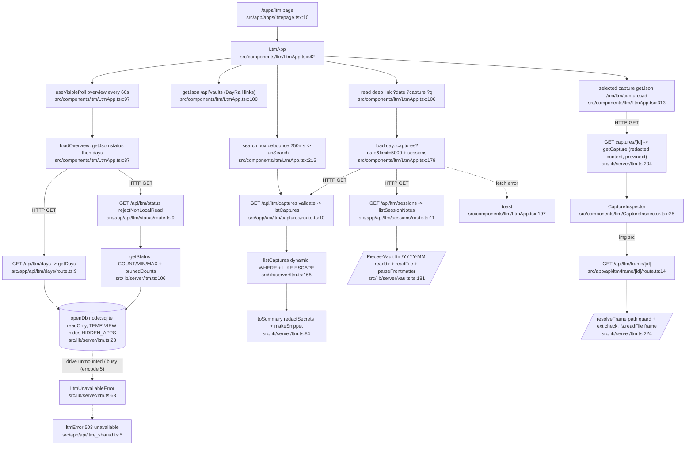
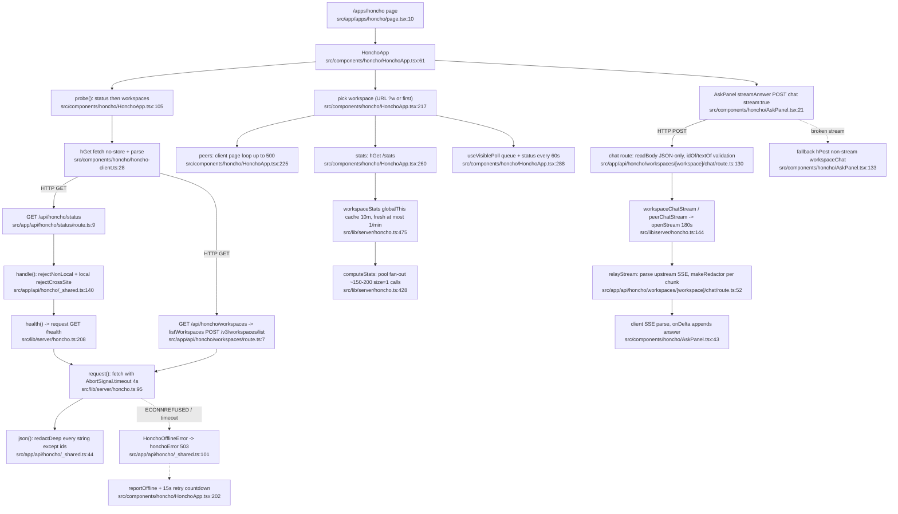
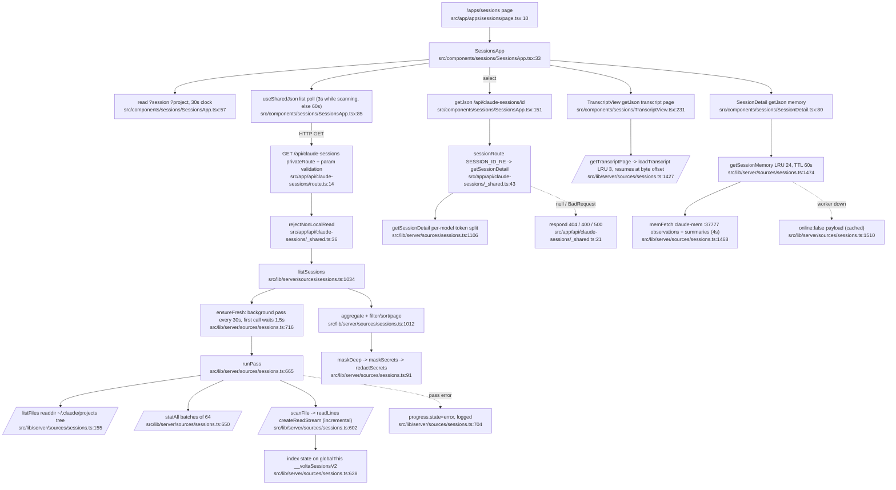

# 01 — Flowchart: memory (LTM · Honcho · Claude Code Sessions)

## 1. Purpose
Three read-only viewers over personal memory stores: **LTM** (unvolta screen captures in a SQLite DB on the Windsor drive + Pieces-Vault session notes), **Honcho** (self-hosted Plastic Labs memory server proxied over HTTP, incl. streamed dialectic chat), and **Sessions** (an in-process index of Claude Code `~/.claude/projects/**/*.jsonl` transcripts, linked to claude-mem).

### Sources consulted (all paths under `src/`)
- `lib/server/ltm.ts:1-321` (full), `lib/server/honcho.ts:1-260, 395-490` (+ grep of exports), `lib/server/sources/sessions.ts:1-128, 155-176, 560-566, 620-760, 1012-1125, 1395-1516` (+ grep)
- `app/api/ltm/_shared.ts:1-19`, `app/api/honcho/_shared.ts:1-152`, `app/api/claude-sessions/_shared.ts:1-51` (full)
- `app/api/ltm/{status,days,today,captures,captures/[id],frame/[id],sessions,activity}/route.ts` (full)
- `app/api/honcho/{status,workspaces,workspaces/[workspace]/chat,…/sessions/[session]/messages}/route.ts` (full), `…/stats/route.ts`, `…/peers`, `…/queue`, `…/messages/[message]` (grep)
- `app/api/claude-sessions/{route,[id]/route,[id]/transcript/route,[id]/memory/route}.ts` (full)
- `components/ltm/LtmApp.tsx:1-135, 175-320`, `ltm-client.ts` + `useVisiblePoll.ts:1-20` (grep/read), `CaptureInspector.tsx` (grep)
- `components/honcho/HonchoApp.tsx:50-135, 195-300`, `AskPanel.tsx:15-60, 120-140`, `honcho-client.ts:1-45`, `useHoncho.ts` (grep)
- `components/sessions/SessionsApp.tsx:55-130` (+ grep), `sessions-client.ts`, `SessionDetail.tsx`, `TranscriptView.tsx` (grep)
- `lib/server/vaults.ts:158-213`, `lib/server/local-only.ts:25-80`, `lib/server/redact.ts` + `lib/server/search/redact.ts` (grep), `app/apps/{ltm,honcho,sessions}/page.tsx` (grep)

## 2. Primary happy paths

### Chart A — LTM viewer (`/apps/ltm`)

Node count: 25 (22 happy path + 3 error).

### Chart B — Honcho (`/apps/honcho`)

Node count: 24 (21 happy path + 3 error/fallback).

### Chart C — Claude Code Sessions (`/apps/sessions`)

Node count: 26 (23 happy path + 3 error).

## 3. Side effects
- SQLite: read-only `DatabaseSync(LTM_DB_PATH, {readOnly, timeout:2000})` `src/lib/server/ltm.ts:39`; `CREATE TEMP VIEW memory` `:43`; handle on `globalThis.__ltmDbFiltered` `:44`, closed/reset on unmount `:58-62`; queries `:111`, `:122-133`, `:191-199`, `:206-211`, `:225`
- File reads: LTM frames `src/app/api/ltm/frame/[id]/route.ts:22` (after `fs.existsSync` `src/lib/server/ltm.ts:231`); Pieces-Vault session notes `src/lib/server/vaults.ts:185`, `:193`; transcripts `src/lib/server/sources/sessions.ts:565` (stream), `.meta.json` `:590`, stats `:654`, `:1079`, `:1401`; dir walks `:131`
- HTTP: Honcho `fetch` `src/lib/server/honcho.ts:101` (JSON) and `:149` (SSE); claude-mem `src/lib/server/sources/sessions.ts:1469`
- Streaming response: SSE relay `src/app/api/honcho/workspaces/[workspace]/chat/route.ts:120`
- In-process caches: Honcho stats `globalThis.__honchoStats` `src/lib/server/honcho.ts:406`; sessions index/transcript LRU/memory LRU `src/lib/server/sources/sessions.ts:628`, `:1423`, `:1514`; LTM DB handle `ltm.ts:44`
- Client: `useVisiblePoll` timers + `visibilitychange` `src/components/ltm/useVisiblePoll.ts:48`; Honcho offline `setInterval` `src/components/honcho/HonchoApp.tsx:204`; `history` URL rewrite `HonchoApp.tsx:291`; Sessions clock `setInterval` `src/components/sessions/SessionsApp.tsx:66`
- No writes to disk anywhere in this feature (all three stores are read-only by design: `ltm.ts:8`, `honcho.ts:20-21`).

## 4. External dependencies
- **platform**: `rejectNonLocalRead` `src/lib/server/local-only.ts:62` (ltm routes e.g. `app/api/ltm/captures/route.ts:3`, `app/api/claude-sessions/_shared.ts:3`); `rejectNonLocal` `app/api/honcho/_shared.ts:3`; `localJson` `src/lib/server/route-helpers.ts:7` (`app/api/ltm/today/route.ts:1`, `activity/route.ts:1`); `redactSecrets`/`maskToken` `src/lib/server/redact.ts:6` → `lib/server/search/redact.ts:258` (imported `ltm.ts:5`, `app/api/honcho/_shared.ts:4`); `useSharedJson` `src/components/sessions/SessionsApp.tsx:11`; `useToasts`/`AppTopBar`/`copyText` from `elements/kit` `src/components/ltm/LtmApp.tsx:18-20`
- **home**: `listSessionNotes`, `parseFrontmatter`, `ltmSourceRange` in `src/lib/server/vaults.ts:181` (`app/api/ltm/sessions/route.ts:3`); `/api/vaults` `src/components/ltm/LtmApp.tsx:100`; `CLAUDE_MEM_URL` from `./claude-mem` `src/lib/server/sources/sessions.ts:22`
- **Consumers of memory** (inbound): home `sources/index.ts:5-6`, `sources/notion.ts:5`; platform `route-helpers.ts:4` (`LtmUnavailableError`); systems `src/lib/server/systems/services.ts:8` (`HONCHO_START_COMMAND`, `HONCHO_URL`); client `ltm-client` reused by `components/sessions/sessions-client.ts:6`, `components/dashboard/widgets/right-hooks.ts:5`, `components/second-brain/graph-data.ts:7`; `useVisiblePoll` reused by `HonchoApp.tsx:29`

## 5. Repeated concerns noticed
- **Three route-helper modules for one guard+error pattern**: `app/api/ltm/_shared.ts:5` (`ltmError`), `app/api/honcho/_shared.ts:140` (`handle`/`honchoError` `:99`), `app/api/claude-sessions/_shared.ts:34` (`privateRoute`/`respond` `:21`), alongside `src/lib/server/route-helpers.ts:7` (`localJson`, which already maps `LtmUnavailableError` at `:14` — duplicated by `ltmError`). Most LTM routes hand-roll guard+try/catch instead of `localJson` (`captures/route.ts:10`, `days/route.ts:9`, `status/route.ts:9`, `frame/[id]/route.ts:14`, `captures/[id]/route.ts:9`).
- **`noStore` header constant x4**: `app/api/ltm/_shared.ts:19`, `app/api/honcho/_shared.ts:8`, `app/api/claude-sessions/_shared.ts:9`, `src/lib/server/editor/nle/http.ts:11` (+ inline `route-helpers.ts:12`, `app/api/vaults/route.ts:13`).
- **`BadRequest` class x3**: `app/api/honcho/_shared.ts:13`, `app/api/claude-sessions/_shared.ts:11`, `src/lib/server/notion/route.ts:19`.
- **Bounded int param parsers x3**: `intOf` `app/api/honcho/_shared.ts:64` ≡ `intParam` `app/api/claude-sessions/_shared.ts:14`; looser `intParam` `app/api/ltm/_shared.ts:13`.
- **Cross-site guard re-implemented**: `rejectCrossSite` `app/api/honcho/_shared.ts:122` vs `src/lib/server/local-only.ts:42` (semantics drift: the honcho copy refuses only `cross-site`/`same-site` and checks Origin host equality; local-only refuses everything except `same-origin`/`none` and also requires an allowed host). JSON-body check `readBody` `honcho/_shared.ts:89` vs `rejectNonLocalMutation` `local-only.ts:71`.
- **Deep redaction x2 + token masker x2**: `redactDeep` `app/api/honcho/_shared.ts:27` vs `maskDeep` `src/lib/server/sources/sessions.ts:91` (different id-key rules); `maskToken` `src/lib/server/sources/sessions.ts:63` duplicates `src/lib/server/search/redact.ts:87`; extra secret regexes `sessions.ts:67-71` live outside the shared redactor.
- **Redaction imported from an API route** (layering): `src/lib/server/sources/sessions.ts:6` imports `redactSecrets` from `@/app/api/honcho/_shared`.
- **SSE framing parsed twice**: server `relayStream` `app/api/honcho/workspaces/[workspace]/chat/route.ts:79` and client `streamAnswer` `src/components/honcho/AskPanel.tsx:43` (same `indexOf('\n\n')` loop).
- **HTTP-with-timeout + error classification**: Honcho `request` `src/lib/server/honcho.ts:95` and `openStream` `:144` duplicate the catch/offline/502 mapping (`:108-118` vs `:156-175`); claude-mem `memFetch` `src/lib/server/sources/sessions.ts:1468` ≡ `getJson` `src/lib/server/sources/claude-mem.ts:56`.
- **Bespoke TTL/LRU caches instead of `cached()`** (`src/lib/server/sources/cache.ts:45`): Honcho stats `src/lib/server/honcho.ts:475`, sessions memory LRU `sessions.ts:1474`, transcript LRU `sessions.ts:1400`.
- **Concurrency pool**: `pool` `src/lib/server/honcho.ts:408` ≡ `mapLimit` `src/lib/server/sources/notes.ts:84`.
- **Paginate-all loops**: server `allPages` `src/lib/server/honcho.ts:421` vs client peers loop `src/components/honcho/HonchoApp.tsx:230-234`.
- **Client fetch wrappers x3**: `getJson`/`ApiError` `src/components/ltm/ltm-client.ts:21`, `hGet`/`hPost`/`HonchoClientError` `src/components/honcho/honcho-client.ts:28`, plus private `getJson` `src/components/launchpad/LaunchpadApp.tsx:21`, `components/editor/nle/timeline/media.ts:53`. Abort detection x2: `isAbortError` `ltm-client.ts:14` vs `isAbort` `honcho-client.ts:19`.
- **Polling**: three mechanisms inside one feature — `useVisiblePoll` (`LtmApp.tsx:97`, `HonchoApp.tsx:288`), `useSharedJson` (`SessionsApp.tsx:85`), raw `setInterval` (`HonchoApp.tsx:204`, `SessionsApp.tsx:66`).
- **Search debounce 250ms copy-paste**: `src/components/ltm/LtmApp.tsx:207`, `src/components/sessions/SessionsApp.tsx:71`.
- **Deep-link read-once-after-mount pattern x3**: `LtmApp.tsx:106`, `HonchoApp.tsx:132`, `SessionsApp.tsx:57`; URL write-back `HonchoApp.tsx:291`, `SessionsApp.tsx:130`.
- **Highlight splitting x2**: `splitHighlight` `src/components/ltm/ltm-client.ts:102` ≡ `src/components/honcho/honcho-client.ts:104`.
- **Time formatting**: `agoLabel` `ltm-client.ts:94`, `ago` `src/components/sessions/sessions-client.ts:22`, `fmtDateTime/fmtTime` `honcho-client.ts:66-78` (plus the ago family listed in home.md).
- **Start command duplicated client/server**: `START_COMMAND` `src/components/honcho/honcho-client.ts:4` ≡ `HONCHO_START_COMMAND` `src/lib/server/honcho.ts:24`.
- **Transcript scanning duplicated**: `src/lib/server/sources/sessions.ts:36`/`:665`/`:602` vs `src/lib/server/sources/transcripts.ts:13`/`:152`/`:143` (both incremental byte-offset JSONL readers with mtime+size memo; automated-dir detection `sessions.ts:173-176` vs `transcripts.ts:71`).
- **ID regexes defined twice**: `SESSION_ID_RE` `src/lib/server/sources/sessions.ts:1067` re-typed inline in client `src/components/sessions/SessionsApp.tsx:61`; project regex `app/api/claude-sessions/route.ts:7` vs `SessionsApp.tsx:62`.
- **Rich text renderer**: `src/components/honcho/RichText.tsx` is a fourth markdown-ish renderer (see home.md).

## 6. Confidence + known gaps
- Confidence: **high** for LTM (server read in full) and Honcho proxy/chat; **medium** for Sessions — `sessions.ts` (1516 lines) read at the index, list, transcript and memory sections only; `scanFile`/`transcriptLine`/`summarize` internals not traced.
- Not charted: Honcho Peers/Sessions/Conclusions/Search tabs (same `handle`→`request`→`json` path, ~12 more routes), `useHonchoGet` `src/components/honcho/useHoncho.ts:16`, LTM `apps`/`today`/`activity` routes (consumed by home), DayTimeline/DayRail rendering.
- The cross-site semantics note in §5 comes from one read of each function; Phase 2 should diff them line by line before merging.
