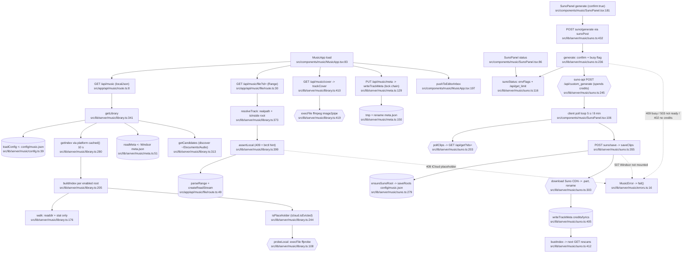

# music — flowchart (Phase 1)

## 1. Purpose
VANTA VECTOR track library over configured (often iCloud-synced) folders — stat-only index, ffprobe metadata for local files, Range streaming, cover art, Windsor-stored notes — plus a bridge to the local `suno-api` service for credit-spending generation, polling and saving finished songs into a Windsor library root.

**Sources consulted** (all paths under `src/`)
- `lib/server/music/library.ts:1-443` (full), `suno.ts:1-452` (full), `config.ts:1-91` (full), `errors.ts:1-21`, `http.ts:1-27`, `index.ts:1-6` (full)
- `lib/server/music/meta.ts:12-60, 125-159` (+ grep outline)
- `app/api/music/{route,file/route,cover/route,meta/route,roots/route}.ts` and `app/api/music/suno/{generate,poll,save,status}/route.ts` (all full)
- `components/music/MusicApp.tsx:61, 83, 175, 197-215` (grep), `SunoPanel.tsx:14-15, 61, 71, 86, 95-145, 175-185`, `music-client.ts:5`, `format.ts:9, 36` (grep)
- `lib/server/icloud.ts:1-33`, `lib/server/sources/cache.ts:45` (signature), `lib/server/route-helpers.ts:7`

## 2. Happy path

Node count: 34.

## 3. Side effects
- ffprobe children: `library.ts:113-121`; ffmpeg cover extraction `library.ts:419-424`.
- Config rewrite (atomic tmp+rename, sync): `config.ts:88-90`, triggered by `setRootEnabled` `library.ts:335` and `ensureSunoRoot` `suno.ts:279`.
- Notes store write (serialized promise chain, tmp+rename): `meta.ts:149-151`, lock `meta.ts:154-157`; from `PUT /api/music/meta` (`app/api/music/meta/route.ts:13`) and Suno save `suno.ts:405`.
- Suno service HTTP (loopback only, `baseUrl` `suno.ts:40-50`): status `suno.ts:135`, generate (spends credits) `suno.ts:245-253`, poll `suno.ts:203`.
- Reads Suno service `.env` (booleans only): `suno.ts:99-112`.
- Suno CDN download to Windsor: `suno.ts:304` fetch, `.part` write `suno.ts:321`, rename `suno.ts:323`, cleanup `suno.ts:326`; mkdir `suno.ts:361`.
- Index cache bust: `library.ts:64-66` (called `library.ts:336`, `suno.ts:280, 412`).
- In-memory state: probes/covers `library.ts:60-61`, meta cache + lock `meta.ts:38`, busy flag `suno.ts:218`; client pending clip ids in localStorage (`writeJson(PENDING_KEY)` `SunoPanel.tsx:185`).
- Client → Editor inbox (localStorage): `MusicApp.tsx:197`.

## 4. External dependencies
- platform: `isEvicted` `lib/server/icloud.ts:9` (`library.ts:6`); `cached` `lib/server/sources/cache.ts:45` (`library.ts:9`); `localJson` `route-helpers.ts:7` (`app/api/music/route.ts:2`); `rejectNonLocalRead/Mutation` (`http.ts:3`, `suno.ts:8`, file/cover routes).
- **Client modules imported by server code**: `brctlCommand`, `cleanTitle` from `components/music/format` (`library.ts:7`); types from `components/music/types` (`library.ts:8`); `SUNO_CREDIT_CHOICES` + types from `components/music/suno-types` (`suno.ts:9-10`).
- External service: local `gcui-art/suno-api` LaunchAgent (`suno.ts:16-30`, `DEFAULT_URL :30`) living on Windsor (`SUNO_DIR :25`).
- Consumers: studio (`studio/index-projects.ts:9, 353, 369-378`), editor (`lib/server/editor/media.ts:8`).
- Env: `SUNO_API_URL` (`suno.ts:41`).

## 5. Repeated concerns noticed
- **Range file route** — `app/api/music/file/route.ts:13-28` copy of `studio/file/route.ts:13`, `media/file/route.ts:12`, `podcast/file/route.ts:13`; `editor/nle/http.ts:37` + `streamFile :55` already generic.
- **Windsor mount detection, twice inside music alone** — `suno.ts:52-59` and `meta.ts:22-31` (+`needsWindsor` `meta.ts:31`), same as `studio/storage.ts:28`, `media/storage.ts:16`, `podcast/storage.ts:27`, `research/inventory.ts:91-99` (which also has a `needsWindsor`). `'/Volumes/Windsor'` literal at `suno.ts:24`, `meta.ts:12`, `config.ts:74`.
- **iCloud eviction** — the check is *not* inline any more: `library.ts:6` re-exports platform `isEvicted` as `isPlaceholder` (`library.ts:70`). What is still duplicated is the user hint: `brctlCommand` lives in a client module (`components/music/format.ts:9`) and is re-implemented server-side in `lib/server/editor/media.ts:22`; studio hand-writes the same "brctl download" text (`studio/config.ts:260`, `studio/runner.ts:286, 510`).
- **Path containment** — private `isInside` `library.ts:72-79` identical to exported `studio/storage.ts:69-76`.
- **ffprobe / mapLimit / probe cache** — `probeLocal` `library.ts:108` (cache clear at 2000, `:154`) vs studio `probeFile` `studio/index-projects.ts:80` (clear at 3000); `FFPROBE` constant `library.ts:20` vs `studio/index-projects.ts:40`, `podcast/config.ts:15`, `editor/nle/paths.ts:22`; `mapLimit` `library.ts:81` = `studio/index-projects.ts:117` = `research/inventory.ts:101`.
- **Atomic JSON writes** — tmp+rename hand-rolled three times in music (`config.ts:88-90`, `meta.ts:149-151`, `suno.ts:319-323`) while `podcast/storage.ts:60` exports `writeFileAtomic`.
- **Async provider poll loop** — Suno polling lives in the browser (`SunoPanel.tsx:106-127`, `POLL_MS`/`GIVE_UP_MS` `:14-15`, own `sleep` `:61`) whereas xAI/Gemini polling is server-side (`media/jobs.ts:158`, `media/gemini.ts:118`); closing the tab mid-poll leaves clips unsaved until the pending key is resumed.
- **Single-flight lock** — `__voltaSunoBusy` boolean `suno.ts:218, 236-237, 266` ≈ `registry.inflight` `media/jobs.ts:39` ≈ studio `S.running` `studio/runner.ts:314` ≈ podcast `__podcastJob` `podcast/pipeline.ts:21`.
- **Spend tracking** — Suno credit gate (`suno.ts:241`) is independent of the USD daily cap in `media/budget.ts:41`; no ledger row is written for Suno spends (only notes in `meta.json` `suno.ts:397-405`).
- **Local-only + JSON-body wrappers** — `musicPut` `http.ts:7-27` and `sunoPost` `suno.ts:432-452` are the same function with a different verb; both ≈ `studioPost` `studio/http.ts:28`. `sunoGet` `suno.ts:419` ≈ `studioGet` `studio/http.ts:15`. Route wrappers live in `suno.ts` (domain module) rather than `http.ts`.
- **Error class** — `MusicError` `errors.ts:5` (adds `extra`) ≈ `StudioError`/`MediaError`/`PodcastError`; `fail()` `errors.ts:16` ≈ `studio/http.ts:8`.
- **Editor-inbox handoff + URL builders** — `MusicApp.tsx:197-205` hand-builds the item; stream URL built in `components/music/format.ts:36` and again server-side `lib/server/editor/media.ts:28`.
- **Library roots config** — `config/music.json` load/save (`config.ts:39, 80`) parallels `config/studio-projects.json` (`studio/config.ts:12, 202`); both sync `readFileSync` with an `errors[]` array surfaced to UI.

## 6. Confidence + known gaps
- Confidence: high — `library.ts`, `suno.ts`, `config.ts` and every route read in full; node lines grep-verified.
- Gaps: `meta.ts:60-125` (`sanitizeMeta` field rules) only outlined; `TrackPanel`/`PlayerBar` waveform path (`music-client.ts:37 loadPeaks`, which re-fetches the whole file via `/api/music/file` and decodes peaks in the browser) not traced further; `config/music.json` contents not inspected; Suno resume-on-reload path (`PENDING_KEY` read) not traced.
