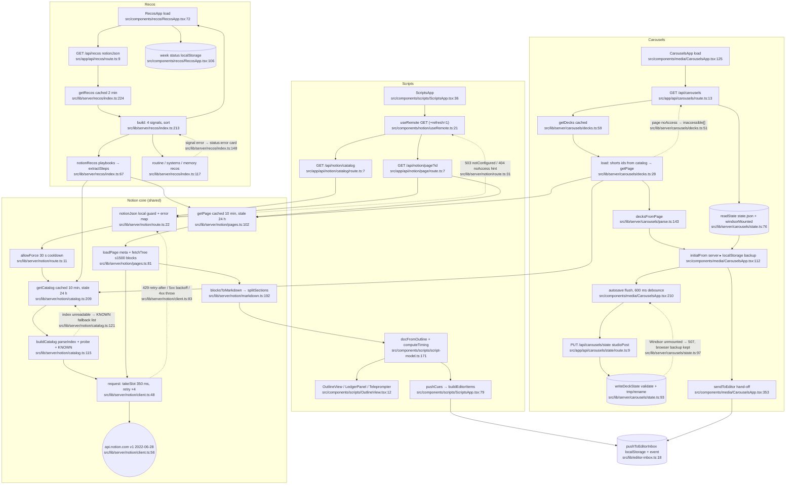

# 01 — Notion content: Scripts, Carousels, Recos (flowchart)

## 1. Purpose
Three apps over one read-only Notion REST client: **Scripts** (episode outlines + source ledgers from the "Video Production" index, teleprompter, push cues to Editor), **Carousels** (Shorts pages parsed into slide decks with review state saved on Windsor), **Recos** (weekly improvement cards from Notion playbooks + routines/systems/memory signals).

**Sources consulted**
- Routes: `src/app/api/notion/{route,page/route,catalog/route,links/route,dreams/route}.ts` (all, 7–11 lines each), `src/app/api/carousels/route.ts:1-23`, `src/app/api/carousels/state/route.ts:1-11`, `src/app/api/recos/route.ts:1-9`
- Notion core: `src/lib/server/notion/client.ts:1-164`, `pages.ts:1-119`, `catalog.ts:1-214`, `route.ts:1-39`, `links.ts:1-19`, `dreams.ts:1-30`, `markdown.ts` (grep of exports: 10-218)
- Carousels: `src/lib/server/carousels/decks.ts:1-61`, `state.ts:1-116`, `parse.ts` (grep), `src/components/media/CarouselsApp.tsx:1-20, 42, 69-140, 205-260, 320-372` (ranges + grep), `src/components/media/ui.tsx` (grep)
- Recos: `src/lib/server/recos/index.ts:1-226`, `src/components/recos/RecosApp.tsx:30-110, 200-230` (grep + ranges), `recos-lib.ts` (grep), `Toasts.tsx` (grep)
- Scripts: `src/components/scripts/ScriptsApp.tsx:1-120`, `script-model.ts` (grep), `OutlineView.tsx`/`LedgerPanel.tsx`/`Teleprompter.tsx` (grep), `src/components/notion/useRemote.ts:1-55`, `src/lib/editor-inbox.ts` (grep), `src/lib/notion-md.ts:1-30`
- Platform/cross-feature: `src/lib/server/sources/cache.ts:1-66`, `src/lib/server/local-only.ts:62`, `src/lib/server/studio/http.ts:8,28`, `src/lib/server/studio/storage.ts:25-40`, `src/lib/server/sources/notion.ts:1-23`, `src/lib/server/launchpad/notion.ts` (grep)

## 2. Primary happy path

Node count: 35.

Secondary Notion routes in the same folder (not drawn): `GET /api/notion/dreams` → `getDreams` `src/lib/server/notion/dreams.ts:28` (db query `dreams.ts:11`); `GET /api/notion/links` → `config/notion-links.json` `src/lib/server/notion/links.ts:9`; `GET /api/notion` is **not** the REST client — it ranks LTM window titles via `src/lib/server/sources/notion.ts:12` (home feature).

## 3. Side effects
- Network: Notion REST GET + `POST /databases/{id}/query` only (read-only by construction) — `src/lib/server/notion/client.ts:56,97-98`; global slot clock on globalThis (≈2.9 req/s) — `client.ts:37-46`; retry/backoff — `client.ts:52-93`.
- Recursive block fetch (parallel per level, budget 1500, depth 8) — `src/lib/server/notion/pages.ts:21-43`.
- In-process SWR cache keys: `notion:catalog` `catalog.ts:211`, `notion:page:<id>` `pages.ts:104`, `notion:dreams:<n>` `dreams.ts:29`, `carousels:decks` `decks.ts:60`, `recos:payload` `recos/index.ts:225`; force-refresh cooldown map on globalThis — `notion/route.ts:8`.
- Disk write (Windsor only): `/Volumes/Windsor/VOLTA/carousels/state.json` via serialised chain + tmp/rename — `src/lib/server/carousels/state.ts:102-106,113-114`. Notion is never written.
- Disk read: `config/notion-links.json` — `src/lib/server/notion/links.ts:11`.
- Browser storage: Scripts last selection + URL history rewrite — `ScriptsApp.tsx:60-63`; Carousels backup copy — `CarouselsApp.tsx:219` (read `:113`); Recos week state — `RecosApp.tsx:92,106`; Editor inbox (localStorage + `CustomEvent`) — `src/lib/editor-inbox.ts:21-22`.
- Browser downloads: PNG export via `slideToBlob` + `<a download>` — `CarouselsApp.tsx:326-344`. Clipboard: revision prompt `CarouselsApp.tsx:320`, Recos agent prompt `RecosApp.tsx:209`.
- Recos fans out into other features' probes (Systems ~5 s, routines, memory sources) — `recos/index.ts:119,154,187`.
- Logging: index fallback — `catalog.ts:125`; unexpected route errors — `notion/route.ts:35`.

## 4. External dependencies
- platform cache — `src/lib/server/notion/pages.ts:3`, `catalog.ts:3`, `dreams.ts:3`, `carousels/decks.ts:4`, `recos/index.ts:5` → `src/lib/server/sources/cache.ts:45`.
- platform guards — `src/lib/server/notion/route.ts:3,24` and `src/app/api/carousels/route.ts:5,14` → `src/lib/server/local-only.ts:62`; `localJson` for links — `src/app/api/notion/links/route.ts:1`.
- platform redaction in Notion errors — `src/lib/server/notion/client.ts:2,68,82` → `src/lib/server/redact.ts:6`.
- **studio** (cross-feature): `fail` + `studioPost` HTTP helpers — `src/app/api/carousels/route.ts:8,21`, `src/app/api/carousels/state/route.ts:4,9` → `src/lib/server/studio/http.ts:8,28`; `StudioError` + `windsorMounted` — `src/lib/server/carousels/state.ts:5,77,97` → `src/lib/server/studio/storage.ts:28`.
- **editor**: `pushToEditorInbox` — `ScriptsApp.tsx:10,86`, `CarouselsApp.tsx:3,354` → `src/lib/editor-inbox.ts:18`.
- **systems**: `getSystemsReport` — `recos/index.ts:8,154` → `src/lib/server/systems/index.ts:154`.
- **home**: `getRoutines` — `recos/index.ts:7,119` → `src/lib/server/sources/routines.ts:353`; `getMemorySources` — `recos/index.ts:6,187` → `src/lib/server/sources/index.ts:236`.
- Server code importing client types: `Deck` from `@/components/media/data` — `src/lib/server/carousels/decks.ts:2`.
- Shared pure helpers: `stripMd` — `recos/index.ts:4` → `src/lib/notion-md.ts:7`.
- Consumers outside this feature: podcast `notionQuery` + `getPage` — `src/lib/server/podcast/gather.ts:3-4,36,50`; feeds + podcast reuse `MarkdownView` — `src/components/feeds/FeedsApp.tsx:11`, `src/components/podcast/EpisodeView.tsx:5`.

## 5. Repeated concerns noticed
- **Notion entry points ×3 + hard-coded IDs duplicated.** REST client `src/lib/server/notion/client.ts:48` vs LTM-title "Notion pages" `src/lib/server/sources/notion.ts:12` (served at `/api/notion`, same URL prefix) vs launchpad pins `src/lib/server/launchpad/notion.ts:57`. `config/notion-links.json` parsed twice: `src/lib/server/notion/links.ts:9` and `src/lib/server/launchpad/notion.ts:57`. Dreams DB id: `notion/dreams.ts:8` and `launchpad/notion.ts:11`; Video Production id: `notion/catalog.ts:12` and `launchpad/notion.ts:13`; OMNI_VEO page id: `notion/catalog.ts:33` and `src/components/studio/FlowPanel.tsx:8`.
- **Podcast bypasses the page cache for its DB query**: `notionQuery` called raw at `src/lib/server/podcast/gather.ts:36` (no `cached()`), unlike `dreams.ts:29`; then strips markdown inline `gather.ts:52` instead of `stripMd` `src/lib/notion-md.ts:7`.
- **Markdown renderers ×3.** `MarkdownView` `src/components/notion/MarkdownView.tsx:200` (used by Scripts, Feeds, Podcast) vs `src/components/second-brain/MarkdownView.tsx:285`; server-side HTML for RSS `notesHtml` `src/lib/server/podcast/notes.ts:65`.
- **JSON manifest / state stores.** Carousels chain+tmp/rename `src/lib/server/carousels/state.ts:90-116` duplicates feeds `JsonState` `src/lib/server/feeds/store.ts:26-97` and podcast `writeFileAtomic` `src/lib/server/podcast/storage.ts:60`.
- **Windsor mount check**: carousels borrows studio's `windsorMounted` (`studio/storage.ts:28`) while feeds (`feeds/store.ts:15`), podcast (`podcast/storage.ts:24`) and media (`media/storage.ts:17`) each reimplement it; carousels hard-codes `/Volumes/Windsor/VOLTA/carousels` at `state.ts:11`.
- **Route error mappers ×4.** `notionJson` `src/lib/server/notion/route.ts:22`, studio `fail` `src/lib/server/studio/http.ts:8` (used by carousels), `localJson` `src/lib/server/route-helpers.ts:7`, honcho `handle` `src/app/api/honcho/_shared.ts:140`. Carousels GET re-checks `not_configured` by hand (`src/app/api/carousels/route.ts:20`) because it uses `fail` instead of `notionJson`.
- **Force-refresh throttles ×2**: `allowForce` `src/lib/server/notion/route.ts:11` vs feeds `src/lib/server/feeds/index.ts:49`.
- **Read/review state in three places**: Windsor `state.json` + localStorage backup (Carousels `CarouselsApp.tsx:113,219`), localStorage only (Recos `RecosApp.tsx:92,106`; Scripts `ScriptsApp.tsx:28,60`), server `read.json` (Feeds `src/lib/server/feeds/store.ts:110`).
- **Client fetch helpers ×4**: `useRemote` `src/components/notion/useRemote.ts:21` (Scripts) vs raw fetch + local state in `CarouselsApp.tsx:129` and `RecosApp.tsx:74` (same `?refresh=1` + `notConfigured` handling) vs `api<T>` in feeds/podcast clients.
- **UI kit forks**: `copyText` ×4 — `src/components/elements/kit/clipboard.ts:4`, `src/components/media/ui.tsx:27`, `src/components/recos/RecosApp.tsx:30`, `src/components/dashboard/orbital/artifact-meta.ts:102`; toasts ×3 — `src/components/elements/kit/toast.tsx:16`, `src/components/media/ui.tsx:103`, `src/components/recos/Toasts.tsx:16`; localStorage JSON helpers `src/components/media/ui.tsx:10,19` vs inline try/catch in Scripts/Recos.
- **Editor hand-off builders ×2**: `buildEditorItems` `src/components/scripts/script-model.ts:202` vs inline cue mapping in `src/components/media/CarouselsApp.tsx:354-363` (same `EditorInboxItem` shape, different timing logic).
- **"Copy an agent prompt" builders ×2**: `buildRevisionPrompt` `CarouselsApp.tsx:69` and `buildAgentPrompt` `src/components/recos/recos-lib.ts:85` (neither uses `openClaudeInTerminal` `src/lib/server/claude-terminal.ts:30` that Systems/Tasks use).

## 6. Confidence + known gaps
- **High** for server code (all Notion/carousels/recos server files read in full; lines grep-verified).
- **Medium** for clients: `CarouselsApp.tsx` (712 lines) and `RecosApp.tsx` read in ranges; slide editing, pins UI, cart drawer not traced. `markdown.ts` and `carousels/parse.ts` only skimmed by export list.
- Not traced: `getSystemsReport` / `getRoutines` / `getMemorySources` internals (belong to systems/home).
