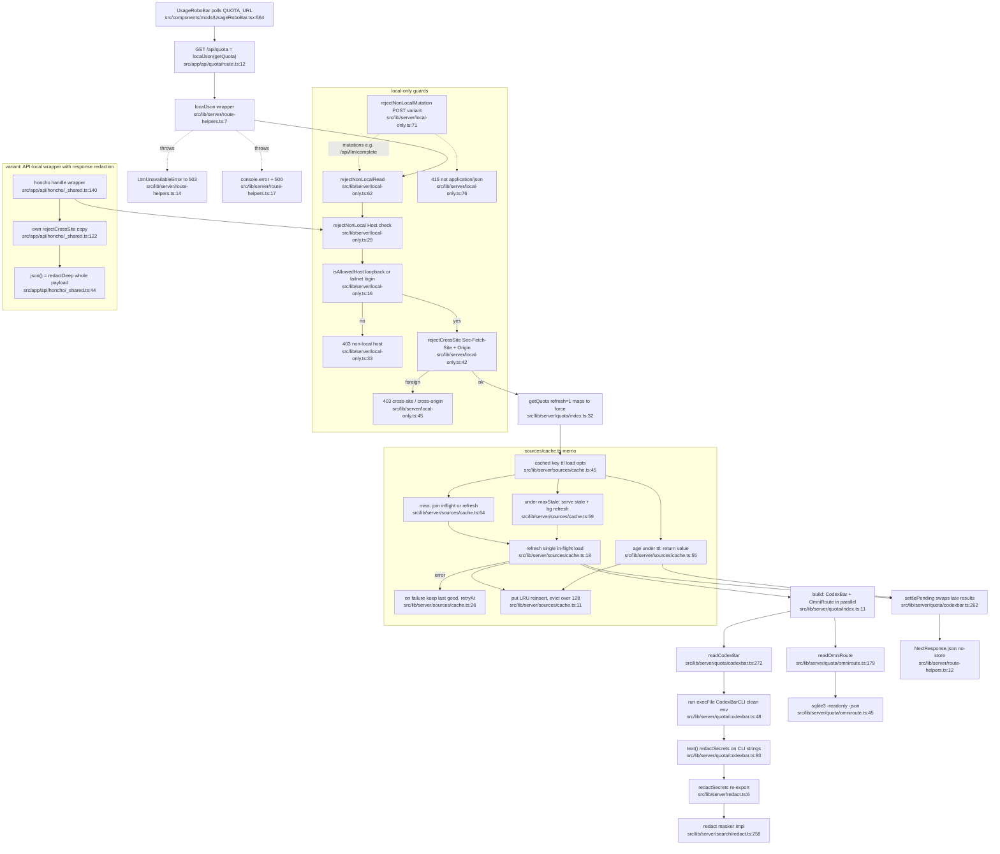
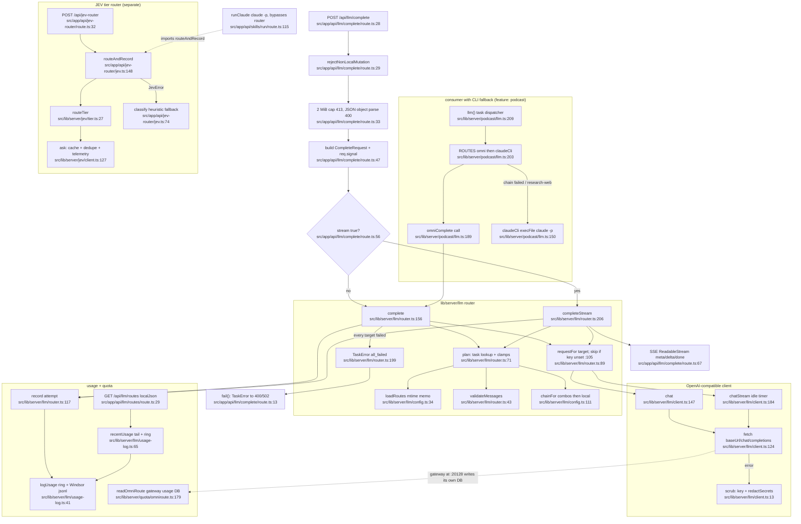
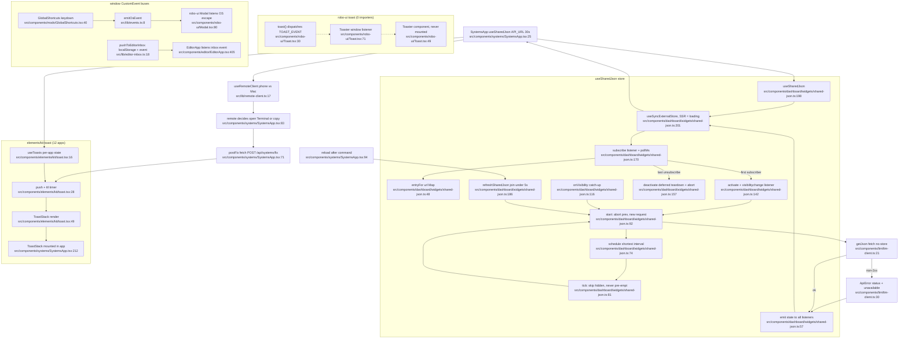

# 01 — Platform (shared layer) flowcharts

Feature #15 in `00-features.md`. Paths are relative to the repo root (`src/...`). Every node label carries `file:line` verified with `grep -n` / `cat -n` on 2026-10-28. Read-only pass; no source was modified.

## 1. Purpose

The platform layer is the shared infrastructure every VOLTA feature leans on:

- **Server guards and route plumbing**: `local-only.ts` (loopback/tailnet host + same-origin + JSON content-type guards), `route-helpers.ts` (`localJson` GET wrapper).
- **Server utilities**: `redact.ts` (secret masker re-export), `icloud.ts` (evicted-placeholder checks), `sources/cache.ts` (stale-while-revalidate memo), `claude-terminal.ts` (open interactive Claude Code in Terminal via osascript), `workspace.ts` (sandboxed `./workspace` I/O), `vaults.ts` (Obsidian vault walk + snapshot).
- **Model plumbing**: `llm/**` (OmniRoute task router with LM Studio last resort + usage log), `quota/**` (CodexBar CLI limits + OmniRoute SQLite usage), `jev/**` (TypeSafe JEV client, cache, breaker, telemetry), plus routes `app/api/{llm,quota,jev-router}`.
- **Client utilities**: `useSharedJson` (refcounted, visibility-aware polling store), `lib/events.ts` (window CustomEvent keyboard bus), `lib/editor-inbox.ts` (localStorage hand-off into Editor), `lib/remote-client.ts` (phone-vs-Mac detection), `lib/format.ts`, `lib/cn.ts`.
- **UI kits**: `components/robo-ui/**` (HudPanel, Modal, Toggle, Toast, badges) and `components/elements/kit/**` (AppTopBar, clipboard, toast).

### Sources consulted

| File | Lines read |
|---|---|
| `src/lib/server/local-only.ts` | 1-79 (all) |
| `src/lib/server/route-helpers.ts` | 1-21 (all) |
| `src/lib/server/redact.ts` | 1-6 (all) |
| `src/lib/server/search/redact.ts` | grep of exports: 87, 140, 184, 212, 258 |
| `src/lib/server/icloud.ts` | 1-33 (all) |
| `src/lib/server/claude-terminal.ts` | 1-42 (all) |
| `src/lib/server/workspace.ts` | 1-61 (all) |
| `src/lib/server/vaults.ts` | 1-30, export grep (12-181) |
| `src/lib/server/sources/cache.ts` | 1-66 (all) |
| `src/lib/server/llm/router.ts` | 1-268 (all) |
| `src/lib/server/llm/client.ts` | 1-268 (all) |
| `src/lib/server/llm/usage-log.ts` | 1-94 (all) |
| `src/lib/server/llm/config.ts` | 10-60, 111 |
| `src/lib/server/llm/index.ts` | 1-9 |
| `src/lib/server/quota/index.ts` | 1-36 (all) |
| `src/lib/server/quota/codexbar.ts` | 36-60, 80, 190-292 |
| `src/lib/server/quota/omniroute.ts` | 40-60, 63-100 (grep), 179-200 |
| `src/lib/server/jev/{index,cache,client,tier,telemetry}.ts` | index 1-8; cache 1-57 (grep); client 34-56, 72-160; tier 18-41; telemetry 11, 78-108 |
| `src/app/api/llm/complete/route.ts` | 1-94 (all) |
| `src/app/api/llm/routes/route.ts` | 1-40 (all) |
| `src/app/api/quota/route.ts` | 1-12 (all) |
| `src/app/api/jev-router/route.ts` | 1-53 (all) |
| `src/app/api/jev-router/jev.ts` | 1-200 (grep), 140-200 |
| `src/lib/{events,format,remote-client,editor-inbox,cn}.ts` | all |
| `src/components/dashboard/widgets/shared-json.ts` | 1-204 (all) |
| `src/components/ltm/ltm-client.ts` | 1-35 |
| `src/components/robo-ui/{Toast.tsx,index.ts}` | all; Modal.tsx 37, 80; Toggle.tsx 21 |
| `src/components/elements/kit/{toast.tsx,clipboard.ts}` | all |
| Consumers for context | `components/systems/SystemsApp.tsx` 7-102, 212; `components/mods/UsageRoboBar.tsx` 27, 557-564; `components/mods/GlobalShortcuts.tsx` 16-40; `components/editor/EditorApp.tsx` 4, 405; `lib/server/podcast/llm.ts` 1-30, 150-209; `app/api/skills/run/route.ts` 105-130; `app/api/honcho/_shared.ts` 1-60, 115-152; `app/api/{ltm,claude-sessions}/_shared.ts` (grep) |
| Duplication hunt | grep sweeps listed in sections 4-5 (all under `src/`, excluding node_modules/.next/.git/workspace) |

## 2. Flowcharts

### (a) A typical private API request through the guards

Worked example: `GET /api/quota` (polled by the UsageRoboBar) through `localJson` → guards → `cached()` → loaders that redact upstream text → JSON response. The Honcho and mutation variants are shown as side branches.

### (b) LLM call path

`POST /api/llm/complete` → task router → OmniRoute combos / LM Studio → usage log; the podcast pipeline is the only in-repo library caller and adds the `claude -p` fallback; quota reads the gateway's own usage DB; JEV is a separate tier-router.

### (c) Client data path

`useSharedJson` (one fetch + timer per URL) → subscriber re-render → user action → feature fetch → toast. Two toast systems and the window CustomEvent buses are shown; the robo-ui `Toaster` is never mounted (dashed).

## 3. Side effects

| Effect | Where |
|---|---|
| Module-global Map `__voltaCache` (LRU 128 keys), survives HMR | `src/lib/server/sources/cache.ts:4`, eviction `:14` |
| Background refresh fire-and-forget; failures logged | `src/lib/server/sources/cache.ts:60`, `console.error` `:28` |
| 403/415 JSON responses (no logging) | `src/lib/server/local-only.ts:33`, `:45`, `:56`, `:76` |
| `console.error('[volta api]')` on any load failure; raw `err.message` returned in 500 body | `src/lib/server/route-helpers.ts:17-18` |
| Writes prompt file under `~/Library/Application Support/VOLTA/agent-prompts`, prunes to 50 | `src/lib/server/claude-terminal.ts:31-34`, unlink `:24` |
| Runs `/usr/bin/osascript` to open + activate Terminal with `claude "$(cat file)"` | `src/lib/server/claude-terminal.ts:36-38` |
| Writes/creates files under `./workspace` (path-escape checked) | `src/lib/server/workspace.ts:32-33`, append `:37-41` |
| `stat` only (never opens evicted files) | `src/lib/server/icloud.ts:13`, `:19`, `:28` |
| Reads `config/llm-routes.json` (mtime memo) | `src/lib/server/llm/config.ts:37-46` |
| HTTP POST to OmniRoute `/v1/chat/completions` or LM Studio, Bearer key | `src/lib/server/llm/client.ts:124-130` |
| Usage ring (200) in `globalThis.__voltaLlmUsage`; append JSONL to `/Volumes/Windsor/VOLTA/llm/usage.jsonl` (refuses to create mount point) | `src/lib/server/llm/usage-log.ts:38-39`, `:49-53` |
| Sync tail-read of usage log on every `/api/llm/routes` | `src/lib/server/llm/usage-log.ts:68-73` |
| `execFile` CodexBarCLI with stripped env; per-provider slots in `globalThis.__voltaCodexbar` | `src/lib/server/quota/codexbar.ts:50`, `:195-196` |
| Reads CodexBar history JSON | `src/lib/server/quota/codexbar.ts:153` |
| `execFile` `/usr/bin/sqlite3 -readonly` on OmniRoute DB; `execFile` omniroute CLI; fetch gateway `/api/health` | `src/lib/server/quota/omniroute.ts:47`, `:80`, `:100` |
| HTTPS POST to TypeSafe `/v1/systemone`; breaker state in `globalThis.__voltaJevBreaker` | `src/lib/server/jev/client.ts:84`, `:46` |
| JEV answer cache (500 entries, 6 h) + in-flight map | `src/lib/server/jev/cache.ts:14-15` |
| JEV telemetry: debounced `setTimeout` flush, tmp write + rename to Windsor | `src/lib/server/jev/telemetry.ts:81-88`, `:100-101` |
| SSE stream with `X-Accel-Buffering: no`; cancel returns generator | `src/app/api/llm/complete/route.ts:83-86` |
| Client: one `visibilitychange` listener for all entries; per-URL timers; AbortController per request | `src/components/dashboard/widgets/shared-json.ts:151`, `:166`, `:77`, `:93-94` |
| Client: localStorage `rubric:editor-inbox` + window event | `src/lib/editor-inbox.ts:21-22`, removes `:33`, `:42` |
| Client: window CustomEvents `rubric:focus-search`, `rubric:escape` | `src/lib/events.ts:9` |
| Client: window CustomEvent `rubric:toast` (no listener mounted anywhere) | `src/components/robo-ui/Toast.tsx:32` |
| Client: clipboard write with hidden-textarea fallback | `src/components/elements/kit/clipboard.ts:7`, `:21` |

## 4. Adoption table

Importer counts = files under `src/` whose `import ... from '...'` resolves to the helper (`grep -rlE --include='*.ts' --include='*.tsx'`, self excluded).

| Helper | Importers | Notable non-adopters / hand-rolled equivalents |
|---|---|---|
| `local-only` guards (`rejectNonLocal*`) | 49 (incl. 8 feature wrappers) | Every route is guarded, but 2 hand-rolled host/origin checks: `app/api/honcho/_shared.ts:122` (own `rejectCrossSite`, weaker: allows any `Sec-Fetch-Site` except cross-site/same-site, no tailnet), `lib/server/podcast/auth.ts:14-23` (own `LOCAL_HOSTS` + `hostnameOf`, justified by `?token=` feed access). Five more copies of the loopback set: `lib/remote-client.ts:7`, `launchpad/services.ts:61`, `launchpad/tailscale.ts:11`, `music/suno.ts:34`, `systems/honcho-deps.ts:16`. |
| `route-helpers.localJson` | 34 | Route classification (121 route.ts): 33 `localJson`, 37 inline `rejectNonLocal*` + hand-written try/catch, 21 API-local `_shared` wrappers, 27 feature wrappers, 3 podcast-auth. Wrappers that re-implement `localJson`'s guard+try/catch+no-store: `studio/http.ts:15` (`studioGet`), `:28` (`studioPost`), `notion/route.ts:22`, `research/route.ts:10` (comment says "Like localJson"), `music/http.ts:7`, `music/suno.ts:419`/`:432`, `editor/nle/http.ts:14`, `app/api/claude-sessions/_shared.ts:34`/`:43`, `app/api/honcho/_shared.ts:140`, `app/api/ltm/_shared.ts:5` (`ltmError` = route-helpers `:14-18`). Hand-rolled JSON body parse/size cap: `llm/complete/route.ts:32-44`, `studio/http.ts:34-44`, `music/http.ts:13`, `music/suno.ts:438`, `editor/nle/http.ts:19`, plus 15 inline `await req.json()` in routes (e.g. `systems/fix/route.ts:22`, `jev-router/route.ts:37`, `media/quote/route.ts:16`). Top inline `NextResponse.json({ error` counts: `llm/complete/route.ts` 6, `systems/fix` 3, `podcast/episode` 3, `media/promote` 3. |
| `redact` (`redactSecrets`) | 18 direct + 2 via honcho re-export | Separate maskers: `systems/run.ts:63` (own regex set, unrelated to search/redact), `components/dashboard/widgets/source-facts.ts:80` (client-side copy), `sources/sessions.ts:73` (pre-pass then `redactSecrets`), `sources/sessions.ts:91` `maskDeep` vs `app/api/honcho/_shared.ts:27` `redactDeep` (two deep-walkers), wrappers `podcast/util.ts:17`, `media/config.ts:37`, `llm/client.ts:13` (each "mask known key literal then redactSecrets"). `sources/{index,sessions}.ts:2/:6` import `redactSecrets` from `app/api/honcho/_shared` instead of `lib/server/redact`. |
| `icloud` | 11 | Good adoption; no raw `blocks === 0` in code. Aliases only: `studio/config.ts:245` (`isDataless = isEvictedFileSync`), `launchpad/repos.ts:32`, `music/library.ts:6` / `research/inventory.ts:5` (`isPlaceholder`). `vaults.ts:47` and `sources/notes.ts:146` carry a `dataless` flag computed from it. |
| `sources/cache.cached` | 32 | Parallel caches: `jev/cache.ts:14-46` (own TTL+LRU+dedupe), `quota/codexbar.ts:195` (own per-provider slot/inflight), `search/index.ts:76`, `research/inventory.ts:67`, `music/library.ts:60`, `studio/index-projects.ts:66` (globalThis stores). mtime-keyed config memos not served by cache.ts: `llm/config.ts:41`, `podcast/config.ts:40`, `research/config.ts:77`, `studio/config.ts:209`, `music/meta.ts:59`, `sources/actions.ts:184`. Force-refresh rate limiters hand-rolled: `notion/route.ts:8-17`, `feeds/index.ts:22`. |
| `claude-terminal.openClaudeInTerminal` | 2 (`systems/fix.ts:104`, `sources/actions-write.ts:134`) | Other Claude CLI launches: `podcast/llm.ts:150-171` (`claude -p`, own `claudeBin` resolver `:52`), `app/api/skills/run/route.ts:115-129` (`execFile('claude', ['-p', ...])` on bare PATH). No other `osascript`. Other execFile wrappers: `systems/run.ts:42`, `quota/codexbar.ts:48`, `quota/omniroute.ts:45`/`:76`, inline `execFile('/usr/bin/open')` at `app/api/media/reveal/route.ts:17`, `app/api/media/export/route.ts:21`. |
| `editor-inbox` | 6 (5 producers + `EditorApp`) | Fully adopted by Generations, Studio, Music, Scripts, Carousels. |
| `useSharedJson` | 19 | Hand-rolled `setInterval` + fetch polling: `components/tasks/TasksApp.tsx:86` and `components/dashboard/widgets/AwaitingBadge.tsx:32` (both poll `/api/actions`, which `mobile/home/AwaitingCard.tsx:19` and `widgets/needs-you.ts:17` already share via useSharedJson), `components/launchpad/LaunchpadApp.tsx:52`, `components/feeds/FeedsApp.tsx:102` (own visibility handling), `components/podcast/PodcastApp.tsx:60`, `components/studio/StudioApp.tsx:133`, `components/media/GenerationsApp.tsx:135` (job polls). Per-feature fetch clients instead of `getJson`: `feeds-client.ts:7`, `gen-client.ts:5`, `music-client.ts:5`, `podcast-client.ts:4`, `research-client.ts:12`, `studio-client.ts:6`, `LaunchpadApp.tsx:21`, `EditorApp.tsx:117`, `NleWorkspace.tsx:45`, `nle/timeline/media.ts:53`. |
| robo-ui `Toast` vs elements/kit `toast` | robo-ui Toast: **0** (`toast`/`Toaster`/`TOAST_EVENT` never imported, `<Toaster>` never mounted); kit toast: 12 | Robo-ui barrel has 24 importers but only for HudPanel (11), PixelMascotLogo (14), ModelEffortBadge (6), HudPill (2); `Modal` and `Toggle` also 0 importers. Third/fourth toast systems: `components/media/ui.tsx:104-118`, `components/recos/RecosApp.tsx:61`, `components/second-brain/SecondBrainApp.tsx:296`, `components/dashboard/orbital/OrbitalToast.tsx:22`, `components/editor/EditorApp.tsx:126`, `components/editor/nle/NleWorkspace.tsx:102`. 15 hand-rolled dialogs (`role="dialog"`/`aria-modal`) instead of robo-ui Modal, e.g. `podcast/GenerateDialog.tsx`, `recos/PromptModal.tsx`, `editor/EditorModals.tsx`, `dashboard/widgets/Overlay.tsx`. |
| `remote-client` | 3 (Launchpad, Systems, Tasks) | No client-side duplicates found; server-side loopback sets listed under local-only. |
| `elements/kit/clipboard.copyText` | 11 | Raw `navigator.clipboard` at `dashboard/widgets/left-ui.tsx:55`, `dashboard/orbital/artifact-meta.ts:103`, `editor/prompt.ts:201` (copy of the same fallback), `dashboard/widgets/ExecutionReportModal.tsx:42`, `second-brain/NodeInspector.tsx:135`. |
| `lib/events` (`isTypingTarget`, `OS_EVENTS`) | 17 | Inline `tagName === 'INPUT'...` copies: `research/LibraryView.tsx:167`, `music/PlayerBar.tsx:205`, `feeds/FeedsApp.tsx:21`, `podcast/Player.tsx:39`, `media/CarouselsApp.tsx:377`, `media/GenerationsApp.tsx:160`. Other ad-hoc window event channels: `search/palette-events.ts:18`, `mobile/MobileMenu.tsx:20`/`:82`, `editor/nle/NleWorkspace.tsx:338` (`nle:fit`). |
| `lib/format` | 35 | Local formatters: `fmtBytes` x5 (`media/gen-client.ts:20`, `music/format.ts:11`, `podcast/podcast-client.ts:32`, `research/types.ts:305`, `studio/studio-client.ts:21`) + `formatBytes` x2 (`sessions-client.ts:113`, `systems/format.ts:10`); `relTime`/`ago` x8 (`launchpad/parts.tsx:10`, `second-brain/analytics-shared.tsx:131`, `second-brain/graph-model.ts:254`, `dashboard/orbital/artifact-meta.ts:82`, `feeds-client.ts:43`, `sessions-client.ts:22`, `studio-client.ts:35`, `lib/server/sources/index.ts:24`); `fmtUsd` x2 (`gen-client.ts:27`, `podcast-client.ts:38`) vs `formatUsd`; `fmtTokens` (`sessions-client.ts:108`) vs `formatTokens`. |
| `lib/cn` | 154 | Universal. |
| `workspace` / `vaults` | 5 / 6 | Not duplicated (scoped). |
| `llm` | 4 (2 routes, `podcast/llm.ts:6`, index) | `/api/llm/complete` has no in-repo UI caller. Bypasses: `skills/run/route.ts:115` and `podcast/llm.ts:150` (`claude -p`). |
| `jev` | 3 static + 1 dynamic (`feeds/triage.ts:27`) | Heuristic twin `app/api/jev-router/jev.ts:74`, imported by `app/api/skills/run/route.ts:12` and `app/api/cache-status/route.ts:4` (library code living in an API route). |
| `quota` | 1 route + 1 type import (`UsageRoboBar.tsx:6`) | n/a |

## 5. Repeated concerns noticed

- **Five secret maskers / two deep-walkers.** Canonical `lib/server/search/redact.ts:258` (re-exported `lib/server/redact.ts:6`, aliased again in `lib/server/search/text.ts:14`); independent regex sets in `lib/server/systems/run.ts:63` and `components/dashboard/widgets/source-facts.ts:80`; a pre-pass masker in `lib/server/sources/sessions.ts:73` with its own `maskToken` `:63` duplicating `search/redact.ts:87`; deep-walkers `sources/sessions.ts:91` (`maskDeep`) and `app/api/honcho/_shared.ts:27` (`redactDeep`); three "mask literal key then redactSecrets" wrappers (`podcast/util.ts:17`, `media/config.ts:37`, `llm/client.ts:13`).
- **Route wrapper sprawl.** `route-helpers.localJson` (`:7`) is re-implemented ~11 times with per-feature error classes: `studio/http.ts:15,28`, `notion/route.ts:22`, `research/route.ts:10`, `music/http.ts:7`, `music/suno.ts:419,432`, `editor/nle/http.ts:14`, `app/api/claude-sessions/_shared.ts:34,43`, `app/api/honcho/_shared.ts:140`, `app/api/ltm/_shared.ts:5`. Missing from the platform: a POST/JSON-body wrapper (studioPost-style) and error-class to status mapping, which is why each feature grew one. `noStore` constant is redefined in at least `honcho/_shared.ts:8`, `ltm/_shared.ts:19`, `claude-sessions/_shared.ts:9`, `studio/http.ts:6`, `llm/complete/route.ts:11`.
- **Two cross-site guards.** `local-only.ts:42` vs `app/api/honcho/_shared.ts:122`; the Honcho copy accepts `Sec-Fetch-Site` values other than `cross-site`/`same-site` and does not apply the tailnet rule to Origin.
- **Platform depends on features.** `route-helpers.ts:4` imports `LtmUnavailableError` from `lib/server/ltm` (memory); `useSharedJson` imports `getJson`/`ApiError` from `components/ltm/ltm-client.ts:21` (memory); `sources/{index,sessions}.ts` import `redactSecrets` from an API route file (`app/api/honcho/_shared.ts:22`).
- **Two toast systems (plus six local ones), robo-ui Toast is dead.** `components/robo-ui/Toast.tsx:30-49` has zero importers and no mounted `<Toaster>`; `components/elements/kit/toast.tsx:16` is per-app state used by 12 apps; local stacks in `media/ui.tsx:104`, `recos/RecosApp.tsx:61`, `second-brain/SecondBrainApp.tsx:296`, `dashboard/orbital/OrbitalToast.tsx:22`, `editor/EditorApp.tsx:126`, `editor/nle/NleWorkspace.tsx:102`. robo-ui `Modal.tsx:37` and `Toggle.tsx:21` are also unused while 15 components hand-roll dialogs.
- **Four Markdown renderers.** `components/notion/MarkdownView.tsx:200`, `components/second-brain/MarkdownView.tsx:285`, `components/research/Markdown.tsx:124`, `components/dashboard/widgets/MiniMarkdown.tsx:160`.
- **Two JEVs.** Real client `lib/server/jev/tier.ts:27` → `client.ts:127`, and the heuristic `classify` in `app/api/jev-router/jev.ts:74`, which also owns `routeAndRecord` (`:148`) consumed by other routes (`skills/run/route.ts:12`, `cache-status/route.ts:4`).
- **Three LLM entry paths.** OmniRoute router (`llm/router.ts:156`), `claude -p` in `podcast/llm.ts:150` with its own binary resolver `:52`, and `claude -p` on bare PATH in `app/api/skills/run/route.ts:115`; plus interactive `claude` via `claude-terminal.ts:35`. Only the router logs usage (`usage-log.ts:41`); CLI calls are invisible to `/api/llm/routes` and quota.
- **Two telemetry/persistence patterns on Windsor.** `llm/usage-log.ts:41-61` (append JSONL, ring buffer) vs `jev/telemetry.ts:81-104` (debounced tmp+rename JSON); both re-implement "do not create the mount point" (`usage-log.ts:49`, `telemetry.ts:94-96`). 20 separate `/Volumes/Windsor` constants across `lib/server` (e.g. `llm/usage-log.ts:11`, `media/config.ts:5`, `podcast/config.ts:11`, `studio/storage.ts:7`, `music/meta.ts:12`, `music/suno.ts:24`, `research/inventory.ts:15`).
- **Parallel caches and breakers.** `sources/cache.ts:45` vs `jev/cache.ts:21-46` (TTL+LRU+dedupe again) vs `quota/codexbar.ts:195` slots; circuit breakers in `jev/client.ts:46` and `search/sources.ts:162`; force-refresh limiters `notion/route.ts:8` and `feeds/index.ts:22` although `cache.ts:43` says callers must rate-limit `force`. Six mtime-keyed config memos (`llm/config.ts:41`, `podcast/config.ts:40`, `research/config.ts:77`, `studio/config.ts:209`, `music/meta.ts:59`, `sources/actions.ts:184`).
- **Polling outside useSharedJson.** `/api/actions` is fetched by three independent paths: `TasksApp.tsx:86` (setInterval), `AwaitingBadge.tsx:32` (setInterval, `?counts=1`), and useSharedJson in `AwaitingCard.tsx:19` / `needs-you.ts:17`. Also `LaunchpadApp.tsx:52`, `FeedsApp.tsx:102`, `PodcastApp.tsx:60`, `StudioApp.tsx:133`. Ten per-feature JSON fetch clients (see table) duplicate `ltm-client.getJson`.
- **Small client utilities copied.** `isTypingTarget` inlined 6x (table), `copyText` fallback copied in `editor/prompt.ts:201`, byte/relative-time formatters copied 7x / 8x, loopback host set defined 7x (server + client).

## 6. Confidence and known gaps

- **Confidence: high** for every node and side-effect line (all read or grep-verified). **Medium-high** for adoption counts: they count files with a matching `from '...'` import; re-exports (e.g. honcho `_shared` re-exporting `redactSecrets`, `editor/nle/paths.ts:69` re-exporting icloud helpers) are listed separately, and dynamic imports were grepped only for `jev`.
- Chart (b)'s link from the gateway call to `readOmniRoute` is conceptual: VOLTA does not write quota data itself; OmniRoute records usage in its own SQLite DB, which `quota/omniroute.ts:45` reads. Whether VOLTA's calls are tagged (`volta` section, `omniroute.ts:237`) was not traced further.
- Chart (c) uses Systems as the worked example; other useSharedJson consumers were counted but not traced individually.
- `/api/llm/complete`, `/api/llm/routes` and `/api/jev-router` have no in-repo UI caller found by grep; external callers (scripts, OpenClaw, the phone) were not checked.
- Not covered in depth: `vaults.ts` internals beyond exports (walk, snapshot `:101`), `quota/codexbar.ts` normalisation (`:82-150`), `jev/client.ts` batch helpers (`rank`/`triage`/`judge`, `:202-266`), `components/robo-ui/{HudPanel,ModelEffortBadge,PixelMascotLogo}` and `elements/kit/AppTopBar.tsx` (UI only, no data flow).
- The "15 hand-rolled dialogs" count is a `role="dialog"|aria-modal` grep and includes legitimate drawers/palettes (e.g. `search/SearchPalette.tsx`, `mobile/MobileMenu.tsx`).
- Route classification (121 `route.ts`) is heuristic by import text; a route importing a guard but leaving one method unguarded would be miscounted. No unguarded route was found.
