# 01 — Podcast / VOLTA Briefing (flowchart)

## 1. Purpose
Daily two-host audio briefing: gather (Notion reports, arXiv, RSS, VOLTA Feeds) → web research (`claude -p`) → dedupe + JEV rank → script (OmniRoute, `claude -p` fallback) → Gemini TTS → ffmpeg → Windsor manifest; served to the in-app player and to Apple Podcasts through a token-guarded private RSS feed.

**Sources consulted**
- Routes: `src/app/api/podcast/{generate,job,status,config,episodes,episode,subscribe,cover,feed.xml,file}/route.ts` (all, full), `src/app/apps/podcast/page.tsx:1-8`
- Server: `src/lib/server/podcast/pipeline.ts:1-242`, `gather.ts:1-274`, `llm.ts:1-219`, `storage.ts:1-130`, `auth.ts:1-53` (full); `research.ts:1-213`, `rank.ts:1-130`, `script.ts:1-196`, `tts.ts:1-312`, `config.ts:1-74`, `util.ts:1-139`, `notes.ts:1-76`, `feed.ts:1-62`, `cover.ts:1-95` (grep + ranges: research 176-213, rank 65-90, script 136-196, tts 127-150/227-280, notes 60-76)
- Client: `src/components/podcast/PodcastApp.tsx:17-110` (grep + ranges), `podcast-client.ts` (grep), `GenerateDialog.tsx`, `EpisodeView.tsx`, `Player.tsx`, `SubscribeCard.tsx`, `TopicWeights.tsx` (grep)
- Scheduler: `scripts/podcast-run.mjs` (grep 3-99), `scripts/podcast-launchagent.plist` (exists)
- Cross-feature: `src/lib/server/jev/client.ts:202-252` (grep), `src/lib/server/llm/index.ts:1-9`, `router.ts:118,156`, `usage-log.ts:41-53`, `src/lib/server/media/budget.ts:1-55`, `src/lib/server/local-only.ts:1-30`

## 2. Primary happy path

```mermaid
flowchart TD
  subgraph GEN["Generate"]
    PA["PodcastApp status + episodes<br/>src/components/podcast/PodcastApp.tsx:17"]
    GDg["GenerateDialog confirm spend<br/>src/components/podcast/GenerateDialog.tsx:14"]
    LA["LaunchAgent podcast-run.mjs scheduled:true<br/>scripts/podcast-run.mjs:55"]
    GR["POST /api/podcast/generate<br/>src/app/api/podcast/generate/route.ts:15"]
    SG["startGeneration preflight, estimate, cost gates<br/>src/lib/server/podcast/pipeline.ts:60"]
    RQS["requireStorage Windsor ≥2 GiB<br/>src/lib/server/podcast/storage.ts:44"]
    JOB[("job on globalThis + .job.json<br/>src/lib/server/podcast/pipeline.ts:26")]
    RUN["run() 7-stage machine<br/>src/lib/server/podcast/pipeline.ts:104"]
    GA["gatherFixedSources<br/>src/lib/server/podcast/gather.ts:252"]
    NO(("readNotion notionQuery + getPage<br/>src/lib/server/podcast/gather.ts:32"))
    AX(("readArxiv, retry ×3<br/>src/lib/server/podcast/gather.ts:106"))
    RSS(("readRss parseFeed<br/>src/lib/server/podcast/gather.ts:170"))
    FD(("readFeeds loopback /api/feeds<br/>src/lib/server/podcast/gather.ts:217"))
    RR["runResearch per-topic, day-cached<br/>src/lib/server/podcast/research.ts:176"]
    CJ[("read/writeCacheJson cache/DATE/*.json<br/>src/lib/server/podcast/storage.ts:101")]
    LLM["llm() task → backend chain<br/>src/lib/server/podcast/llm.ts:209"]
    CC(("claudeCli: execFile claude -p<br/>src/lib/server/podcast/llm.ts:150"))
    OR(("omniRoute → lib/server/llm complete<br/>src/lib/server/podcast/llm.ts:188"))
    RK["rankAndSelect dedupe + heuristics<br/>src/lib/server/podcast/rank.ts:65"]
    JR(("JEV rank() top 60<br/>src/lib/server/jev/client.ts:202"))
    WS["writeScript + 1 revision, writeTitle<br/>src/lib/server/podcast/script.ts:136"]
    SY["synthesize chunks, running spend cap<br/>src/lib/server/podcast/tts.ts:227"]
    GEM(("Gemini TTS interactions API<br/>src/lib/server/podcast/tts.ts:146"))
    AS["assemble ffmpeg concat + 2-pass loudnorm<br/>src/lib/server/podcast/tts.ts:274"]
    BN["buildNotes show notes md<br/>src/lib/server/podcast/notes.ts:31"]
    WF[("writeFileAtomic notes/script, rename mp3<br/>src/lib/server/podcast/pipeline.ts:201")]
    UE[("upsertEpisode manifest.json<br/>src/lib/server/podcast/storage.ts:87")]
    POLL["poll GET /api/podcast/job every 2 s<br/>src/components/podcast/PodcastApp.tsx:60"]
  end

  subgraph SERVE["Serve"]
    FX["GET /api/podcast/feed.xml<br/>src/app/api/podcast/feed.xml/route.ts:13"]
    AU["authorizeFeedRequest token ∨ local<br/>src/lib/server/podcast/auth.ts:35"]
    LE[("listEpisodes / getEpisode readManifest<br/>src/lib/server/podcast/storage.ts:77")]
    BF["buildFeedXml + notesHtml<br/>src/lib/server/podcast/feed.ts:15"]
    PL["EpisodeView Player src=fileUrl<br/>src/components/podcast/EpisodeView.tsx:54"]
    FI["GET/HEAD /api/podcast/file Range stream<br/>src/app/api/podcast/file/route.ts:30"]
  end

  PA --> GDg --> GR
  LA --> GR
  GR --> SG --> RQS
  SG --> JOB
  SG --> RUN
  RUN --> GA
  GA --> NO
  GA --> AX
  GA --> RSS
  GA --> FD
  RUN --> RR --> CJ
  RR --> LLM --> CC
  LLM --> OR
  RUN --> RK --> JR
  RUN --> WS --> LLM
  RUN --> SY --> GEM
  SY --> AS --> BN --> WF --> UE
  RUN --> JOB
  POLL --> JOB
  PA --> POLL

  FX --> AU --> LE --> BF
  PL --> FI --> AU
  FI --> LE

  SG -. "409 busy/exists · 402 confirm · 422 cap · 503 key/ffmpeg<br/>src/lib/server/podcast/pipeline.ts:64" .-> GR
  RQS -. "507 Windsor missing / full<br/>src/lib/server/podcast/storage.ts:46" .-> GR
  OR -. "gateway fails → claude -p fallback<br/>src/lib/server/podcast/llm.ts:204" .-> CC
  JR -. "unavailable → heuristic only<br/>src/lib/server/podcast/rank.ts:84" .-> RK
  RR -. "degraded research → warnings, still ships<br/>src/lib/server/podcast/pipeline.ts:145" .-> RUN
  SY -. "spend > hard cap → 402 stop<br/>src/lib/server/podcast/tts.ts:246" .-> RUN
  RUN -. "throw → job failed + rm workDir<br/>src/lib/server/podcast/pipeline.ts:94" .-> JOB
  JOB -. "restart mid-run → Interrupted<br/>src/lib/server/podcast/pipeline.ts:36" .-> LA
```

Node count: 34.

## 3. Side effects
- **Job state**: globalThis singleton `src/lib/server/podcast/pipeline.ts:21,92`; best-effort snapshot `/Volumes/Windsor/VOLTA/podcast/.job.json` on every stage change — `pipeline.ts:23,26-30,114,122`; rehydrated as "Interrupted" after restart — `pipeline.ts:35-41`.
- **Network**: Notion DB query + page fetch — `gather.ts:36,50`; arXiv API (3 attempts, 3.5 s+ backoff) — `gather.ts:113,117`; RSS feeds 3-wide — `gather.ts:172-174`; loopback `http://127.0.0.1:$PORT/api/feeds?limit=100` — `gather.ts:222`; JEV rank (30 s timeout) — `rank.ts:78-81`; Gemini TTS per chunk (4 attempts) — `tts.ts:143-149`; OmniRoute via `complete()` — `llm.ts:189`.
- **Child processes**: `claude -p` with WebSearch/WebFetch for research, no tools otherwise; API-key env vars stripped — `llm.ts:66-73,155-182`; ffmpeg loudnorm 2 passes + ffprobe — `tts.ts:255-258`, `tts.ts:274-312` (`FFMPEG`/`FFPROBE` `config.ts:14-15`).
- **Disk writes (Windsor)**: research cache `cache/<date>/research-<topic>.json` — `research.ts:200` → `storage.ts:108-111`; work dir WAV chunks + gap + concat list — `tts.ts:228-229,244,249,277`; notes `.md`, `.script.txt`, mp3 rename — `pipeline.ts:201-203`; `manifest.json` — `storage.ts:90`; cleanup of work dir — `pipeline.ts:229,239`; prune caches >14 d — `storage.ts:115-129`.
- **Disk writes (repo/boot disk)**: `config/podcast.json` on weight/storyCount PUT (sync tmp+rename) — `config.ts:66-68`; `claude -p` cwd in `os.tmpdir()/volta-podcast-llm` — `config.ts:16`, `llm.ts:153`.
- **Spend**: TTS USD computed per chunk and hard-capped — `tts.ts:242-246`; cost persisted in episode record — `pipeline.ts:187-192`; Claude list-price tracked but not billed — `pipeline.ts:191`.
- **Serving**: RSS with token in enclosure/cover URLs — `feed.ts:11,19`; mp3 Range streaming with abort → stream.destroy — `file/route.ts:59-60`; PNG cover rendered in-process and memoised — `cover.ts:7,51-94`; auth failure counter (30/min → 429) on globalThis — `auth.ts:17,41-48`.
- **Indirect**: the Feeds loopback call fires Feeds' JEV `scheduleTriage` — `src/lib/server/feeds/index.ts:88`.

## 4. External dependencies
- **notion-content**: `notionConfigured`, `notionQuery`, `NotionError`, `pageTitle`, `pageUrl` — `src/lib/server/podcast/gather.ts:3` → `src/lib/server/notion/client.ts:33,98`; `getPage` — `gather.ts:4,50` → `src/lib/server/notion/pages.ts:102`; status route — `src/app/api/podcast/status/route.ts:8,22`; `MarkdownView` — `src/components/podcast/EpisodeView.tsx:5,85`.
- **feeds**: HTTP `GET /api/feeds` — `gather.ts:222` (served by `src/lib/server/feeds/index.ts:85`).
- **platform JEV**: `jevConfigured`, `rank` — `src/lib/server/podcast/rank.ts:2,75,78`; status — `src/app/api/podcast/status/route.ts:9,22`.
- **platform LLM**: `complete` — `src/lib/server/podcast/llm.ts:6,189` → `src/lib/server/llm/router.ts:156`.
- **platform guards**: `rejectNonLocalRead` — `src/lib/server/podcast/auth.ts:4,40`, `episode/route.ts:2`; `rejectNonLocalMutation` — `generate/route.ts:2,16`, `config/route.ts:2,15`; `localJson` — `job`, `episodes`, `status`, `subscribe`, `config` routes (`route-helpers.ts:7`).
- **platform redaction**: `maskSecrets` → `redactSecrets` — `src/lib/server/podcast/util.ts:2,17-20`.
- **Reverse dependency (generations)**: `src/lib/server/media/budget.ts:3,13-20` reads the podcast manifest's `cost.ttsUsd` into the daily spend cap.
- **Scheduler**: `scripts/podcast-run.mjs:55,74` (LaunchAgent `com.epsilon.volta-podcast.plist`) drives the same HTTP API and re-starts interrupted jobs (`podcast-run.mjs:79-84`).

## 5. Repeated concerns noticed
- **LLM call wrappers ×2+.** Podcast has its own task router with ordered backend fallback `src/lib/server/podcast/llm.ts:202-218` layered over the platform router `src/lib/server/llm/router.ts:156` (which already routes task→combo via `config/llm-routes.json`). The `claude -p` path (`llm.ts:150`) is not recorded in the platform usage log (`src/lib/server/llm/usage-log.ts:41`, called from `router.ts:118`); claude-binary discovery `llm.ts:52` exists only here while `src/lib/server/claude-terminal.ts:30` launches `claude` a third way.
- **Spend ledgers / caps split.** Podcast enforces a per-episode hard cap + confirm threshold (`pipeline.ts:72-75,167-170`, `tts.ts:246`) and never calls the daily cap `assertWithinDailyCap` (`src/lib/server/media/budget.ts:38-55`), yet Generations counts podcast spend in that cap (`media/budget.ts:13-20,24`). JEV keeps a third cost ledger (`src/lib/server/jev/telemetry.ts:101`, `USD_PER_INPUT_TOKEN` export `jev/index.ts:5`).
- **Job queue + polling ×3.** Podcast single-job globalThis + `.job.json` (`pipeline.ts:21-47`) + 2 s client poll (`PodcastApp.tsx:60`) + script poll (`scripts/podcast-run.mjs:74`); media jobs map `src/lib/server/media/jobs.ts:15`; studio runner `src/lib/server/studio/runner.ts:76`; feeds' fire-and-forget triage run flag `src/lib/server/feeds/triage.ts:17`.
- **Two JEVs**: podcast statically imports `lib/server/jev` (`rank.ts:2`), feeds dynamically imports it (`src/lib/server/feeds/triage.ts:27`), and `src/app/api/jev-router/jev.ts:74` keeps a heuristic classifier for skills.
- **Atomic JSON/manifest writes ×N.** `writeFileAtomic` `storage.ts:60` vs sync `renameSync` in the same feature `config.ts:66-68` vs feeds `JsonState` `src/lib/server/feeds/store.ts:68-96` vs carousels `src/lib/server/carousels/state.ts:93-116`. Manifest upsert (`storage.ts:87-91`) has no serialisation chain, unlike feeds/carousels.
- **Windsor mount + free-space check ×4**: `checkStorage` `storage.ts:24-41` ≈ `checkStudioStorage`/`windsorMounted` `src/lib/server/studio/storage.ts:28-42` ≈ `src/lib/server/media/storage.ts:17-20` ≈ `src/lib/server/feeds/store.ts:15-24`; `MOUNT_POINT` redeclared `config.ts:11`.
- **Concurrency limiter ×7**: `pmap` `src/lib/server/podcast/util.ts:25` ≈ `pmap` `src/lib/server/jev/client.ts:160` ≈ `mapLimit` in `research/inventory.ts:101`, `music/library.ts:81`, `studio/index-projects.ts:117`, `search/notes-index.ts:58`, `sources/notes.ts:84`.
- **Retry/backoff loops ×3**: Notion `src/lib/server/notion/client.ts:52-93`, Gemini `tts.ts:143`, arXiv `gather.ts:111-119` — each hand-rolled.
- **ffmpeg path constants ×3**: `config.ts:14`, `src/lib/server/music/library.ts:21`, `src/lib/server/editor/nle/paths.ts:21`.
- **Redaction wrappers**: `maskSecrets` `util.ts:17` (extra rules + `redactSecrets`) vs feeds `clean` `src/lib/server/feeds/util.ts:16` vs `src/lib/server/redact.ts:6` (re-export of `search/redact`) vs honcho re-export `src/app/api/honcho/_shared.ts:22`.
- **Local-host allowlist duplicated**: `LOCAL_HOSTS` + `hostnameOf` in `auth.ts:14,19` copies `src/lib/server/local-only.ts:4,30-31`.
- **HTML/XML escaping + markdown→HTML**: `esc` `notes.ts:62` vs `escXml` `util.ts:139`; `notesHtml` `notes.ts:65` is a third markdown/HTML renderer next to `src/components/notion/MarkdownView.tsx:200` and `src/components/second-brain/MarkdownView.tsx:285`.
- **Feeds consumed over loopback HTTP with an assumed port** (`gather.ts:219-222`, default `50000`) instead of calling `listFeeds()`; uses `excerpt` (360 chars) rather than the item body.
- **Client fetch helper**: `api<T>` `src/components/podcast/podcast-client.ts:4` duplicates `src/components/feeds/feeds-client.ts:7`.

## 6. Confidence + known gaps
- **High** for orchestration (`pipeline.ts`, `gather.ts`, `llm.ts`, `storage.ts`, `auth.ts`, all routes read in full).
- **Medium** for `research.ts`, `rank.ts`, `script.ts`, `tts.ts`, `notes.ts`, `feed.ts`, `cover.ts`: read by range/grep (prompt text, dedupe heuristics, chunking, WAV encoding not traced).
- Client components read by grep only (player controls, topic-weights editor, research notice).
- `scripts/podcast-run.mjs` read by grep; LaunchAgent schedule time not verified from the plist.
- Not verified at runtime: whether `config/llm-routes.json` actually defines `long-write`/`quick`/`deep-reasoning` combos.
