# 01 — Flowchart: research (VOLTA Research hub)

## 1. Purpose
A read-only research hub over a stat-only file inventory of the configured roots (persisted to Windsor), joined to Voltamachine Stage A/B JSON records and Voltamachine vault notes. Four tabs: Library (ranked search plus optional JEV re-rank), Threads (graphify communities, domain network, folder bridges), Syntheses (cleaned markdown) and Status (coverage, LaunchAgents, mounts). Nothing opens an iCloud placeholder.

**Sources consulted** (all paths relative to `src/`)
- API routes (all read in full): `app/api/research/{search,doc,graph,threads,syntheses,synthesis,status,stats}/route.ts`
- `lib/server/research/route.ts:1-26`, `config.ts:1-179`, `inventory.ts:1-329`, `stagea.ts:1-177`, `library.ts:1-290`, `search.ts:1-174`, `vault.ts:1-314`, `doc.ts:1-118`, `graphs.ts:1-170`, `threads.ts:1-223`, `stats.ts:1-61`, `status.ts:1-214` (all in full)
- Client: `components/research/ResearchApp.tsx:1-104` (full), `research-client.ts:1-44` (full), `LibraryView.tsx:140-230`; fetch-site greps of `DocPanel.tsx`, `ThreadsView.tsx`, `SynthesesView.tsx`, `StatusView.tsx`; `types.ts:303-326` (grep)
- Platform (targeted): `lib/server/local-only.ts:60-75`, `route-helpers.ts:1-21`, `sources/cache.ts:1-66`, `icloud.ts:1-20`, `redact.ts:1-6`, `jev/client.ts:42,52,202` (grep), `app/apps/research/page.tsx:7`

## 2. Primary happy path

```mermaid
flowchart TD
  subgraph UI["Client"]
    PAGE["ResearchApp tabs<br/>src/components/research/ResearchApp.tsx:26"]
    LV["LibraryView search fetch (220ms debounce)<br/>src/components/research/LibraryView.tsx:197"]
    BRETRY["building → retry 2.5s<br/>src/components/research/LibraryView.tsx:217"]
    DP["DocPanel fetch /doc<br/>src/components/research/DocPanel.tsx:33"]
    TV["ThreadsView fetch /threads + /graph<br/>src/components/research/ThreadsView.tsx:294"]
    SV["SynthesesView fetch /syntheses, /synthesis<br/>src/components/research/SynthesesView.tsx:24"]
    STV["StatusView fetch /status[?refresh=1]<br/>src/components/research/StatusView.tsx:30"]
  end

  subgraph LIB["Library pipeline (shared by search/doc/threads/stats/status)"]
    SR["GET /api/research/search (localJson)<br/>src/app/api/research/search/route.ts:10"]
    PP["parseParams<br/>src/lib/server/research/search.ts:26"]
    SRCH["search(): filter + scoreRow + sort<br/>src/lib/server/research/search.ts:109"]
    GL["getLibrary (key = gen+stageA+vault)<br/>src/lib/server/research/library.ts:264"]
    CFG[("loadConfig config/research.json, memo by mtime<br/>src/lib/server/research/config.ts:70")]
    GI["getInventory memory → disk → build<br/>src/lib/server/research/inventory.ts:287"]
    RP[("readPersisted Windsor inventory.json<br/>src/lib/server/research/inventory.ts:237")]
    WALK[("walkRoot readdir+lstat, isPlaceholder<br/>src/lib/server/research/inventory.ts:123")]
    PER[("persist tmp+rename on Windsor<br/>src/lib/server/research/inventory.ts:219")]
    SA[("getStageA stagea/*.json + *.stageb.md, cached 60s<br/>src/lib/server/research/stagea.ts:164")]
    VLT[("getVault walk+read vault md, cached 60s<br/>src/lib/server/research/vault.ts:226")]
    MIR[("mirrorExists fs.stat sourcePdf ×16<br/>src/lib/server/research/library.ts:49")]
    BLD["build(): join inventory↔StageA, mentions, facets<br/>src/lib/server/research/library.ts:77"]
    JEV["jevRerank top 30 (6s)<br/>src/lib/server/research/search.ts:88"]
    JEVC[("JEV rank() HTTP<br/>src/lib/server/jev/client.ts:202")]
  end

  subgraph DOC["Doc / threads / graph"]
    RJ["researchJson guard + ResearchError status<br/>src/lib/server/research/route.ts:10"]
    GD["getDoc: row, concepts, related<br/>src/lib/server/research/doc.ts:55"]
    SBT[("readStageBText + redact<br/>src/lib/server/research/stagea.ts:167")]
    GG[("getGraph graph.json + GRAPH_REPORT.md, cached 5m<br/>src/lib/server/research/graphs.ts:105")]
    TH["getThreads: clusters, domain net, highlights<br/>src/lib/server/research/threads.ts:218"]
    SG["sampleGraph (browser-sized)<br/>src/lib/server/research/graphs.ts:111"]
  end

  subgraph SYN["Syntheses + status"]
    LS["listSyntheses / getSynthesis<br/>src/lib/server/research/vault.ts:272"]
    CLEAN["stripAnsi + stripThinking + frontMatter<br/>src/lib/server/research/vault.ts:122"]
    ST["getStatus<br/>src/lib/server/research/status.ts:102"]
    SPAWN[("execFile plutil + launchctl print<br/>src/lib/server/research/status.ts:31")]
    MNT[("exists /Volumes/Voltamachina, /Volumes/Windsor<br/>src/lib/server/research/status.ts:154")]
  end

  RED["redactSecrets on served text<br/>src/lib/server/redact.ts:6"]
  OUT["JSON no-store response<br/>src/lib/server/route-helpers.ts:12"]

  PAGE --> LV --> SR --> PP --> SRCH --> GL
  GL --> GI
  GI --> CFG
  GI --> RP
  GI -.->|"no persisted / stale / hash changed"| WALK
  WALK --> PER
  GL --> SA
  GL --> VLT
  GL --> MIR --> BLD
  BLD --> SRCH
  SRCH -.->|"rerank=1"| JEV --> JEVC
  SRCH --> OUT
  GI -.->|"first build > waitMs: {building:true}"| BRETRY
  BRETRY -.-> LV

  PAGE --> DP --> RJ --> GD
  GD --> GL
  GD --> GG
  GD --> SBT
  GD --> RED
  PAGE --> TV --> TH
  TH --> GL
  TH --> GG
  TV --> SG --> GG
  TH --> RED
  PAGE --> SV --> LS --> VLT
  VLT --> CLEAN
  LS --> RED
  PAGE --> STV --> ST
  ST --> GL
  ST --> SPAWN
  ST --> MNT
  ST --> GG
  RED --> OUT

  GG -.->|"iCloud placeholder → ResearchError 409"| RJ
```

Node count: 35.

Notes on the edges:
- `/threads` (`app/api/research/threads/route.ts:9`), `/syntheses` (`syntheses/route.ts:8`), `/stats` (`stats/route.ts:9`) and `/status` (`status/route.ts:9`) use `localJson`. `/doc` (`doc/route.ts:9`), `/graph` (`graph/route.ts:8`) and `/synthesis` (`synthesis/route.ts:8`) use `researchJson`. The chart collapses the guard into one node per group.
- Error and fallback paths: JEV failure or an open circuit gives `rerank:'fallback'` (`search.ts:104-106,169`). A graph that is missing or a placeholder throws `ResearchError` 404/409 (`graphs.ts:46-47`), mapped at `route.ts:19`. Doc treats the graph as optional (`doc.ts:90-92`). If Windsor is unmounted, the persist step is skipped (`inventory.ts:223`) and `persistError` is surfaced.

## 3. Side effects
- **Directory walks (stat only)**: inventory `readdir`/`lstat` with 24-way concurrency (`inventory.ts:128,146-152`) and a root existence check (`inventory.ts:201`); vault `listMd` to depth 2 (`vault.ts:158-173`); Stage A `readdir` (`stagea.ts:101`).
- **File reads**: Stage A JSON plus `stat`, 16 workers (`stagea.ts:117`); Stage B md (`stagea.ts:125,171`); vault notes, skipping placeholders and files over 600 KB (`vault.ts:204-211`); `graph.json` (`graphs.ts:48`) and `GRAPH_REPORT.md` (`graphs.ts:83`); `index-status.json` and `state.json` (`status.ts:107-108`); the batch-index log (`status.ts:76`); `batch-insights.md` (`status.ts:88`); `config/research.json` read synchronously (`config.ts:73,82`); the persisted inventory (`inventory.ts:241`).
- **File writes**: inventory JSON to `cfg.indexPath` (default `/Volumes/Windsor/VOLTA/research/inventory.json`, `config.ts:131`) via `mkdir`, tmp write and `rename` (`inventory.ts:224-227`). This is the feature's only write.
- **Stats of external paths**: `mirrorExists` stats each Stage A `sourcePdf` on `/Volumes/Voltamachina` (`library.ts:49-64`) and memoizes forever in `M.mirror`. Mount checks are at `inventory.ts:91-98` and `status.ts:154-155`. `catalog.csv` is stat'd at `status.ts:187`.
- **Process spawns**: `plutil -convert json` (`status.ts:31,67`) and `launchctl print gui/<uid>/<label>` (`status.ts:50`), cached 20 s (`status.ts:100`).
- **HTTP out**: the JEV `rank()` re-rank, which is opt-in and dynamically imported (`search.ts:90-99`).
- **In-memory state**: `globalThis.__voltaResearchInv` (`inventory.ts:67-68`), `__voltaResearchLib` (`library.ts:42-43`), the module-level config memo (`config.ts:68`), and the SWR cache keys `research:stagea|vault|graph:<id>|agents` (`stagea.ts:164`, `vault.ts:226`, `graphs.ts:107`, `status.ts:100`).
- **Client**: `localStorage` holds the tab (`ResearchApp.tsx:23,46`) and the filters (`LibraryView.tsx:155`); `history.replaceState('#tab')` (`ResearchApp.tsx:47`).

## 4. External dependencies
- **platform**:
  - `rejectNonLocalRead` (`research/route.ts:3`)
  - `localJson` (`app/api/research/search/route.ts:4`, plus stats, status, threads, syntheses)
  - `cached` (`stagea.ts:5`, `vault.ts:5`, `graphs.ts:5`, `status.ts:7`)
  - `redactSecrets` (`stagea.ts:6`, `vault.ts:6`, `doc.ts:3`, `threads.ts:4`)
  - `isEvicted` from `icloud.ts` (`inventory.ts:5`). It is re-exported as `isPlaceholder` (`inventory.ts:89`) and consumed by `vault.ts:8`, `graphs.ts:7` and `status.ts:10`.
  - JEV `jevConfigured`, `jevCircuit` and `rank` via `await import('../jev')` (`search.ts:90-92`, defined at `jev/client.ts:42,52,202`).
- **components/research/types.ts (server → client import)**:
  - `tagKey`, `bestLabel` and `brctlCommand` are runtime helpers (`types.ts:303,317,323`). They are imported by `library.ts:4`, `stagea.ts:4`, `stats.ts:2` and `threads.ts:3`.
  - Types only are imported by `inventory.ts:6`, `search.ts:2`, `vault.ts:4`, `doc.ts:2`, `graphs.ts:4` and `status.ts:6`.
- **Client kit**: `AppTopBar` and `ToastStack`/`useToasts` (`ResearchApp.tsx:7-8`).
- No calls into the home, memory or search features. Research keeps its own Obsidian vault reader that is separate from `lib/server/vaults.ts`.

## 5. Repeated concerns noticed
- **iCloud placeholder check**: research does *not* inline `blocks === 0`. `inventory.ts:5` imports `icloud.isEvicted` and re-exports it as `isPlaceholder` (`inventory.ts:89`), and `vault.ts:8`, `graphs.ts:7` and `status.ts:10` import it through inventory. The literal appears only in comments (`inventory.ts:10`, `vault.ts:11`). The smells:
  - Research routes a platform helper through its own module.
  - `music/library.ts:6` aliases it the same way.
- **Windsor mount check duplicated**:
  - `windsorMounted()` with the same `dev !==` test: `research/inventory.ts:91-98`, `music/meta.ts:22`, `music/suno.ts:52`, `studio/storage.ts:28`.
  - A weaker `exists('/Volumes/Windsor')` at `research/status.ts:155`.
  - `'/Volumes/Windsor'` constants at `feeds/config.ts:15`, `podcast/config.ts:11`, `media/config.ts:5` and `systems/storage.ts:30`.
- **Worker pool / concurrency limiter, 4 copies in this feature alone**:
  - `mapLimit` (`inventory.ts:101`)
  - inline `queue.shift()` pools (`stagea.ts:110-159`, `library.ts:51-63`, `vault.ts:199-221`)
  - elsewhere: `search/notes-index.ts:58`, `sources/notes.ts:84`, `music/library.ts:81`, `studio/index-projects.ts:117`, `honcho.ts:408`, `launchpad/repos.ts:133`.
- **Config load with mtime memo**: `research/config.ts:68-77`, the same pattern as `llm/config.ts:41`, `podcast/config.ts:40`, `sources/actions.ts:184` and `feeds/files.ts:145`.
- **Env and path resolution**: `expandHome` is defined three times (`research/config.ts:13`, `music/config.ts:14`, `studio/config.ts:66`).
- **Frontmatter parsing**:
  - `research/vault.ts:90 frontMatter`
  - `vaults.ts:158 parseFrontmatter`
  - `sources/skills.ts:12`
  - `app/api/workspace/frontmatter.ts:2`
  - `search/notes-index.ts:169 bodyFirst`
- **Obsidian vault reading and URL building**:
  - `research/vault.ts:158-224` walks and reads the vault independently of `vaults.ts:101 vaultSnapshot` and the search notes index (`search/notes-index.ts:73`).
  - `obsidianUrl` exists at `research/vault.ts:228`, `vaults.ts:127` and `components/second-brain/graph-model.ts:88`.
- **Markdown/text helpers**:
  - `plain()` markdown-to-text (`vault.ts:101`)
  - `norm()` (`vault.ts:49`)
  - `tokensOf` (`search.ts:54`) versus `search/text.ts:31 parseQuery`
  - `scoreRow` (`search.ts:56`) versus `search/text.ts:126 nameScore`
  - snippet windowing in `snippetFor` (`vault.ts:245`) versus `search/text.ts:101 makeSnippet` and `ltm.ts:72`
- **Small helpers copy-pasted inside research**:
  - `stemOf` at `library.ts:46` and `doc.ts:9`
  - `clip` at `library.ts:47` and `threads.ts:17` (also `podcast/util.ts:6` and `jev/client.ts:146`)
  - `publicRow` at `search.ts:80` and `doc.ts:13`
- **Inconsistent redaction**: `doc.ts:111` masks `row.title` and `row.summary`, but `search.ts:172` returns the same `LibraryRow` fields unmasked. Masking happens per call site at about 15 places (`doc.ts:10-52,108-115`, `threads.ts:76,123,208`, `vault.ts:253,256,278-310`) and not at one serialization boundary.
- **JSON-file read helpers**: `readJson` at `research/status.ts:17`, also `sources/mcp.ts:65`, `sources/plugins.ts:22` and `launchpad/notion.ts:25`.
- **LaunchAgent introspection duplicated**: `plutil -convert json` and `launchctl print gui/<uid>/` appear at `research/status.ts:31,50,67` and `sources/routines.ts:269,290`, and `systems/run.ts:23` wraps `plutil` again.
- **Route wrapper fork**: `researchJson` (`research/route.ts:10-24`) re-implements `localJson` (`route-helpers.ts:7-21`) just to honour `ResearchError.status`. Other per-feature error classes would need the same fork (`MusicError` `music/errors.ts:5`, `StudioError` `studio/storage.ts:17`, `NotionError` `notion/client.ts:18`, `PodcastError` `podcast/storage.ts:11`). `notion/route.ts` and `studio/http.ts` also call `rejectNonLocalRead` directly.
- **"Building" sentinel plumbing**: the `{ building: true, inventory: inventoryState() }` literal is repeated at `doc/route.ts:13`, `stats/route.ts:9`, `threads/route.ts:9` and `search.ts:111`. On the client, `isBuilding` plus a 2.5 s retry is duplicated at `LibraryView.tsx:217` and `ThreadsView.tsx:298`.
- **globalThis singleton plus a hand-rolled inflight dedupe**: `inventory.ts:67`, `library.ts:42,276-289`, next to `sources/cache.ts`, which already dedupes inflight loads.
- **Persisted JSON index on Windsor with a tmp+rename write** (`inventory.ts:219-235`) is another bespoke JSON-file store.
- **Dead route**: `/api/research/stats` (`stats/route.ts:9` → `stats.ts:6`) has no client caller. A grep of `components/`, `app/` and `lib/` finds no fetch.

## 6. Confidence + known gaps
- **High** for the server: every file under `lib/server/research/` and every research API route was read in full, and line numbers come from `cat -n`.
- **Medium** for the client: only the fetch sites in `DocPanel`, `ThreadsView`, `SynthesesView`, `StatusView` and `ForceGraph` were grepped, and rendering was not traced.
- The chart folds several dependencies into single nodes:
  - the four GET routes that use `localJson`
  - `library.build`'s vault-mention pass (`library.ts:211-223`, which uses `mentionsOf` at `vault.ts:235`)
  - the `facetsOf` computation (`library.ts:228`)
- Not traced:
  - JEV client internals (`jev/client.ts`): circuit breaker, cache and telemetry.
  - The `config/research.json` contents. The default paths cited come from fallbacks in `config.ts`.
  - How graphify produces `graph.json`. It is external, and this app only reads it.
