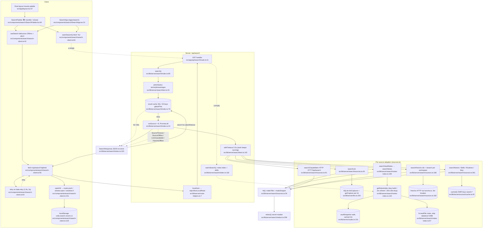

# 01 — Flowchart: search (VOLTA Search, ⌘K palette + /apps/search)

## 1. Purpose
One query fanned out in parallel to 8 read-only memory sources (LTM OCR, Obsidian notes, claude-mem, Honcho, Notion titles, skills, routines, MCP servers), each under a 2.5 s budget, returning masked + highlighted hits grouped per source. Served by `GET /api/search`; consumed by the global ⌘K palette and the full-page Search app.

**Sources consulted** (all paths relative to `src/`)
- `app/api/search/route.ts:1-17` (full)
- `lib/server/search/index.ts:1-122` (full)
- `lib/server/search/sources.ts:1-354` (full)
- `lib/server/search/notes-index.ts:1-267` (full)
- `lib/server/search/text.ts:1-150` (full)
- `lib/server/search/redact.ts:1-277` (full)
- `lib/server/search/types.ts:1-66` (full)
- `components/search/search-client.ts:1-183` (full)
- `components/search/palette-events.ts:1-19` (full)
- `components/search/SearchPalette.tsx:14-160` ; `components/search/SearchApp.tsx:14-117` (+ grep of 118-391)
- `components/search/SearchHitRow.tsx` (grep only)
- Platform/deps (targeted reads): `lib/server/route-helpers.ts:1-21`, `lib/server/local-only.ts:60-75`, `lib/server/sources/cache.ts:1-66`, `lib/server/vaults.ts:20-135`, `lib/server/icloud.ts:1-20`, `lib/server/redact.ts:1-6`, `lib/server/ltm.ts:70-93,165-215` (grep), `lib/server/honcho.ts` (export grep), `lib/server/sources/{claude-mem,notion,skills,routines,mcp}.ts` (export grep), `app/layout.tsx:3,57`, `app/apps/search/page.tsx:10`

## 2. Primary happy path

Node count: 31.

Error/fallback (dashed): timeouts and offline sources become per-source `status` (`index.ts:56-70`) rather than failing the request; `retry: true` when a warming source timed out (`index.ts:105`) drives the client re-ask (`search-client.ts:64-66`). Semantic sources skip for <3 chars (`index.ts:49-52`).

## 3. Side effects
- **HTTP out**: claude-mem worker `GET ${CLAUDE_MEM_URL}/api/search` with 4 s timeout — `lib/server/search/sources.ts:92-95`; Honcho `listWorkspaces/listPeers/listSessions` — `sources.ts:145-148`; Honcho `searchWorkspace` (embedding call) per workspace — `sources.ts:188`.
- **SQLite read** (node:sqlite, read-only, sync): `listCaptures` — `sources.ts:45`; `getCapture` once per hit (N+1) — `sources.ts:47` → `lib/server/ltm.ts:204-211` (3 queries each).
- **File reads**: vault walk (readdir+stat) via `vaultSnapshot` — `notes-index.ts:76` → `vaults.ts:101-125`; every note body read at index build — `notes-index.ts:97`; matched notes re-read for snippet — `notes-index.ts:234`.
- **In-memory caches (globalThis)**: response cache `__voltaSearchResults` — `index.ts:76`, insert/evict `index.ts:109-113`; notes index `__voltaSearchNotes` — `notes-index.ts:55-56`; Honcho breaker `__voltaSearchHonchoBreaker` — `sources.ts:162`; shared SWR cache keys `search:skills|honcho-ids|notion|routines|mcp` — `sources.ts:144,262,288,311,334`, `index.ts:120`.
- **Timers**: idle-drop `setInterval` (unref'd) — `notes-index.ts:128-137`.
- **Client**: `localStorage` recent searches — `search-client.ts:90-121`; URL `?q=&sources=` rewritten — `SearchApp.tsx:59-69`; window CustomEvents `volta:search-palette-open|page-focus` — `palette-events.ts:6-18`.

## 4. External dependencies
- **platform** guard/wrapper: `localJson` — `app/api/search/route.ts:1`, `route-helpers.ts:7-21` → `local-only.ts:62`.
- **platform** SWR cache: `cached` — `search/index.ts:4`, `search/sources.ts:4`.
- **platform** redaction: `search/redact.ts` *is* the canonical masker re-exported as `redactSecrets` by `lib/server/redact.ts:6` (search owns platform code — ownership inversion).
- **platform** iCloud: indirectly via `vaults.ts:7,47` (`isEvicted` → `dataless`).
- **memory** (LTM): `listCaptures`, `getCapture`, `LtmUnavailableError` — `search/sources.ts:3`, `search/index.ts:3`.
- **memory** (Honcho): `listWorkspaces`, `listPeers`, `listSessions`, `searchWorkspace`, `HonchoApiError`, `HonchoOfflineError` — `search/sources.ts:2`, `search/index.ts:2`.
- **home** sources: `CLAUDE_MEM_URL` (`sources/claude-mem.ts:8`) — `search/sources.ts:5`; `getMcpServers` (`sources/mcp.ts:155`) — `sources.ts:6`; `getNotionPages` (`sources/notion.ts:12`, itself backed by `ltm.getNotionTitles`) — `sources.ts:7`; `getRoutines` (`sources/routines.ts:353`) — `sources.ts:8`; `getSkills` (`sources/skills.ts:89`) — `sources.ts:9`, `index.ts:5`; `vaultSnapshot`, `obsidianUrl` — `notes-index.ts:4`.
- **client** deep links into other apps: `/apps/ltm?...` (`sources.ts:53`), `/apps/honcho?...` (`sources.ts:164`), `/second-brain?view=...` (`sources.ts:299,322,345`, `notes-index.ts:249`).
- Client shell: `AppTopBar` — `SearchApp.tsx:10`; `OS_EVENTS` — `SearchPalette.tsx:9`.

## 5. Repeated concerns noticed
- **Worker-pool helper reimplemented**: `mapLimit` — `search/notes-index.ts:58`; also `research/inventory.ts:101`, `sources/notes.ts:84`, `music/library.ts:81`, `studio/index-projects.ts:117`; `pool` — `honcho.ts:408`, `launchpad/repos.ts:133`.
- **Snippet windowing twice**: `makeSnippet` — `search/text.ts:101` vs a private `makeSnippet` in `ltm.ts:72` (used at `ltm.ts:91`). `searchLtm` discards LTM's snippet and re-fetches full text via `getCapture` per hit (`search/sources.ts:47`) — N+1 SQLite.
- **Frontmatter stripping/parsing**: `bodyFirst` — `search/notes-index.ts:169-182`; vs `vaults.ts:158 parseFrontmatter`, `research/vault.ts:90 frontMatter`, `sources/skills.ts:12 frontmatter`, `app/api/workspace/frontmatter.ts:2 parseFrontmatter`.
- **Full-text vault indexing twice**: in-memory notes index here (`notes-index.ts:73-112`, own TTLs 2m/20m) vs research's own vault loader (`research/vault.ts:175-224`) which re-walks + re-reads Obsidian markdown with a different depth cap and size cap.
- **Obsidian URL building**: `vaults.ts:127` (used here) vs `research/vault.ts:228` vs `components/second-brain/graph-model.ts:88`.
- **Ad-hoc globalThis singletons + private TTL/LRU** beside `sources/cache.ts`: response cache `search/index.ts:74-76,109-113` (own LRU of 40), notes state `notes-index.ts:55`, breaker `sources.ts:162`. 31 files in `lib/` use the `globalThis as unknown as` pattern.
- **Number formatter redefined**: `const fmt = n.toLocaleString('en-US')` at `search/index.ts:42`, `search/sources.ts:32`, `search/notes-index.ts:156`; client uses `lib/format.formatInt` (`SearchApp.tsx:8`).
- **Constant duplicated client/server**: `MIN_QUERY_CHARS = 2` at `search/index.ts:26` and `components/search/search-client.ts:8`; source labels at `search/index.ts:31-40` and `search-client.ts:10-19`.
- **Typed "offline" error classes per service**: `SourceOffline` (`search/sources.ts:30`), mapped alongside `LtmUnavailableError`/`HonchoOfflineError` (`search/index.ts:65`); route wrapper only knows `LtmUnavailableError` (`route-helpers.ts:14`). Same per-feature pattern as `ResearchError` (`research/config.ts:15`).
- **Redaction ownership**: canonical masker lives in `search/redact.ts:258`, re-exported via `lib/server/redact.ts:6`, re-exported again via `app/api/honcho/_shared.ts:22`, imported from the API route by `sources/sessions.ts:6`.
- **Unused server capability**: `parseSources` (`search/index.ts:78`) honours `?sources=`, but `useSearch` never sends it (`search-client.ts:56`); SearchApp filters client-side (`SearchApp.tsx:79`), so all 8 sources always run.
- **Name/term matching helpers** (`allTermsIn`, `nameScore` — `search/text.ts:121,126`) vs research's own `tokensOf`/`scoreRow` (`research/search.ts:54-78`).

## 6. Confidence + known gaps
- **High** for the server path: every server file in `lib/server/search/` was read in full and line numbers come from `cat -n`.
- **Medium** for the client: `SearchPalette.tsx` lines 160-336, `SearchApp.tsx` lines 118-391 and `SearchHitRow.tsx` were only grepped. Rendering details are omitted.
- Not traced: internals of `getSkills`/`getRoutines`/`getMcpServers`/`getNotionPages` (home feature) and Honcho's `request()` (`honcho.ts:101,149`). Their side effects (transcript scans, `launchctl`/`plutil`, `~/.claude.json` reads) belong to the home and memory flowcharts.
- `redact.test.ts` is referenced at `redact.ts:3` but was not opened.
