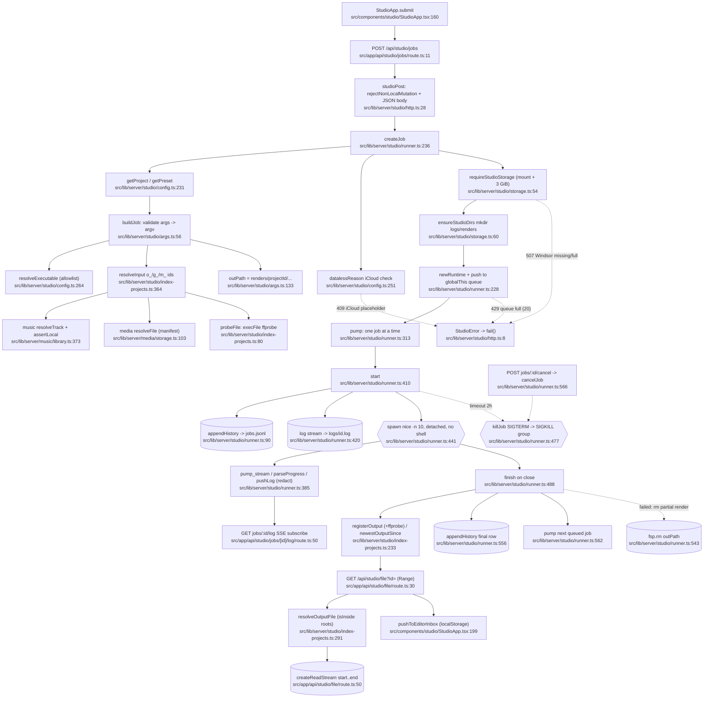

# studio — flowchart (Phase 1)

## 1. Purpose
Preset-only render queue (Remotion / HyperFrames / ffmpeg / pipeline) that runs one niced, shell-free child process at a time, streams its log over SSE, and writes renders, logs and job history to the Windsor drive.

**Sources consulted** (all paths under `src/`)
- `lib/server/studio/runner.ts:1-585` (full)
- `lib/server/studio/storage.ts:1-76` (full)
- `lib/server/studio/http.ts:1-50` (full)
- `lib/server/studio/args.ts:1-177` (full)
- `lib/server/studio/config.ts:10-21, 202-298` (grep outline + 240-290 read)
- `lib/server/studio/index-projects.ts:1-120, 227-412, 485-498` (+ grep outline of the rest)
- `app/api/studio/jobs/route.ts:1-15`, `jobs/[id]/route.ts:1-16`, `jobs/[id]/cancel/route.ts:1-21`, `jobs/[id]/log/route.ts:1-92`, `file/route.ts:1-59`, `outputs/route.ts:1-33`, `projects/route.ts:1-12`, `compositions/route.ts:1-8`
- `components/studio/StudioApp.tsx:47, 109, 155-176, 199` (grep), `components/studio/studio-client.ts:1-103` (grep)
- `lib/server/icloud.ts:1-33`, `lib/server/local-only.ts:29-71` (exports), `lib/server/music/library.ts:373-406`, `lib/server/media/storage.ts:103-118`

## 2. Happy path

Node count: 35.

## 3. Side effects
- Child process: `spawn('/usr/bin/nice', ['-n','10', exe, ...argv], {detached:true})` — `src/lib/server/studio/runner.ts:441`; process-group kill `runner.ts:467`, SIGKILL after 8 s `runner.ts:481-484`, 2 h timeout `runner.ts:446`.
- ffprobe child processes: `src/lib/server/studio/index-projects.ts:80-115`.
- Job history JSONL append (Windsor): `runner.ts:90` (`JOBS_FILE` = `storage.ts:11`).
- Per-job log file: `runner.ts:420`, written in `pushLog` `runner.ts:366` (5 MB cap `runner.ts:33`).
- Directories: `storage.ts:62-63` (logs, renders/<project>), `runner.ts:89`, `runner.ts:249` (custom out dir).
- Partial-render delete on failure/cancel: `runner.ts:543`.
- Compositions cache write (non-atomic `writeFile`): `index-projects.ts:490-491`.
- Client localStorage handoff to Editor: `components/studio/StudioApp.tsx:199`.
- In-memory singleton state on `globalThis.__voltaStudioRunner`: `runner.ts:76-77`.

## 4. External dependencies
- platform: `rejectNonLocalRead/Mutation` `lib/server/local-only.ts:62,71` (via `studio/http.ts:3`); `redactSecrets` `runner.ts:9`, `args.ts:4`; `isEvicted` / `isEvictedFileSync` `lib/server/icloud.ts:9,17` (used `index-projects.ts:21`, `config.ts:245`).
- music: `resolveTrack`, `assertLocal`, `getLibrary`, `musicInputs` (`index-projects.ts:9`, used `:353-406`); **client module import** `brctlCommand` from `components/music/format.ts` (`index-projects.ts:10`).
- generations: `readManifest`, `resolveFile`, `MediaError` (`index-projects.ts:7-8`, used `:332-349`, `:384-395`).
- editor (reverse dependency): `lib/server/editor/media.ts:10-13`, `editor/nle/assets.ts:5`, `editor/nle/upload.ts:7`, `editor/nle/http.ts:6`, `editor/nle/paths.ts:6` import studio config/index/storage/http. carousels too: `lib/server/carousels/state.ts:5`, `app/api/carousels/state/route.ts:4`.
- Config file `config/studio-projects.json` read sync: `config.ts:12, 212`.

## 5. Repeated concerns noticed
- **Job queue + lock + log/history** — studio globalThis queue `runner.ts:76-77`, single runner `runner.ts:313-317`, JSONL history `runner.ts:86-134` with restart→`interrupted` `runner.ts:125-131`. Parallels: editor NLE export registry `lib/server/editor/nle/export.ts:35-36` (+ `export-jobs.json` mirror `:18`, SIGTERM→SIGKILL `:161-164`), podcast `lib/server/podcast/pipeline.ts:21-46` (`.job.json` snapshot), generations `lib/server/media/jobs.ts:15` (memory-only).
- **Range file route** — `app/api/studio/file/route.ts:13-28` `parseRange` is a byte-for-byte copy of `app/api/media/file/route.ts:12`, `app/api/music/file/route.ts:13`, `app/api/podcast/file/route.ts:13`; `lib/server/editor/nle/http.ts:37` + exported `streamFile` `:55` already generalise it but nobody else uses it.
- **Windsor mount detection** — `storage.ts:28-35` (`dev !== /Volumes dev`) duplicated in `media/storage.ts:16-17`, `music/suno.ts:52`, `music/meta.ts:22`, `podcast/storage.ts:27-28`, `feeds/store.ts:19`, `research/inventory.ts:91`. Free-space gate 3 GiB here (`storage.ts:13`) vs 2 GiB in media (`media/config.ts:10`).
- **Path containment** — `isInside` `storage.ts:69` identical to private copy `music/library.ts:72`; media inlines realpath+`startsWith` `media/storage.ts:110-114`, `media/export.ts:52-58`.
- **ffprobe + mapLimit** — `probeFile` `index-projects.ts:80` vs `probeLocal` `music/library.ts:108`, FFPROBE constant in `index-projects.ts:40`, `music/library.ts:20`, `podcast/config.ts:15`, `editor/nle/paths.ts:22`; `mapLimit` copies `index-projects.ts:117`, `music/library.ts:81`, `research/inventory.ts:101`, `search/notes-index.ts:58`, `sources/notes.ts:84`.
- **iCloud hint strings** — check itself is shared (`icloud.ts:9`), but the "brctl download" message is hand-written at `config.ts:260`, `runner.ts:286`, `runner.ts:510`, `index-projects.ts:404`, while `brctlCommand` exists twice (`components/music/format.ts:9`, `lib/server/editor/media.ts:22`).
- **o_/g_/m_ source aggregation** — studio input picker `index-projects.ts:332` (generations), `:353` (music), `outputs/route.ts:14-27`; editor media bin does the same aggregation in `lib/server/editor/media.ts:126` / `:174`.
- **Local-only + JSON-body wrappers** — `studioPost` `http.ts:28-49` ≈ `sunoPost` `music/suno.ts:432-452` ≈ `musicPut` `music/http.ts:7-27` ≈ `nleMutation` `editor/nle/http.ts:14`; `studio/http.ts` is already used as platform by carousels/editor.
- **Per-feature error class with status** — `StudioError` `storage.ts:17` = `MediaError` `media/config.ts:26` = `MusicError` `music/errors.ts:5` = `PodcastError` `podcast/storage.ts:11`.
- **Editor-inbox handoff** — `StudioApp.tsx:199` builds the item by hand, same as `GenerationsApp.tsx:225`, `MusicApp.tsx:197`; file-URL builders duplicated (`studio-client.ts:19`, `gen-client.ts:18`, `music/format.ts:36`).

## 6. Confidence + known gaps
- Confidence: high for the server path (runner/args/storage read in full; every node line grep-verified).
- Gaps: `config.ts` parse functions (`parseArgSpec`/`parsePreset`, 70-200) and `index-projects.ts` compositions (414-567) only outlined; `PresetForm`/`QueuePanel`/`ProjectPanel` UI not read; `config/studio-projects.json` contents not inspected; `toPublicPreset` readiness logic skimmed.
