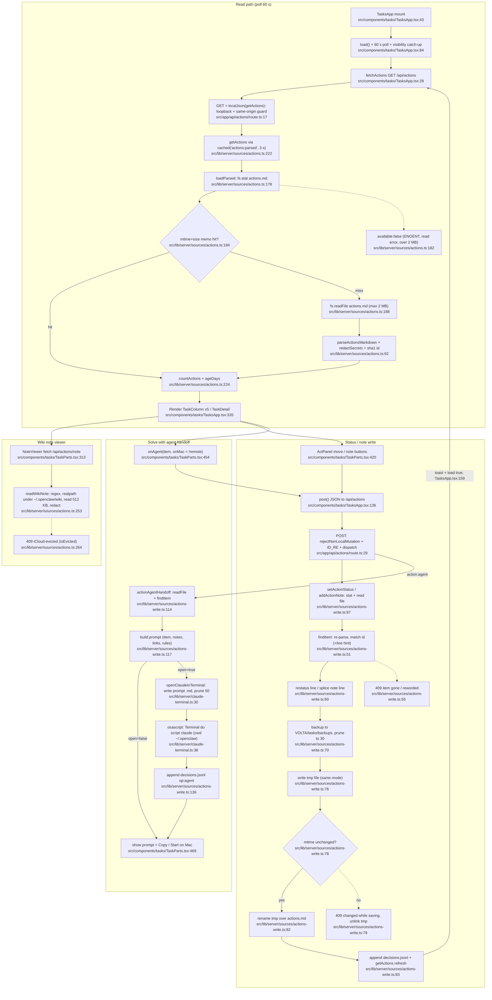

# 01 — Flowchart: tasks

## Purpose
Live board over OpenClaw's `~/.openclaw/wiki/main/actions.md`. It parses the file into status columns and reads linked wiki notes. It also lets Patrick act on an item: flip its status, add a note, or hand it to Claude Code in Terminal. All three actions edit the file inline, with a backup and an mtime guard.

## Sources consulted
- `src/app/api/actions/route.ts:1-55` (all)
- `src/app/api/actions/note/route.ts:1-23` (all)
- `src/lib/server/sources/actions.ts:1-273` (all)
- `src/lib/server/sources/actions-write.ts:1-138` (all)
- `src/lib/server/claude-terminal.ts:1-42` (all)
- `src/components/tasks/TasksApp.tsx:1-360` (all)
- `src/components/tasks/types.ts:1-78` (all)
- `src/components/tasks/TaskParts.tsx` (grep: 17, 87, 157-243, 297-354, 391-478)
- `src/lib/server/route-helpers.ts:1-21`, `src/lib/server/local-only.ts:29-79`, `src/lib/server/sources/cache.ts:40-66`, `src/lib/remote-client.ts:1-29`, `src/lib/server/redact.ts:6`, `src/lib/server/icloud.ts:9-33`
- Consumers: `src/components/dashboard/widgets/AwaitingBadge.tsx:21,32`, `src/components/mobile/home/AwaitingCard.tsx:19`, `src/components/dashboard/widgets/needs-you.ts:5-17`

## Flowchart

Node count: 35 (read 12, note 3, write 13, agent 7). The route guard for `/api/actions/note` (`src/app/api/actions/note/route.ts:14`, `rejectNonLocalRead`) is folded into the N1→N3 edge. Mutation guards are listed under External dependencies.

## Side effects
- **File read**: `~/.openclaw/wiki/main/actions.md` with stat and read. `src/lib/server/sources/actions.ts:178,188`, and again for writes at `src/lib/server/sources/actions-write.ts:44,46`.
- **File read**: wiki notes under `~/.openclaw/wiki`, using realpath plus a partial `fh.read`. `src/lib/server/sources/actions.ts:257,261,265-268`.
- **In-process memo**: a module-level `memo` keyed on mtime+size (`src/lib/server/sources/actions.ts:173,184,191`), wrapped by the shared SWR `cached('actions:parsed', 3 s)` (`:222`).
- **File write (backup)**: `~/Library/Application Support/VOLTA/tasks/backups/actions-<stamp>.md`, keeping the newest 30 and unlinking the rest. `src/lib/server/sources/actions-write.ts:70-73`.
- **File write (atomic)**: writes `actions.md.volta-<pid>.tmp`, checks mtime, then renames over `actions.md`. `src/lib/server/sources/actions-write.ts:75-82`.
- **Append log**: `~/Library/Application Support/VOLTA/tasks/decisions.jsonl`. `src/lib/server/sources/actions-write.ts:83,136`.
- **Cache bust**: `getActions({refresh:true})` after a commit. `src/lib/server/sources/actions-write.ts:84`.
- **File write**: the prompt file `~/Library/Application Support/VOLTA/agent-prompts/task-<stamp>.md`, pruned to 50. `src/lib/server/claude-terminal.ts:31-34`.
- **Process spawn**: `/usr/bin/osascript` tells Terminal to run `cd ~/.openclaw && claude "$(cat file)"`, with a 10 s timeout. `src/lib/server/claude-terminal.ts:35-38`.
- **Browser storage**: `localStorage['volta:tasks:staleDays']`. `src/components/tasks/TasksApp.tsx:16,21,185`.

## External dependencies
- **platform/local-only**: `rejectNonLocalRead` (`src/lib/server/local-only.ts:62`) through `localJson` (`src/lib/server/route-helpers.ts:7`) and directly at `src/app/api/actions/note/route.ts:14`. `rejectNonLocalMutation` (`src/lib/server/local-only.ts:71`) at `src/app/api/actions/route.ts:29`.
- **platform/cache**: `cached` (`src/lib/server/sources/cache.ts:45`), used at `src/lib/server/sources/actions.ts:222`.
- **platform/redact**: `redactSecrets` (`src/lib/server/redact.ts:6`, which re-exports `src/lib/server/search/redact.ts:258`), used at `src/lib/server/sources/actions.ts:143,164,269`.
- **platform/icloud**: `isEvicted` (`src/lib/server/icloud.ts:9`), used at `src/lib/server/sources/actions.ts:264`.
- **platform/claude-terminal**: `openClaudeInTerminal` (`src/lib/server/claude-terminal.ts:30`), used at `src/lib/server/sources/actions-write.ts:134`.
- **platform/remote-client**: `useRemoteClient` (`src/lib/remote-client.ts:17`), used at `src/components/tasks/TasksApp.tsx:129`.
- **platform UI kit**: `AppTopBar`, `useToasts`, `copyText` (`src/components/tasks/TasksApp.tsx:7-9`).
- **Inbound (home)**: `AwaitingBadge` polls `/api/actions?counts=1` with its own interval (`src/components/dashboard/widgets/AwaitingBadge.tsx:21,32`). `AwaitingCard` reads `/api/actions` through `useSharedJson` (`src/components/mobile/home/AwaitingCard.tsx:19`). `needs-you.ts` does too (`src/components/dashboard/widgets/needs-you.ts:17`).
- **Layering smell**: the server imports types and `ACTION_STATUSES` from `@/components/tasks/types` (`src/lib/server/sources/actions.ts:20-21`, `actions-write.ts:12`, `src/app/api/actions/route.ts:9`).

## Repeated concerns noticed
1. **Agent prompt building and handoff.** `actionAgentHandoff` builds its prompt inline (`src/lib/server/sources/actions-write.ts:117-132`) and has its own "ask before…" rules (`:130`). `src/lib/server/systems/fix.ts:62-91` (GUARDRAILS + `buildPrompt`) repeats the same ground rules in different words. Both then call `openClaudeInTerminal` with a different cwd and tag (`actions-write.ts:134` vs `fix.ts:104`). Both return the same `{prompt, opened, error}` shape.
2. **Typed route error class.** `ActionWriteError` (`src/lib/server/sources/actions-write.ts:28`), `NoteError` (`src/lib/server/sources/actions.ts:238`) and `FixError` (`src/lib/server/systems/fix.ts:19`) are the same `{status, message}` class. Every POST/GET handler maps them by hand: `src/app/api/actions/route.ts:50-54`, `src/app/api/actions/note/route.ts:18-21`, `src/app/api/systems/fix/route.ts:37-41`. `localJson` (`src/lib/server/route-helpers.ts:7`) only covers GET and only knows `LtmUnavailableError`.
3. **Mutation route boilerplate.** These steps repeat in `src/app/api/actions/route.ts:28-36` and `src/app/api/systems/fix/route.ts:17-25`: `rejectNonLocalMutation`, JSON parse with a 400, an `ID_RE` check, `action` dispatch, and `noStore`. The `noStore` constant is redefined at `actions/route.ts:15`, `actions/note/route.ts:11`, `systems/fix/route.ts:9` and `launchpad/route.ts:13`.
4. **Backup + prune-to-N and timestamp helpers.** `commit` keeps 30 backups (`src/lib/server/sources/actions-write.ts:70-73`). `prune` keeps 50 prompt files (`src/lib/server/claude-terminal.ts:21-28`). The `stamp()` helper is identical at `actions-write.ts:41` and `claude-terminal.ts:15`.
5. **Atomic tmp+rename.** `actions-write.ts:75-82` is the only version with an mtime guard. The same tmp+rename pattern also appears at `src/lib/server/music/config.ts:88`, `src/lib/server/podcast/config.ts:66`, `src/lib/server/feeds/store.ts:80`, `src/lib/server/research/inventory.ts:225`, `src/lib/server/carousels/state.ts:103`, `src/lib/server/jev/telemetry.ts:99` and `src/lib/server/editor/nle/paths.ts:78`.
6. **mtime memo layered on the SWR cache.** `actions.ts:173-191` keeps a hand-rolled mtime+size memo inside `cached()`. Similar memos: `src/lib/server/sources/notes.ts:65`, `src/lib/server/llm/config.ts:41`, `src/lib/server/research/config.ts:77`, `src/lib/server/studio/config.ts:209`, `src/lib/server/music/meta.ts:59` and `src/lib/server/feeds/files.ts:145`.
7. **Client polling, three different ways for one endpoint.** TasksApp runs its own loop with a 60 s interval, abort and visibility catch-up (`src/components/tasks/TasksApp.tsx:60-98`). AwaitingBadge has its own `setInterval` (`src/components/dashboard/widgets/AwaitingBadge.tsx:32`). AwaitingCard uses `useSharedJson` at 60 s (`src/components/mobile/home/AwaitingCard.tsx:19`). So `/api/actions` gets polled by separate timers, and TasksApp does not share the store.
8. **Client POST helper and copy-toast.** `post()` at `src/components/tasks/TasksApp.tsx:136-152` is the same as `postFix()` at `src/components/systems/SystemsApp.tsx:68-81`. `onCopy` at `TasksApp.tsx:175` matches `copy` at `SystemsApp.tsx:57`.
9. **Remote-client gating of Mac-only actions.** `onAgent(item, !remote)` (`src/components/tasks/TaskParts.tsx:454`) and the "View actions.md" vs `open` command switch (`TasksApp.tsx:295-313`) follow the same pattern as `SystemsApp.tsx:97` and `LaunchpadApp.tsx:79-85`.
10. **iCloud eviction checks are inconsistent.** The wiki note checks `isEvicted(st)` (`actions.ts:264`). `actions.md` itself does not, either on read (`actions.ts:188`) or on write (`actions-write.ts:46`).

## Confidence + known gaps
- **High** for the server read, write and agent paths: every file was read in full and the line numbers were grep-verified.
- **Medium** for `TaskParts.tsx` UI lines: only the relevant regions were grepped, not the whole file.
- **Stale documentation (code smell)**: `TasksApp.tsx:3` ("Read-only … nothing here can change it"), the `TasksApp.tsx:208` "read-only / VOLTA never writes actions.md" badge, and `actions.ts:5` ("Nothing in VOLTA writes to this file") all contradict `actions-write.ts`.
- **Not traced**: `useToasts` and `copyText` internals, and `cache.ts` refresh/retry internals beyond `:45-66`.
