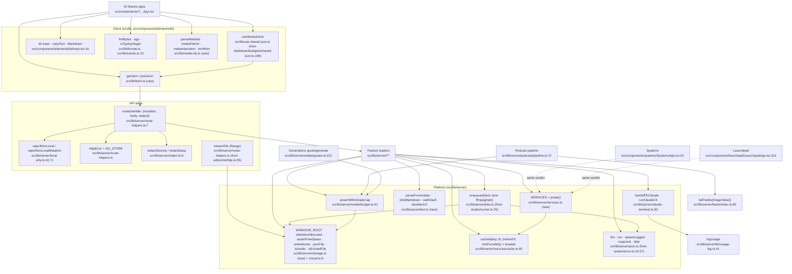

# 03 — Unified proposal (VOLTA OS, 2026-10-28)

Orchestrator synthesis of `02-duplication-report.md`. Rule applied throughout: **one path per concern, extend existing platform modules before adding files, delete the copies**. No registries/factories where a function or switch suffices; no feature flags keeping old paths alive. Paths are under `src/`.

Twelve unified systems, in dependency order. U1–U5 are platform foundations every later system uses; U6–U12 are feature-level consolidations. The 11 present-day bugs from 02 are folded into the system that removes their cause (marked **fixes A#/W#**).

---

## U1 — One route wrapper, one error type
**Component:** extend `lib/server/route-helpers.ts`. Single entry point:
```ts
route(handler, { mutation?: boolean, body?: 'json', maxBody?: number })  // returns a Next route handler
class HttpError extends Error { constructor(readonly status: number, message: string) }
export const NO_STORE
```
`route()` runs `rejectNonLocal` / `rejectNonLocalMutation` (from `local-only.ts`), parses + size-caps the JSON body, catches `HttpError` → `{error}` with its status, maps unknown errors to 500, and sets `NO_STORE`. `LtmUnavailableError` becomes `new HttpError(503, …)` thrown from `ltm.ts`, removing the `route-helpers.ts:4 → ltm` inversion.

**Old call sites become:** `localJson` (34 routes) → `route(fn)`; `studioPost` (`studio/http.ts:28`), `nleMutation` (`editor/nle/http.ts:14`), `musicPut` (`music/http.ts:7`), `sunoPost` (`music/suno.ts:432`), `researchJson` (`research/route.ts:10`), `notionJson` (`notion/route.ts:22`), `app/api/{ltm,honcho,claude-sessions}/_shared.ts` wrappers, and the hand-rolled media/actions/systems-fix/apply-feedback routes → `route(fn, { mutation: true, body: 'json' })`. The 11 error classes (`StudioError`, `MediaError`, `MusicError`, `PodcastError`, `ResearchError`, `NotionError`, `ActionWriteError`, `NoteError`, `FixError`, `TaskError`, `JevError`) and 3 `BadRequest`s → `HttpError`. Notion-specific status mapping (no-access, 429) moves into `notion/client.ts` as thrown `HttpError`s, so Carousels and Recos inherit it (**fixes W6**). Honcho's `rejectCrossSite`/`readBody` copies are deleted; its 64 KB cap becomes `maxBody`. Shared int-param parser `intParam(url, name, {min,max})` replaces the 3 copies (M1).

**Capability loss:** none. Studio's `not_configured` code becomes an `HttpError` with that message.

## U2 — One secret masker, applied at the response boundary
**Component:** `lib/server/redact.ts` becomes the implementation (move `search/redact.ts` body here; `search/` imports it). Entry points: `redactSecrets(text)`, `redactDeep(value)`.

**Old call sites become:** `systems/run.ts:63` `redact` → `redactSecrets` (editor ffmpeg logs now masked like Studio's); `sessions.ts:63` `maskToken`, `sessions.ts:91` `maskDeep`, `honcho/_shared.ts:27` `redactDeep` → `redactDeep`; literal-key wrappers `podcast/util.ts:17`, `media/config.ts:37`, `llm/client.ts:13`, `feeds/util.ts:16` → `redactSecrets`. `sources/{index,sessions}.ts` import from `lib/server/redact.ts`, not `app/api/honcho/_shared` (inversion removed). `route()` gets `{ redact: true }` to apply `redactDeep` to the payload once; research search and doc both use it (**fixes A3**) and the ~15 per-field masks in research go away.

**Kept:** the client-side masker `dashboard/widgets/source-facts.ts:80` (legitimate; client can't import server-only).

## U3 — Storage: Windsor, atomic writes, iCloud
**Component:** new `lib/server/storage.ts` (absorbs `icloud.ts`'s exports by re-export, keeps that file):
```ts
WINDSOR_ROOT                       // VOLTA_WINDSOR env, default '/Volumes/Windsor'
isWindsorMounted(): Promise<boolean>        // device compare vs /Volumes
assertFreeSpace(dir, needBytes = 0)         // single floor: 3 GiB
writeAtomic(file, data, { expectMtimeMs? })  // tmp + rename, same mode, optional mtime guard
jsonFile<T>(file, fallback)                  // { read(), update(fn) } serialised per file
```
**Old call sites become:** 22 `/Volumes/Windsor` literals in 17 files → `WINDSOR_ROOT` (`studio/storage.ts:7`, `media/config.ts:5`, `podcast/config.ts:11`, `feeds/config.ts:15`, `music/{suno,meta,config}.ts`, `editor/feedback.ts:11`, `nle/paths.ts:19`, `carousels/state.ts:11`, `llm/usage-log.ts:11`, `research/config.ts:131`, `ltm.ts:10`, `systems/storage.ts:30`); 7 mount checks + `research/status.ts:155` → `isWindsorMounted` (**fixes A5**); free-space checks `studio/storage.ts:13,42`, `media/config.ts:10`, `podcast/storage.ts:31`, `nle/paths.ts:24-67` → `assertFreeSpace`; ~14 tmp+rename writers → `writeAtomic` / `jsonFile` (`feeds/store.ts` `JsonState` is the model for `jsonFile`); `workspace.ts:30-34` uses `writeAtomic` and apply-feedback goes through `jsonFile`-style per-file serialisation (**fixes A4**); `actions-write.ts` keeps its mtime guard via `expectMtimeMs`; `actions.ts` read/write paths add `isEvictedFile` (**fixes W5**). `isInside(root, p)` (realpath containment) lives here too, replacing `studio/storage.ts:69`, `music/library.ts:72`, `media/storage.ts:110`, `media/export.ts:52,110`.

**Capability loss:** podcast/media free-space floor rises from 2 to 3 GiB. Acceptable on a near-full disk.

## U4 — One file-streaming route body
**Component:** move `editor/nle/http.ts:37,55` (`parseRange`, `streamFile`) into `route-helpers.ts` as `streamFile(req, absPath, { mime, cache })`.
**Old call sites become:** `app/api/{studio,music,podcast}/file/route.ts`, `app/api/media/file/route.ts` → resolve path, then `return streamFile(...)`. Media's `immutable` cache becomes the `cache` option (keep it for content-addressed generations).
**Capability loss:** none.

## U5 — One process module
**Component:** promote `systems/run.ts` to `lib/server/proc.ts`: `bin(name)` (resolver incl. `ffmpeg`/`ffprobe` honouring `VOLTA_FFMPEG`/`VOLTA_FFPROBE`), `run(cmd, args, opts)` (LC_ALL=C, timeout, stderr tail → `HttpError`), `spawnLogged(...)` for long jobs, `mapLimit(items, n, fn)`, `tilde(p)`.
**Old call sites become:** ffmpeg/ffprobe constants `music/library.ts:20-21`, `studio/index-projects.ts:40`, `nle/paths.ts:21-22`, `podcast/config.ts:14-15` → `bin()`; `promisify(execFile)` in `research/status.ts:14`, `launchpad/repos.ts:12`, `sources/routines.ts:13`, `launchpad/tailscale.ts:9` → `run()`; spawn+stderr shaping in `nle/{thumbs,peaks,export,text}.ts`, `studio/index-projects.ts:85`, `music/library.ts:113,419`, `podcast/tts.ts:257`, `studio/runner.ts:441` → `run`/`spawnLogged`; `systems/fix.ts:51` → `run` (**fixes W4**); 13 limiters → `mapLimit`.
**Capability loss:** none.

---

## U6 — One job queue for long work
**Component:** new `lib/server/jobs.ts`, a single function `enqueue({ kind, lane, historyFile, run })` backed by one globalThis queue per **lane** (`'ffmpeg'` and `'net'`). JSONL history with torn-line skip and "interrupted on restart" (from `studio/runner.ts:86-134`); SIGTERM→SIGKILL cancel.
**Old call sites become:** Studio renders and NLE exports both use lane `'ffmpeg'` (one heavy encode at a time); media generations, Suno, podcast use lane `'net'`. Deleted: `studio/runner.ts:76-77,313`, `nle/export.ts:35,158-164`, `media/jobs.ts:15` (gains persistence), `podcast/pipeline.ts:21-46` `.job.json`, `suno.ts:218` boolean. Client polling of job status goes through U11's `useSharedJson`.
**Capability loss:** Studio render and NLE export can no longer run simultaneously — intended.

## U7 — One service registry and probe (Systems + Launchpad)
**Component:** new `lib/server/services.ts`: a typed array `SERVICES` (id, label, url from env — `HONCHO_API_URL`, `CLAUDE_MEM_URL`, `HERMES_GATEWAY_PORT`/listener detection — health path, start command) and `probe(service)` with one up/degraded/down rule (2xx + optional `ok:true` = up; 4xx/5xx = degraded; no answer = down), cached via `cached()`.
**Old call sites become:** `systems/index.ts:36-54` + `systems/run.ts:86` `httpGet` and `launchpad/probe.ts:7-21` + `launchpad/services.ts:9,26-37` → `probe()` over `SERVICES`; Launchpad renders the same verdict as Systems (**fixes A1**). Ports in `llm/config.ts:14-15` read from `SERVICES`. The bad VOLTA start command (`systems/services.ts:246`, non-existent `rubric-agentic-os` dir) is corrected here. Loopback host sets (`launchpad/services.ts:61`, `launchpad/tailscale.ts:11`, `music/suno.ts:34`, `podcast/auth.ts:14,19`) import `LOOPBACK`/`hostnameOf` from `local-only.ts`; client `remote-client.ts:7` keeps its own copy (client bundle).
**Capability loss:** Launchpad's looser "anything <500 is up" goes away — intended.

## U8 — Agent handoff, Claude CLI and spend
**Component:** extend `lib/server/claude-terminal.ts`:
```ts
handoffToClaude({ tag, cwd, title, body, open })  // adds shared guardrails + logs to ~/Library/Application Support/VOLTA/agent-log.jsonl
runClaudeCli(prompt, opts)                         // the only `claude -p` path; calls usage-log
```
and `media/budget.ts` `assertWithinDailyCap(usd)` becomes the single spend gate.
**Old call sites become:** `systems/fix.ts:62-104` and `sources/actions-write.ts:117-136` pass only their item-specific body to `handoffToClaude` (both now logged); `podcast/llm.ts:52,150` and `skills/run/route.ts:115-130` → `runClaudeCli` (usage now visible to quota); `podcast/pipeline.ts` calls `assertWithinDailyCap` before TTS (**fixes A2**), keeping its own per-episode cap. Client copy-prompt builders (`CarouselsApp.tsx:69`, `recos/recos-lib.ts:85`) stay client-side but import one `agentGuardrails` string from a shared non-server module.
**Kept:** podcast's LLM fallback chain over `llm/router` (legitimate), Suno credits (different currency).

## U9 — Vault, text and media-id helpers
**Component:** new `lib/server/text.ts`: `parseFrontmatter`, `stripMarkdown`, `obsidianUrl`, `walkVault(root, onFile)`; and `lib/media-ids.ts` (shared client/server): `parseMediaId`, `mediaFileUrl`, `brctlHint`, `makeInboxItem`, `EDITOR_INBOX_KEY` (moved from `lib/editor-inbox.ts`).
**Old call sites become:** frontmatter ×5 (`vaults.ts:158`, `research/vault.ts:90`, `sources/skills.ts:12`, `app/api/workspace/frontmatter.ts:2`, `search/notes-index.ts:169`) → `parseFrontmatter` (CRLF + case-insensitive keys); vault walkers ×3 → `walkVault`; Obsidian URL ×3 → `obsidianUrl`; md→text ×4 (`feeds/util.ts:23,36`, `lib/notion-md.ts:7`, `podcast/gather.ts:52`) → `stripMarkdown`; file-id regex ×3 → `parseMediaId` (case-insensitive everywhere, **fixes W1**); file-URL builders ×4, `brctl` builders ×3, studio's 4 hand-written iCloud hints, and the 5 inbox-item builders → `lib/media-ids.ts`; `EditorApp.tsx:406` uses `EDITOR_INBOX_KEY`. Editor pin validation: export `SKILLS`, `MAX_PINS`, `validatePin` from `editor/feedback.ts`; apply-feedback uses them (resolve the 300/500 question here).
**Capability loss:** none.

## U10 — Cache options instead of side caches
**Component:** extend `sources/cache.ts` `cached(key, ttl, fn)` with `{ mtimeOf?: string[], minForceMs? }` and add `breaker(name, { failures, coolMs })`.
**Old call sites become:** 7 mtime config memos (`llm/config.ts:41`, `research/config.ts:77`, `studio/config.ts:209`, `podcast/config.ts:40`, `music/meta.ts:59`, `sources/actions.ts:184`, `feeds/files.ts:145`) → `cached(..., { mtimeOf: [file] })`; 4 force limiters (`vaults.ts:97`, `launchpad/repos.ts:190`, `notion/route.ts:8`, `feeds/index.ts:49`) → `minForceMs`; globalThis caches in `search/{index,sources,notes-index}.ts`, `research/{inventory,library}.ts` → `cached`; breakers `jev/client.ts`, `search/sources.ts:162` → `breaker`. Search's N+1 LTM fetch (`search/sources.ts:47`) becomes one batched query.
**Kept:** Feeds' persistent `triage.json` (legitimate).

## U11 — Client data and UI kit
**Component:** move `useSharedJson` to `lib/use-shared-json.ts` (it already dedupes, pauses when hidden, shares across components); single `getJson`/`postJson` in `lib/fetch.ts`; `lib/format.ts` gains `fmtBytes`, `ago`; `elements/kit` is the only toast/clipboard/markdown source.
**Old call sites become:** `useApi` (`second-brain/analytics-shared.tsx:40`), `useVisiblePoll`, `useSection` (`LaunchpadApp.tsx:29`), `useRemote` (`notion/useRemote.ts:21`) and raw `setInterval` polls in `TasksApp.tsx:86`, `AwaitingBadge.tsx:21`, `FeedsApp.tsx:102`, `PodcastApp.tsx:60`, `StudioApp.tsx:133` → `useSharedJson` (one `/api/actions` timer for Tasks + badge + card; one store for `/api/sources`); delete `usePolledJson` (`right-hooks.ts:26`) and `robo-ui/Toast.tsx`; ~10 per-feature fetch clients → `getJson`/`postJson` (`TasksApp` `post` and `SystemsApp` `postFix` merge); local toast stacks (`media/ui.tsx:103`, `recos/Toasts.tsx:16`, editor `notify`) → kit toast; `copyText` ×4 + raw clipboard → kit `copyText`; `fmtBytes` ×7, `ago` ×10 → `lib/format.ts`; `isTypingTarget` inlined ×6 → `lib/events.ts:13`; markdown renderers ×5 → one `kit/Markdown` (Notion and Second Brain variants become props); SSE parsing → one `readSse()` used by server route and `AskPanel` (**fixes W3**); editor thumb caches ×2 → one (**fixes W2**); two `useNow` → one.
**Capability loss:** none; Recos review state moves server-side (Windsor `jsonFile`) so the phone sees it.

## U12 — Feature boundaries: podcast→feeds, Notion, types
**Component:** no new module; direct imports and type moves.
**Old call sites become:** `podcast/gather.ts:217-226` loopback fetch → `listFeeds({ triage: false })` from `feeds/index.ts:85` (errors surface instead of `[]`); Notion IDs (`notion/dreams.ts:8`, `notion/catalog.ts:12`, `launchpad/notion.ts:11,13`) → one `config/notion-links.json` loader in `notion/links.ts`; podcast's raw `notionQuery` (`gather.ts:36`) → cached `notion/pages`. Types used by server code move from `components/*/types.ts` to `src/types/` (research, music, media/data, tasks, editor spatial, rl-rules); `shared-json.ts:15`'s `ltm-client` import goes. The heuristic JEV (`app/api/jev-router/jev.ts`) moves to `lib/server/jev/heuristic.ts` (it already wraps `routeTier`).
**Capability loss:** none.

---

## What stays specialized
Podcast feed token auth · client-side masker · Suno credits · podcast LLM fallback chain · Honcho dependency classifier · Feeds triage label store. Each serves a different trust model, runtime or currency (see 02).

## Suggested order
U1 → U2 → U3 → U5 → U4 → U10 (foundations; each is mechanical and unblocks the rest) → U7, U8 (bug fixes A1, A2) → U6 → U9 → U11 → U12. The five bug-risk items can also be patched ahead of the refactor in one small PR: A2 (one `assertWithinDailyCap` call), A3 (mask in `research/search.ts`), A4 (atomic write), A5 (mount check), plus the Systems start-command path.

## Proposed unified system

