<div align="center">

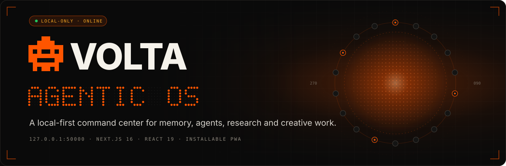

<br />

**A private, local-first operating system for one person's digital life.**<br />
Memory, agents, research and a full creative studio, in one dark HUD served from `127.0.0.1`.

<br />

[](https://nextjs.org)
[](https://react.dev)
[](https://www.typescriptlang.org)
[](https://tailwindcss.com)
[](#-safety--privacy)
[](#-on-your-phone)

<sub>
<a href="#-what-it-is">What it is</a> ·
<a href="#-gallery">Gallery</a> ·
<a href="#-the-apps">The apps</a> ·
<a href="#-architecture">Architecture</a> ·
<a href="#-run-it">Run it</a> ·
<a href="#-configuration">Configuration</a> ·
<a href="#-safety--privacy">Safety</a>
</sub>

</div>

<br />

<p align="center">
  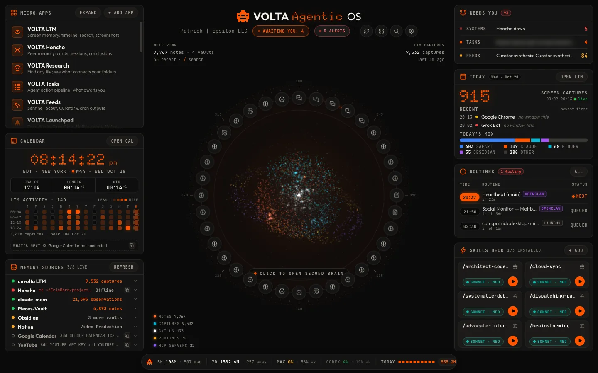
</p>

<br />

## ◆ What it is

VOLTA is a single Next.js server on your Mac that turns everything you already run (screen memory, note vaults, Notion, Claude Code sessions, an agent fleet, local models, render tools) into one command center. There is no cloud backend and no account: the server binds to `127.0.0.1:50000`, reads your sources **read-only**, and writes only to its own workspace, its config and an external drive.

<table>
<tr>
<td width="33%" valign="top">

### 🧠 Remember
Screen-memory timeline (LTM), Honcho peer memory, Claude Code sessions, Obsidian and Pieces vaults, and a 3D Second Brain graph over all of them, with one ⌘K search across every source.

</td>
<td width="33%" valign="top">

### 🛰 Operate
Health of every local service, model and disk with one-click fixes, the OpenClaw action board, cron feeds triaged by a classifier, and a launchpad for gateways, repos, deploys and tailnet links.

</td>
<td width="33%" valign="top">

### 🎬 Create
Research corpus, Notion scripts with source ledgers, a render queue for HyperFrames, Remotion and ffmpeg, a review-and-edit video editor, paid image/video/voice with spend caps, a music library and a daily podcast.

</td>
</tr>
</table>

<br />

## ◆ Gallery

<table>
<tr>
<td width="50%">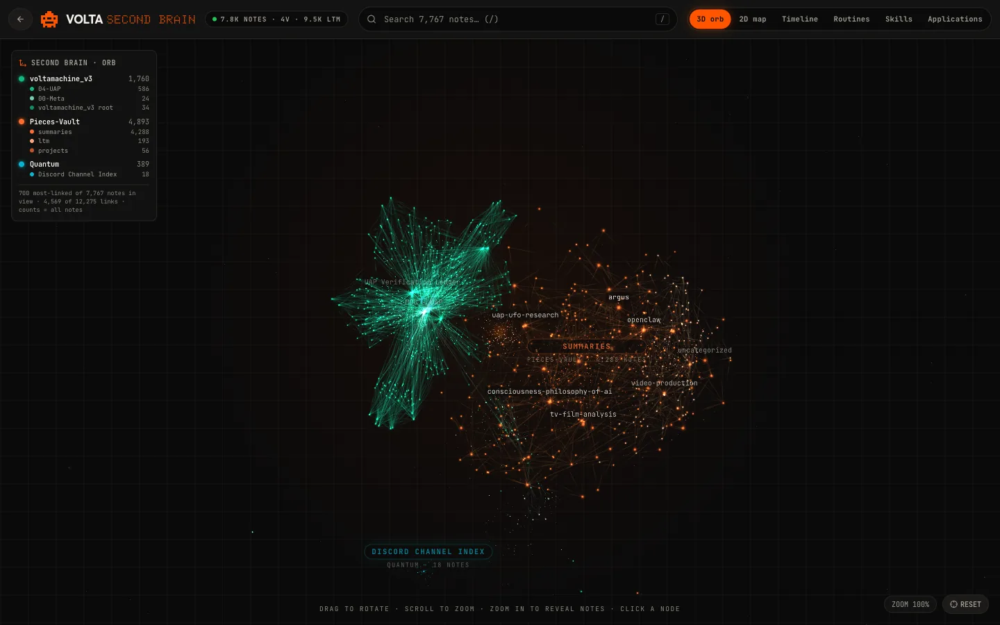<br /><sub><b>Second Brain</b> · 3D orb of 7.8k linked notes across vaults</sub></td>
<td width="50%">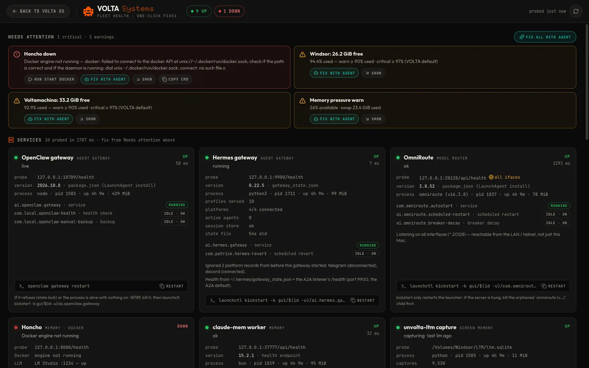<br /><sub><b>Systems</b> · live probes, disk thresholds, Fix with agent</sub></td>
</tr>
<tr>
<td width="50%">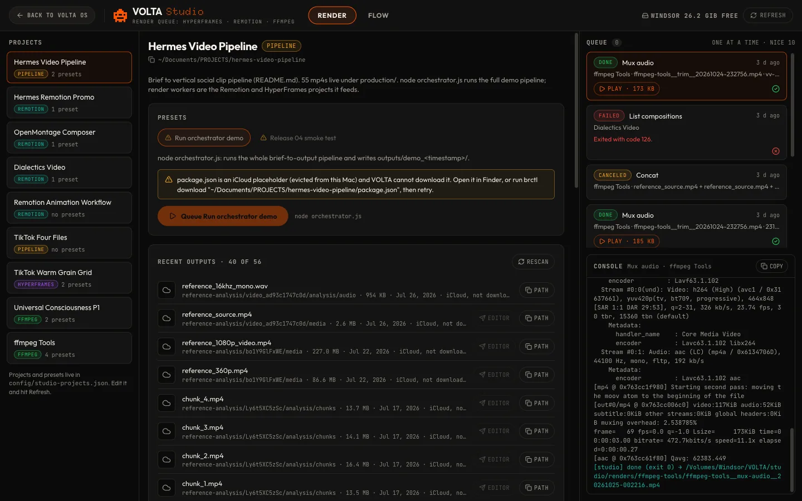<br /><sub><b>Studio</b> · HyperFrames / Remotion / ffmpeg render queue</sub></td>
<td width="50%">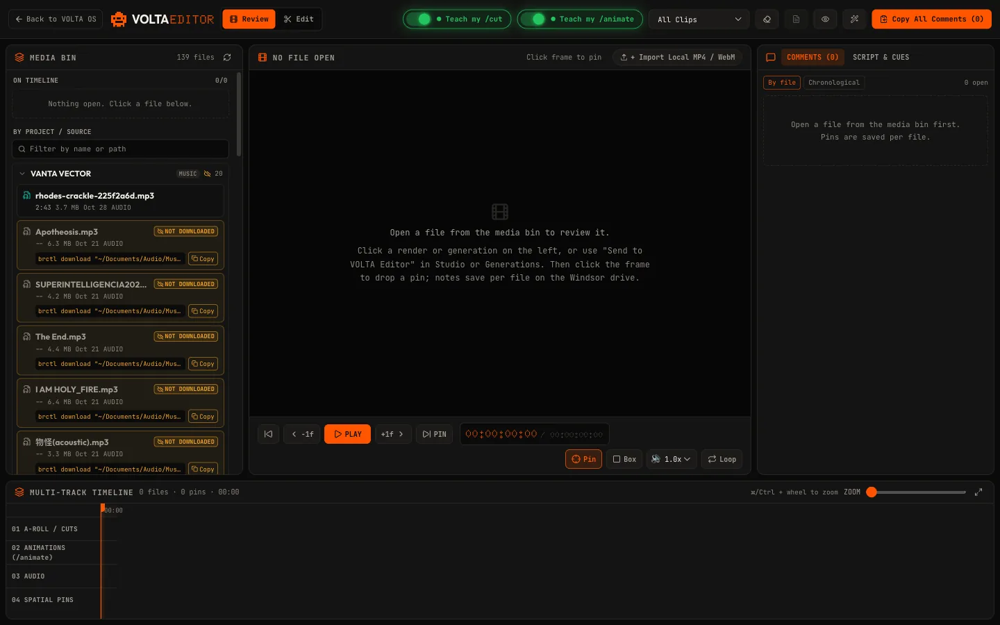<br /><sub><b>Editor</b> · spatial review pins + multi-track timeline</sub></td>
</tr>
<tr>
<td width="50%">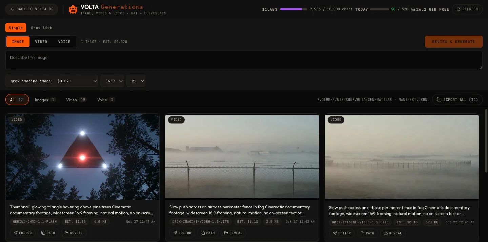<br /><sub><b>Generations</b> · quote first, then generate, under a daily cap</sub></td>
<td width="50%">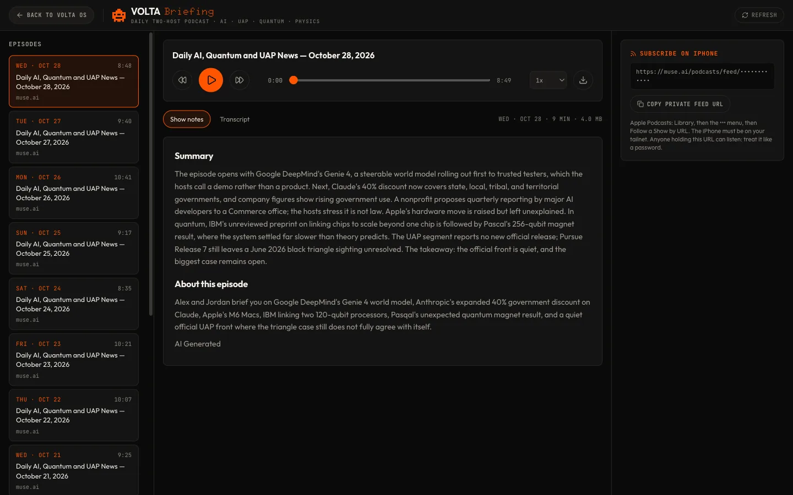<br /><sub><b>Briefing</b> · daily two-host podcast with notes and transcripts</sub></td>
</tr>
<tr>
<td width="50%">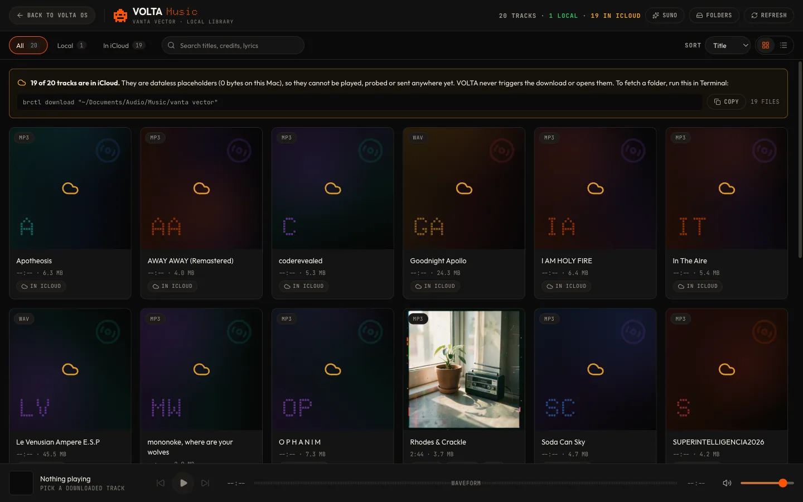<br /><sub><b>Music</b> · VANTA VECTOR library, lyrics, Suno hand-off</sub></td>
<td width="50%">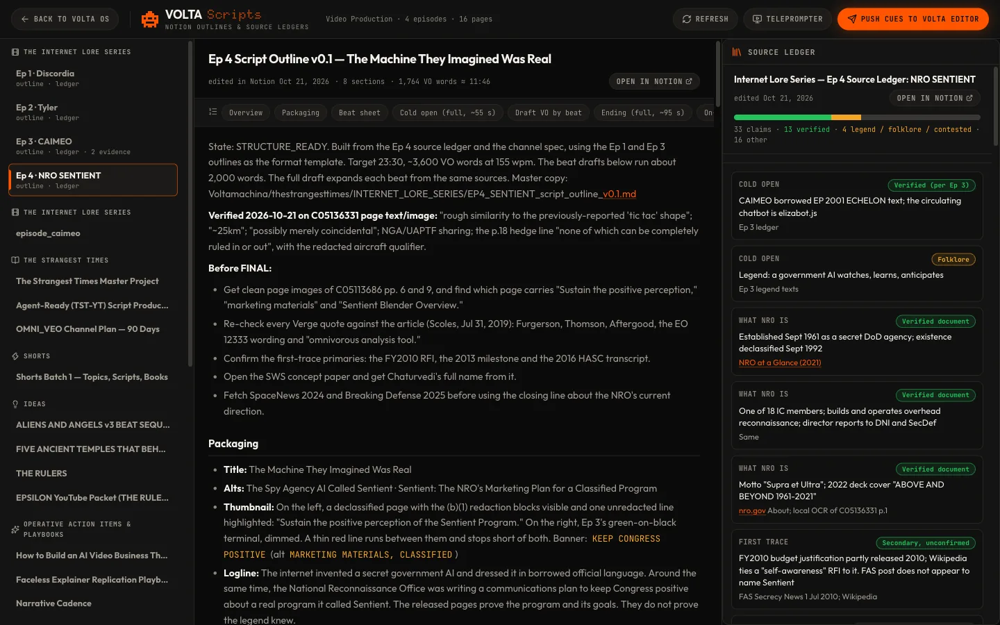<br /><sub><b>Scripts</b> · Notion outlines beside a verified source ledger</sub></td>
</tr>
<tr>
<td width="50%">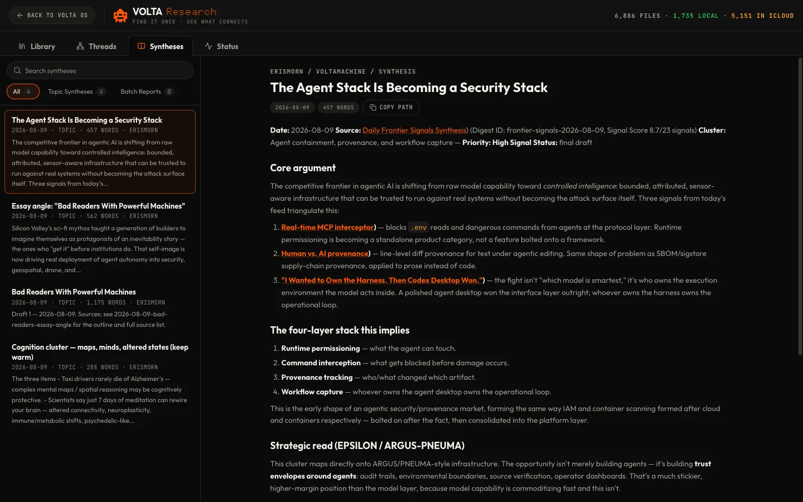<br /><sub><b>Research</b> · corpus library, threads and syntheses</sub></td>
<td width="50%">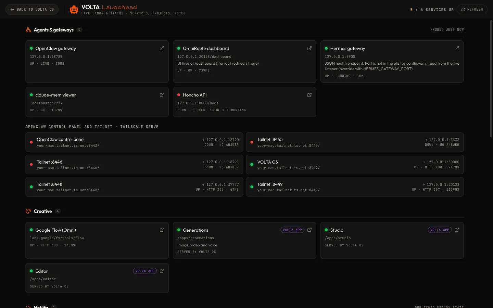<br /><sub><b>Launchpad</b> · gateways, tailnet serve, creative tools</sub></td>
</tr>
</table>

<p align="center">
  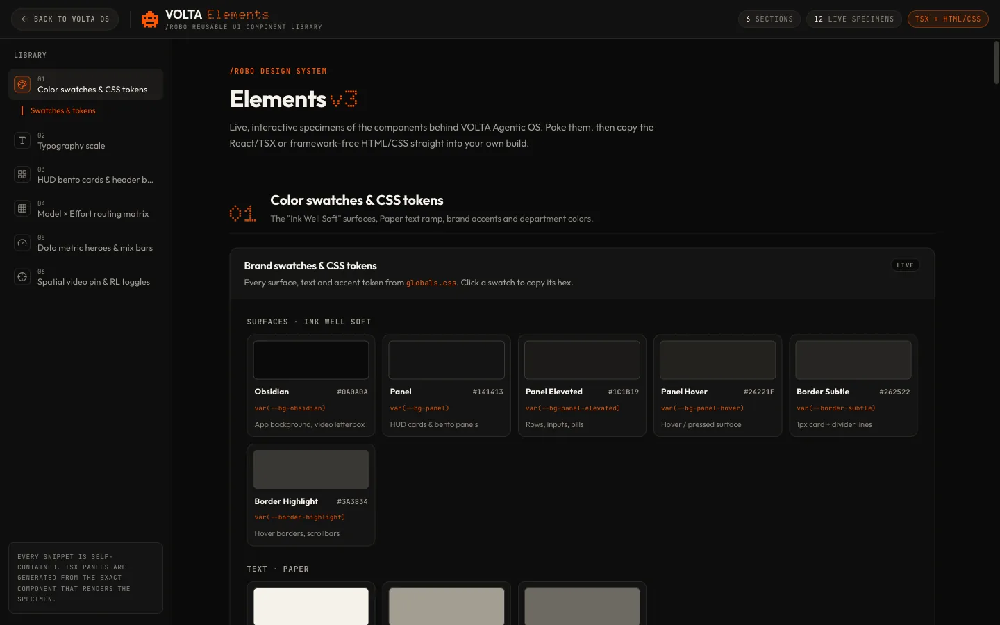<br />
  <sub><b>Elements</b> · the <code>/robo</code> design system every screen is built from</sub>
</p>

### 📱 On your phone

VOLTA ships a web app manifest (`src/app/manifest.ts`) and a dedicated phone layout: below 768 px the home screen becomes a single "Today" feed with a bottom tab bar. Put the server behind `tailscale serve` and use **Add to Home Screen** for a full-screen app on iPhone.

<table>
<tr>
<td align="center" width="33%">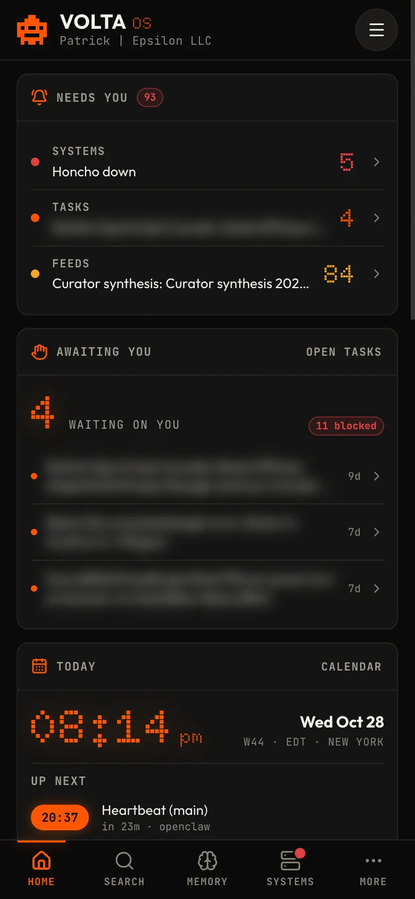<br /><sub>Today feed</sub></td>
<td align="center" width="33%">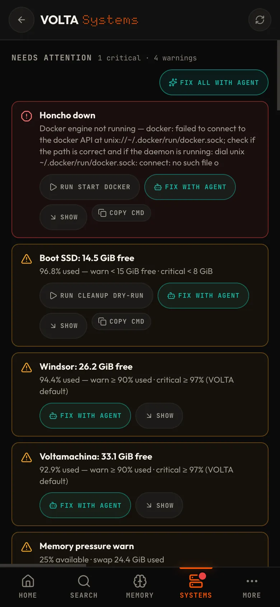<br /><sub>Systems</sub></td>
<td align="center" width="33%">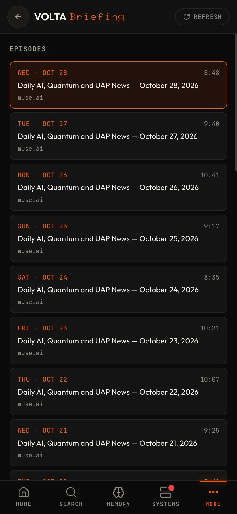<br /><sub>Briefing</sub></td>
</tr>
</table>

<sub>Screenshots are from a live instance. Private values (task titles, feed tokens, tailnet hostnames, home-folder paths) were blurred or replaced before capture.</sub>

<br />

## ◆ The apps

Every app is a route of the same server (`src/app/apps/<id>`), with its UI in `src/components/<id>` and its server logic in `src/lib/server/<id>`. Status follows [`MICRO_APPS_SPEC.md`](MICRO_APPS_SPEC.md).

#### Home and memory

| App | Route | What it does |
|---|---|---|
| **Home** | `/` | Bento HUD: micro-app launcher, clocks, LTM heatmap, memory sources, orbital note ring, Needs You, Today, routines, skills deck and a usage bar. Phone gets the "Today" feed. |
| **Second Brain** | `/second-brain` | 3D orb and 2D map of vault wikilinks, LTM timeline, routines, skills, MCP servers and applications. |
| **Search** | `/apps/search` · <kbd>⌘K</kbd> | One search across every memory source, re-ranked by the JEV classifier. |
| **LTM** | `/apps/ltm` | Screen-memory timeline, search and screenshots from the unvolta LTM SQLite (read-only). |
| **Honcho** | `/apps/honcho` | Peer memory: cards, sessions, conclusions and streaming chat against Honcho on `:8000`. |
| **Sessions** | `/apps/sessions` | Claude Code projects, sessions and token counts from `~/.claude/projects`. |

#### Agents and systems

| App | Route | What it does |
|---|---|---|
| **Systems** | `/apps/systems` | Probes services, models, memory and disks; each problem gets a documented command or **Fix with agent**. |
| **Tasks** | `/apps/tasks` | OpenClaw `actions.md` as a board, with the "Awaiting you" count that the home screen shows. |
| **Feeds** | `/apps/feeds` | Cron outputs from OpenClaw, ErisMorn and Hermes, triaged into needs-action / FYI / noise by JEV. |
| **Launchpad** | `/apps/launchpad` | Agents and gateways, tailnet `serve` mappings, creative tools, git repos, Netlify deploys and Notion pins. |
| **Recos** | `/apps/recos` | Weekly improvement cards built from real signals: failing routines, Systems, Notion playbooks, memory backlogs. |

#### Research and content

| App | Route | What it does |
|---|---|---|
| **Research** | `/apps/research` | Inventory of the research corpus (local, iCloud, external drive), threads, graphs and syntheses. |
| **Scripts** | `/apps/scripts` | Notion episode outlines with their source ledgers, a teleprompter, and "Push cues to Editor". |
| **Carousels** | `/apps/carousels` | Shorts decks from Notion: review, pin, approve, export PNG. |

#### Creative studio

| App | Route | What it does |
|---|---|---|
| **Generations** | `/apps/generations` | xAI image and video, ElevenLabs voice and Gemini, each with a quote, a confirm step and a server-side daily cap. |
| **Studio** | `/apps/studio` | Render queue for HyperFrames, Remotion and ffmpeg presets from `config/studio-projects.json`, plus a Flow tab. |
| **Editor** | `/apps/editor` | Review mode (spatial pins, dictation, compiled agent prompt, **Apply & teach**) and an Edit mode multi-track timeline. |
| **Music** | `/apps/music` | VANTA VECTOR library, player, lyrics and credits; the Suno panel hands song creation to Claude in Chrome and imports the downloads. |
| **Podcast** | `/apps/podcast` | VOLTA Daily Briefing: episodes, show notes, whisper.cpp transcripts and a private RSS feed for Apple Podcasts. |
| **Elements** | `/apps/elements` | The `/robo` design system: tokens, type, HUD cards, badges, with copyable TSX and HTML/CSS. |

<br />

## ◆ Architecture

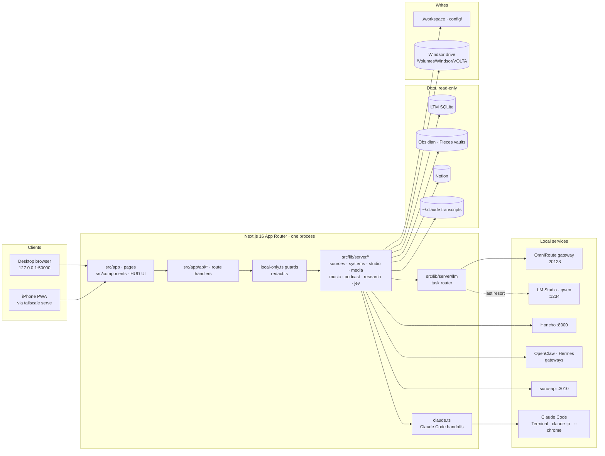

**How the pieces fit**

- **One server, many apps.** Pages render the HUD; every private read or write goes through a route in `src/app/api/*`, which calls a module in `src/lib/server/*`. There is no database of VOLTA's own: state is read from your sources and written as files.
- **LLM gateway.** Text tasks (`research-web`, `long-write`, `quick`, `code`, `video-prompts`, `deep-reasoning`) are routed by `config/llm-routes.json` through a chain of OmniRoute combos (`127.0.0.1:20128`), with LM Studio's local `qwen/qwen3.5-9b` appended as the last resort. The OmniRoute key is scoped to subscription and local providers, so API-billed providers are never selected. Every call lands in a usage log that feeds the bottom usage bar.
- **Claude Code handoffs.** `src/lib/server/claude.ts` is the single door to Claude Code: an *interactive* session in a new Terminal window (Systems "Fix with agent", Tasks "Solve with agent", the Suno hand-off via `claude --chrome`), or a headless `claude -p` call. Shared ground rules are appended to every prompt and every hand-off is logged.
- **JEV.** A Typesafe classifier (`src/lib/server/jev`) ranks search results, triages feeds and picks podcast stories, with a deterministic heuristic fallback and a local telemetry log.
- **Storage.** `src/lib/server/storage.ts` decides where bulky state lives: renders, generations, podcasts, music and indexes go to the external Windsor drive, and a write is refused if it would leave less than 3 GiB free. iCloud placeholders are detected and never read; the UI offers the `brctl download` command instead.

<details>
<summary><b>Repository layout</b></summary>

```text
src/
  app/
    page.tsx            Home shell (desktop bento / phone feed)
    second-brain/       Second Brain
    apps/<id>/          One route per micro app
    api/<area>/         Route handlers (all private routes guarded)
    manifest.ts         PWA manifest
  components/<id>/      UI per app · robo-ui/ shared HUD kit · mobile/ phone shell
  lib/server/           Server-only modules (sources, systems, llm, jev, media, music, podcast, studio, ...)
config/                 llm-routes · music · podcast · research · studio-projects · notion-*.json
workspace/              VOLTA's own writable files: skills, routines, departments, artifacts
scripts/                Podcast runner + LaunchAgent plist
docs/                   Handoff notes, audits, screenshots
PATHFINDER-2026-10-28/  Feature map, duplication report, unified architecture proposal
```

</details>

<br />

## ◆ Run it

**Requirements:** macOS, Node.js 20.9+, and whichever local services you want lit up (each app degrades gracefully and says what is missing).

```bash
npm install
```

```bash
npm run dev
```

Open <http://127.0.0.1:50000>.

| Script | What it runs |
|---|---|
| `npm run dev` | `next dev --turbopack` on `127.0.0.1:50000` with hot reload |
| `npm run build` | Production build into `.next/` |
| `npm run start` | Serve the production build on `127.0.0.1:50000` |
| `npm run serve` | Build and start into `.next-prod/`, so it never collides with a running dev server |
| `npm run typecheck` | `tsc --noEmit` |

<details>
<summary><b>Keep it running (LaunchAgent)</b></summary>

On the author's Mac the dev server runs as the LaunchAgent `com.epsilon.volta-os`, logging to `~/Library/Logs/volta-os.log`. Restart it with:

```bash
launchctl kickstart -k gui/$(id -u)/com.epsilon.volta-os
```

Because it hot-reloads, don't run `next build` into `.next/` beside it; use `npm run serve` or a separate `NEXT_DIST_DIR`.

</details>

<details>
<summary><b>Phone access over Tailscale</b></summary>

1. Expose the server on your tailnet, for example `tailscale serve --https=8447 http://127.0.0.1:50000`.
2. Set `VOLTA_TAILNET_HOST` to your machine's tailnet hostname and `VOLTA_TAILNET_USERS` to the comma-separated Tailscale logins allowed in.
3. Open the HTTPS URL on your phone and choose **Add to Home Screen**.

Private routes accept the tailnet host only when `tailscale serve` vouches for the caller with a `Tailscale-User-Login` header that is on the list.

</details>

<br />

## ◆ Configuration

**Config files** (`config/`, checked in, no secrets):

| File | Controls |
|---|---|
| `llm-routes.json` | Gateway and local model endpoints, per-task combo chains, limits, and the list of API-billed providers to avoid |
| `music.json` | Library roots, discovery rules, file extensions and the metadata path |
| `podcast.json` | Show metadata, hosts, topics, research sources, script and TTS settings, audio and cost limits |
| `research.json` | Corpus roots, exclusions, index location, summary stages and graph settings |
| `studio-projects.json` | Render projects and their presets |
| `notion-pages.json` · `notion-links.json` | Notion pages and links surfaced in Scripts, Launchpad and Recos |

**Environment** (`.env.local`, git-ignored, read server-side only). Every variable is optional; the matching feature reports itself as not configured when one is missing.

| Area | Variables |
|---|---|
| Access | `VOLTA_TAILNET_HOST`, `VOLTA_TAILNET_USERS` |
| LLM | `OMNIROUTE_API_KEY`, `OMNIROUTE_BASE_URL`, `VOLTA_CLAUDE_BIN`, `RUBRIC_CLAUDE_LIVE` |
| Media spend | `XAI_API_KEY`, `ELEVENLABS_API_KEY`, `GEMINI_API_KEY`, `VOLTA_GEN_DAILY_USD`, `VOLTA_GEN_MAX_USD` |
| Sources | `NOTION_TOKEN`, `LTM_DB_PATH`, `LTM_FRAMES_DIR`, `PIECES_VAULT_DIR`, `HONCHO_API_URL`, `CLAUDE_MEM_URL`, `GOOGLE_CALENDAR_ICS_URL`, `YOUTUBE_API_KEY`, `YOUTUBE_CHANNEL_ID` |
| Services | `SUNO_API_URL`, `OPENCLAW_BIN`, `OMNIROUTE_BIN`, `HERMES_GATEWAY_PORT`, `NETLIFY_API_KEY` |
| Classifier | `TYPESAFE_JEV_API_KEY`, `TYPESAFE_BASE_URL`, `VOLTA_JEV_MODEL` |
| Storage | `VOLTA_WINDSOR` (external drive mount, default `/Volumes/Windsor`) |
| Podcast | `PODCAST_FEED_TOKEN`, `PODCAST_CLAUDE_BIN` |

<br />

## ◆ Safety & privacy

VOLTA sits on top of screen captures, private notes and paid APIs, so the rules are enforced in code, not left to convention.

- **Local-only routes.** Every private route passes through `src/lib/server/local-only.ts`: the `Host` must be loopback (or the allow-listed tailnet login), cross-site and cross-origin requests are refused, and mutations additionally require a same-origin `application/json` body. This blocks LAN access, DNS rebinding and drive-by form posts.
- **Secrets never leave the server.** Keys live in `.env.local` and are read server-side only. Output that might carry a secret (logs, command output, transcripts) is passed through `redact.ts`; integrations report only *whether* a key is set, never its value.
- **Your sources are read-only.** LTM, vaults, Notion, OpenClaw and Honcho are only read. VOLTA writes to `./workspace`, `config/` and its own folder on the external drive.
- **Nothing spends without a confirm.** Paid media calls go through a review step that shows a server-made quote (valid for five minutes) before anything is generated. The server refuses any single request above `VOLTA_GEN_MAX_USD` (default $5) and any request that would push the day's spend past `VOLTA_GEN_DAILY_USD` (default $20), checked at quote time and again at generate time. Suno song creation spends credits only inside an interactive Claude in Chrome session you watch; importing the results spends nothing.
- **Agents stay interactive.** "Fix with agent" never runs a command from the browser: the server re-derives each fix from a fresh probe and opens Claude Code in Terminal, where your normal permission prompts apply.
- **No API billing for text.** LLM text goes through subscription-scoped OmniRoute combos, local LM Studio or `claude -p` on the Max plan.
- **Honest data.** No invented numbers: estimates are labelled, empty states say what is missing, and polling runs no faster than once a minute and pauses in hidden tabs.

<br />

## ◆ Further reading

| Document | Covers |
|---|---|
| [`docs/HANDOFF.md`](docs/HANDOFF.md) | Run notes, hard rules and the current roadmap for agents picking up the codebase |
| [`MICRO_APPS_SPEC.md`](MICRO_APPS_SPEC.md) | Every shipped app with its data source and status, plus proposals |
| [`INTEGRATION_CONTRACTS.md`](INTEGRATION_CONTRACTS.md) | Shared modules, API contracts and cross-app hand-offs |
| [`HANDOFF_SPEC.md`](HANDOFF_SPEC.md) | Original design spec for the HUD |
| [`PATHFINDER-2026-10-28/`](PATHFINDER-2026-10-28/00-features.md) | Feature map, duplication report and the unified architecture proposal |
| [`docs/audits/`](docs/audits) | Audit reports |

<br />

<div align="center">
<br />
<sub>Built by EPSILON LLC · private repository · runs on one Mac</sub>
</div>
